# Hotel Management System — Staff and Branch Manager Guide

This guide explains the staff and branch-manager interface. Menus and actions depend on the signed-in role and branch. Use only actions available to your account. The screenshots in this guide are from the **English interface** and are kept separate from the Vietnamese screenshots in [USER_GUIDE_VI.md](./USER_GUIDE_VI.md).

Each section names the **screen to open** and the actions performed there. Bold menu names match the navigation labels; screenshots below each section show the referenced pages or dialogs.

> **Before sharing:** screenshots may show sample guest, employee, booking, or payment information. Review and redact personal or financial details before publishing this guide outside the hotel team.

## Contents

1. [Sign in, language, and navigation](#1-sign-in-language-and-navigation)
2. [Overview and reports](#2-overview-and-reports)
3. [Create and find bookings](#3-create-and-find-bookings)
4. [Edit a booking and add services](#4-edit-a-booking-and-add-services)
5. [Cancel a booking and refund the guest](#5-cancel-a-booking-and-refund-the-guest)
6. [Check-in, check-out, and surplus refunds](#6-check-in-check-out-and-surplus-refunds)
7. [Rooms, rates, buildings, floors, and hotel rules](#7-rooms-rates-buildings-floors-and-hotel-rules)
8. [Service catalog and guest service usage](#8-service-catalog-and-guest-service-usage)
9. [Customers, orders, and invoices](#9-customers-orders-and-invoices)
10. [Promotion management](#10-promotion-management)
11. [Staff, shifts, and tasks](#11-staff-shifts-and-tasks)
12. [Refund approvals](#12-refund-approvals)
13. [Settings, roles, and permissions](#13-settings-roles-and-permissions)
14. [Troubleshooting and safe operation](#14-troubleshooting-and-safe-operation)

## 1. Sign in, language, and navigation

**Screen and actions:** Use the **Sign in** screen to enter the system. After signing in, use the left navigation to open a page, the top bar to switch language, and the account card at the bottom of the sidebar to sign out.

1. Sign in with the staff or manager account provided to you. Verify the branch shown in the sidebar before changing records.
2. Use the left navigation to open a module. Expand a menu item with a chevron to see its pages; use the menu button on smaller screens.
3. Select **English** in the top bar to use the English interface. The language switch changes interface labels, not names, notes, or other text entered by users.
4. A missing menu may mean that your role does not have access. Ask a manager to confirm your role instead of using another person's account.
5. Sign out after work, especially on a shared device.

## 2. Overview and reports

### Overview

The Overview page is for monitoring, not a substitute for checking a booking's full record.

**Screen and actions:** Sidebar → **Overview**. The summary cards, arrival/departure schedule, and services-awaiting-confirmation list are on this page; open the relevant module to complete a transaction.

1. Open **Overview** and review the summary cards for current branch activity.
2. Check the selected date, then use the date controls to move to another day or return to today.
3. Select the arrival, departure, or early check-in list to find the relevant booking.
4. Open a row only after checking the guest and room. Continue the transaction in Check-in / Check-out or Booking management.
5. In services awaiting confirmation, verify the booked service and quantity against actual use before confirming it.

<figure style="display:inline-block;vertical-align:top;width:49%;margin:0 0 12px">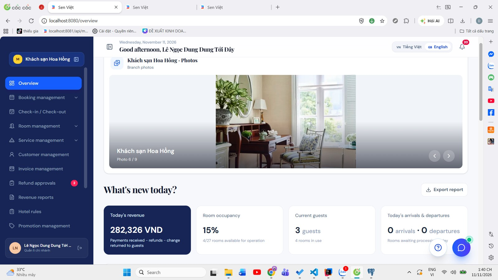<figcaption style="margin-top:4px;font-size:0.82em">Branch overview</figcaption></figure> <figure style="display:inline-block;vertical-align:top;width:49%;margin:0 0 12px">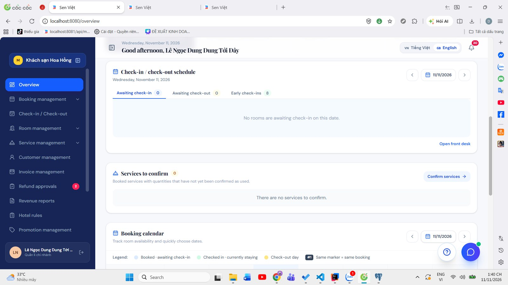<figcaption style="margin-top:4px;font-size:0.82em">Arrival, departure, and schedule</figcaption></figure>
<figure style="display:inline-block;vertical-align:top;width:49%;margin:0 0 12px">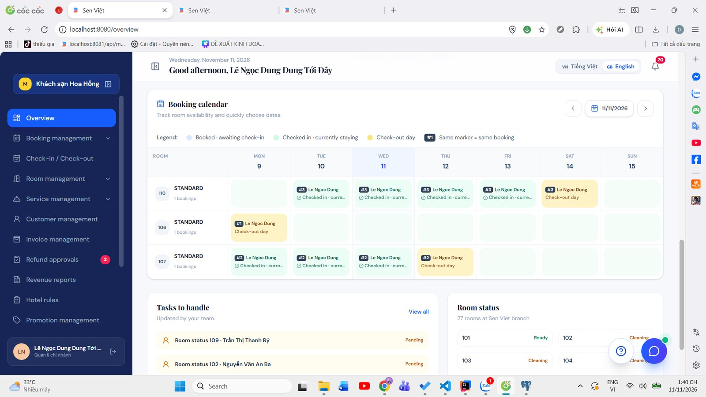<figcaption style="margin-top:4px;font-size:0.82em">Services awaiting confirmation</figcaption></figure>

### Revenue reports

**Screen and actions:** Sidebar → **Revenue reports**. Choose the reporting period in the top filter, then review the report tabs/tables.

1. Open **Revenue reports** and choose the reporting period before interpreting totals.
2. Review the available summary, room, service, promotion, booking-status, and cancellation breakdowns.
3. Use the report tabs/filters to compare categories. If the range is wrong or data is still loading, correct the filter or reload before exporting or sharing results.
4. Reconcile a discrepancy against the underlying bookings and invoices; do not treat a blank or failed report as zero.

<figure style="display:inline-block;vertical-align:top;width:49%;margin:0 0 12px">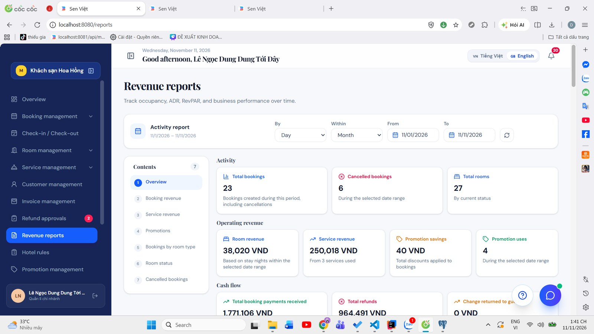<figcaption style="margin-top:4px;font-size:0.82em">Screen 01 - reports</figcaption></figure> <figure style="display:inline-block;vertical-align:top;width:49%;margin:0 0 12px">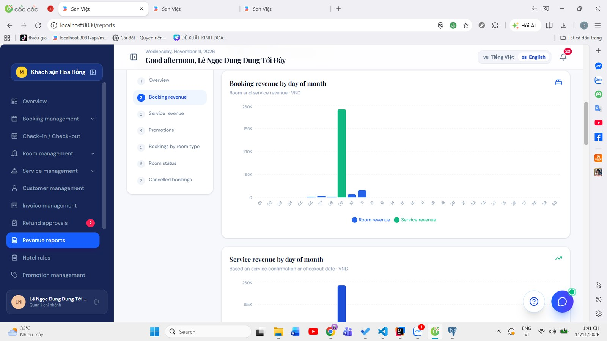<figcaption style="margin-top:4px;font-size:0.82em">Screen 02 - reports</figcaption></figure>
<figure style="display:inline-block;vertical-align:top;width:49%;margin:0 0 12px">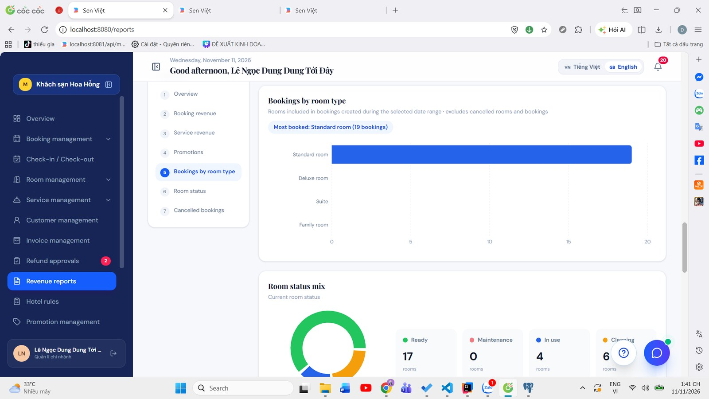<figcaption style="margin-top:4px;font-size:0.82em">Screen 03 - reports</figcaption></figure> <figure style="display:inline-block;vertical-align:top;width:49%;margin:0 0 12px">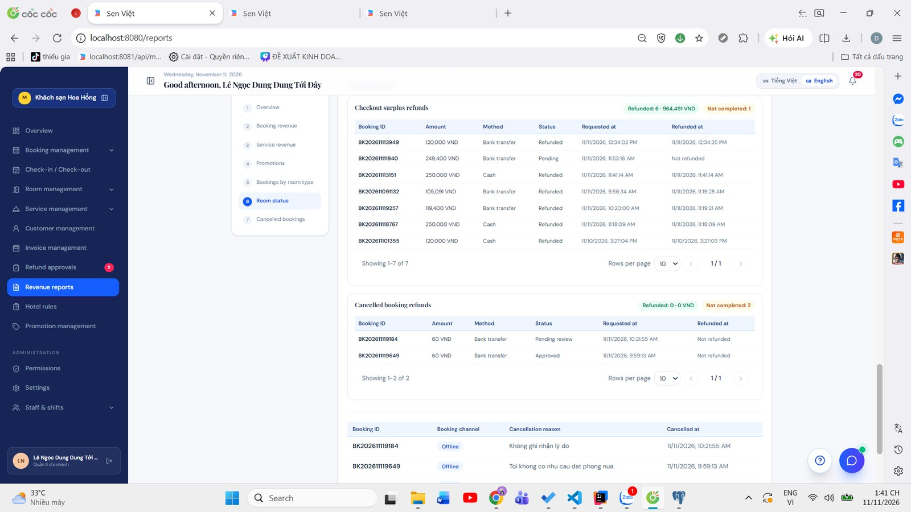<figcaption style="margin-top:4px;font-size:0.82em">Screen 04 - reports</figcaption></figure>

## 3. Create and find bookings

### Create a booking

**Screen and actions:** **Booking management → Bookings** → **New booking**. The form proceeds through **Dates & rooms → Booking information → Services → Promotion/summary**.

1. Open **Booking management → Bookings** and choose **New booking**.
2. In the date-and-room step, select check-in and then check-out. Confirm the night count and use the calendar legend to distinguish available rooms from unavailable ones.
3. Search or filter by room type, floor, or building. Select the required available room cells; click a selected cell again to remove it. For multiple rooms, check every room and date before continuing.
4. Find an existing customer or enter the guest information requested by the form. Verify the selected profile, contact details, guest counts per room, capacity, and any displayed surcharge.
5. Choose services for all rooms or configure them room by room. Check the unit, quantity, room assignment, and estimated charge. Leave unrequested services unselected.
6. Search for a promotion or enter a code. Open its details to check its scope, minimum spend, validity, and status before applying it.
7. Review the final guest, rooms, dates, services, promotion, and total. Submit once and wait for confirmation; record the booking reference.

<figure style="display:inline-block;vertical-align:top;width:49%;margin:0 0 12px">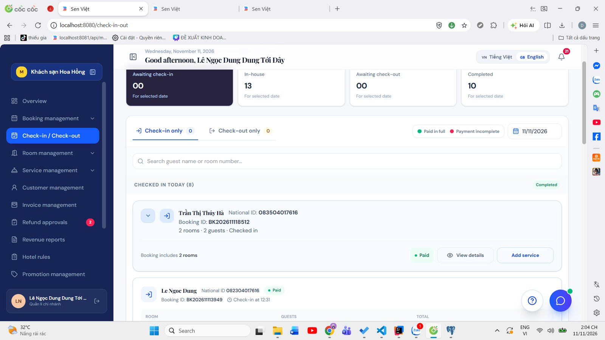<figcaption style="margin-top:4px;font-size:0.82em">Screen 01 - booking create</figcaption></figure> <figure style="display:inline-block;vertical-align:top;width:49%;margin:0 0 12px">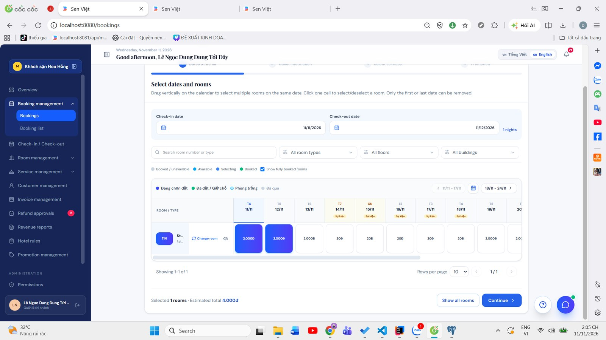<figcaption style="margin-top:4px;font-size:0.82em">Screen 02 - booking create</figcaption></figure>
<figure style="display:inline-block;vertical-align:top;width:49%;margin:0 0 12px">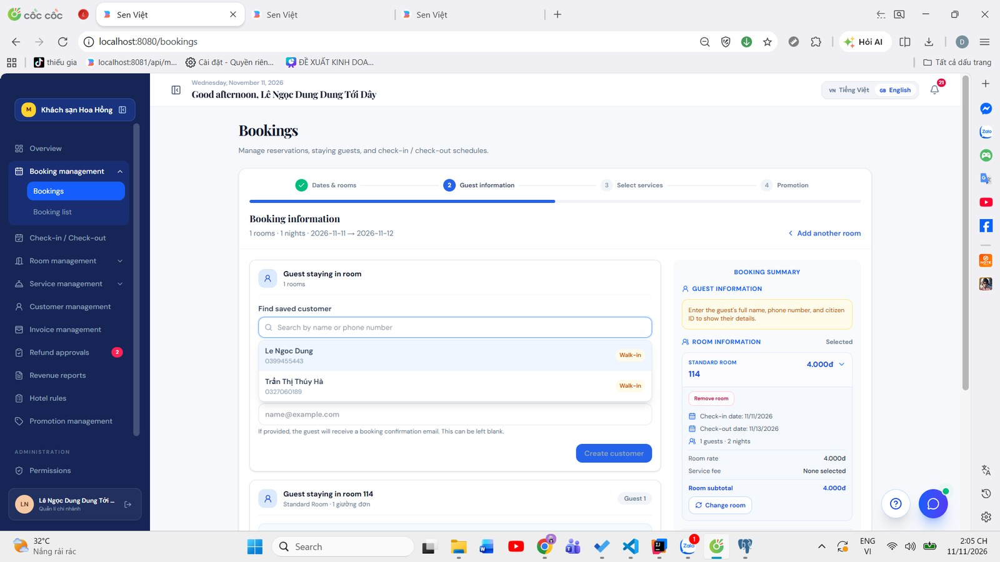<figcaption style="margin-top:4px;font-size:0.82em">Screen 03 - booking create</figcaption></figure> <figure style="display:inline-block;vertical-align:top;width:49%;margin:0 0 12px">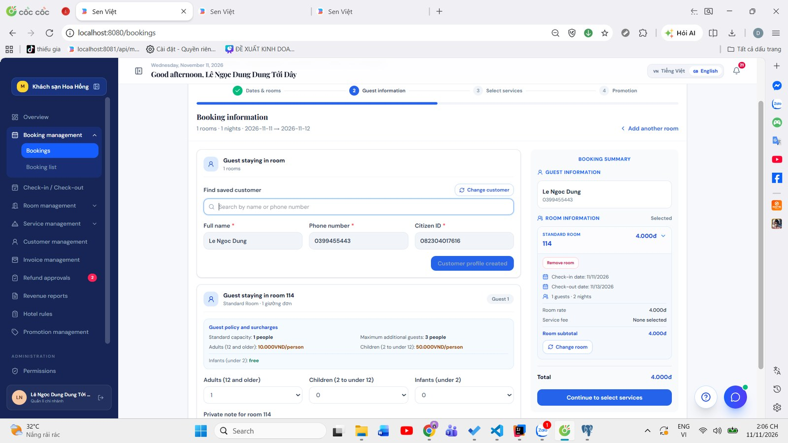<figcaption style="margin-top:4px;font-size:0.82em">Screen 04 - booking create</figcaption></figure>
<figure style="display:inline-block;vertical-align:top;width:49%;margin:0 0 12px">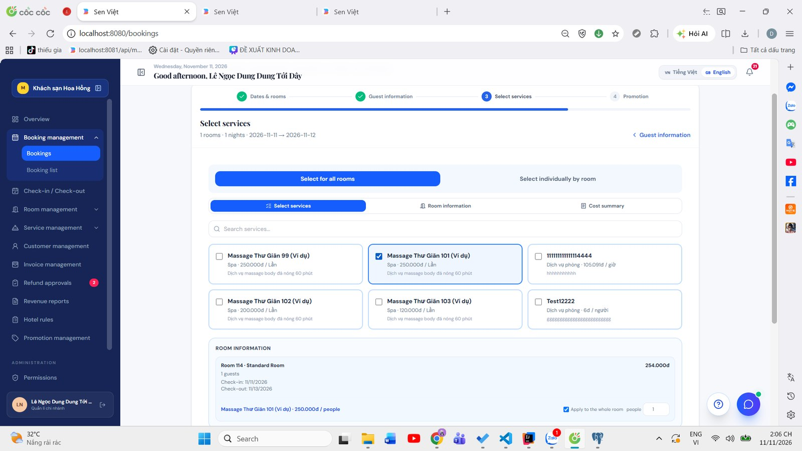<figcaption style="margin-top:4px;font-size:0.82em">Screen 05 - booking create</figcaption></figure> <figure style="display:inline-block;vertical-align:top;width:49%;margin:0 0 12px">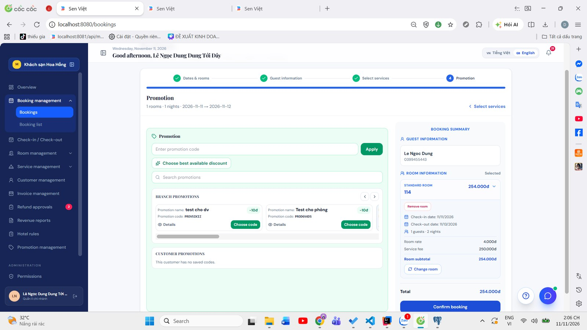<figcaption style="margin-top:4px;font-size:0.82em">Screen 06 - booking create</figcaption></figure>
<figure style="display:inline-block;vertical-align:top;width:49%;margin:0 0 12px">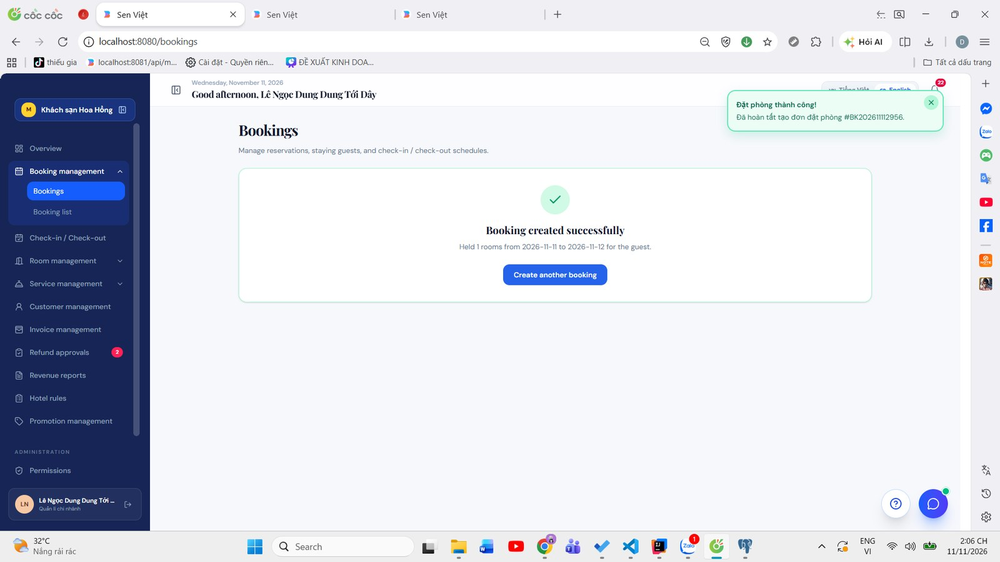<figcaption style="margin-top:4px;font-size:0.82em">Screen 07 - booking create</figcaption></figure>

### Find and review an existing booking

**Screen and actions:** **Booking management → Booking list**. Search the table, then select the row/details action to open the booking record and payment history.

1. Open **Booking management → Booking list**. Search and filter by the available booking, guest, date, and status fields.
2. Verify the booking reference, guest, dates, rooms, payment status, and total before opening or editing it.
3. Use the booking details and payment history to reconcile amounts. Use edit actions only while the booking is in a state that permits the requested change.
4. After saving, reopen or refresh the record and verify the resulting status and values.

<figure style="display:inline-block;vertical-align:top;width:49%;margin:0 0 12px">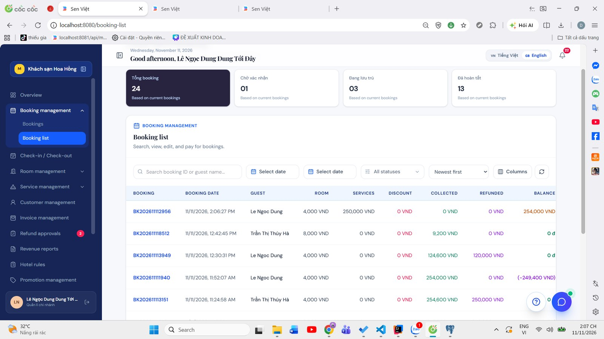<figcaption style="margin-top:4px;font-size:0.82em">Screen 01 - booking list</figcaption></figure> <figure style="display:inline-block;vertical-align:top;width:49%;margin:0 0 12px">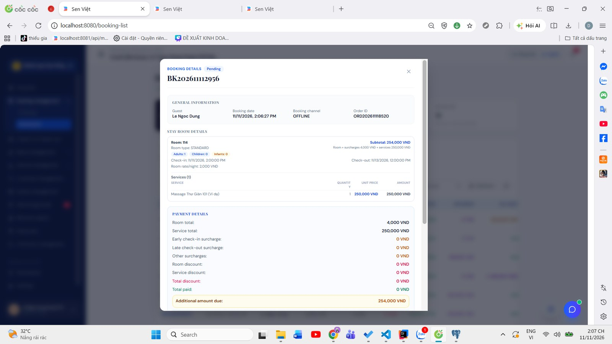<figcaption style="margin-top:4px;font-size:0.82em">Screen 02 - booking list</figcaption></figure>
<figure style="display:inline-block;vertical-align:top;width:49%;margin:0 0 12px">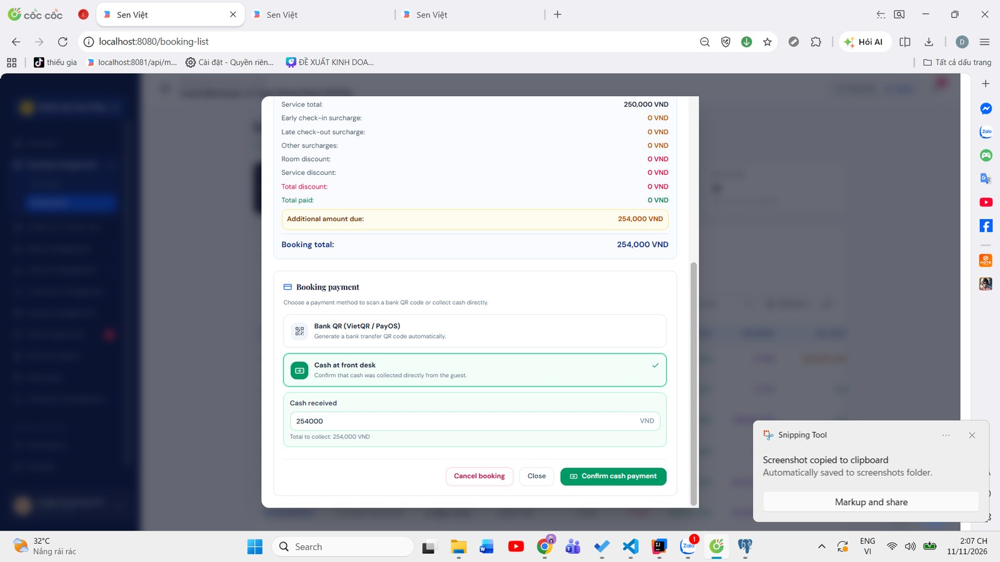<figcaption style="margin-top:4px;font-size:0.82em">Screen 03 - booking list</figcaption></figure> <figure style="display:inline-block;vertical-align:top;width:49%;margin:0 0 12px">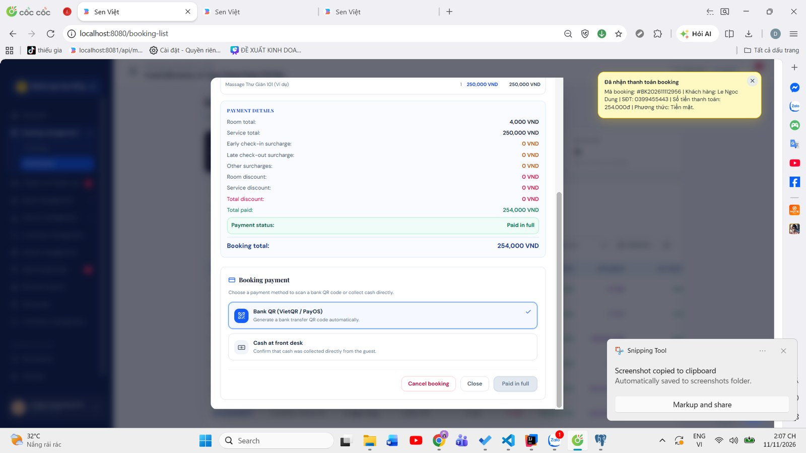<figcaption style="margin-top:4px;font-size:0.82em">Screen 04 - booking list</figcaption></figure>

## 4. Edit a booking and add services

Use this workflow when a guest asks to add a service to an existing booking. It is separate from adding a service to the general service catalog.

**Screen and actions:** **Booking management → Booking list** → select the booking → **Edit**. In the edit form, use **Add services to selected rooms**; **Update** saves the booking changes.

1. In **Booking list**, find the correct booking and open its edit action. Confirm the booking reference and guest before changing anything.
2. Review the rooms and existing services. The service editor applies additions to active rooms; cancelled or inactive rooms cannot be used for new service selections.
3. In **Add services to selected rooms**, open the relevant room and select the requested service. Set the quantity for that room and check the displayed unit and price.
4. Repeat for each applicable room. Do not select the same service for every room unless the guest requested it for every room.
5. Review the existing quantities and new selections. Remove accidental selections and confirm the affected room and quantity.
6. Select **Update** once, wait for the save result, then reopen the booking to verify the service and quantity were recorded.
7. Explain any resulting charge to the guest and check the updated invoice/payment balance through the normal branch process.

<figure style="display:inline-block;vertical-align:top;width:49%;margin:0 0 12px">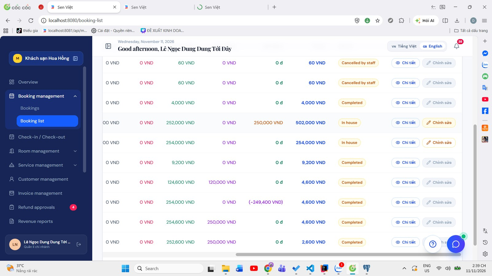<figcaption style="margin-top:4px;font-size:0.82em">Booking list before editing</figcaption></figure> <figure style="display:inline-block;vertical-align:top;width:49%;margin:0 0 12px">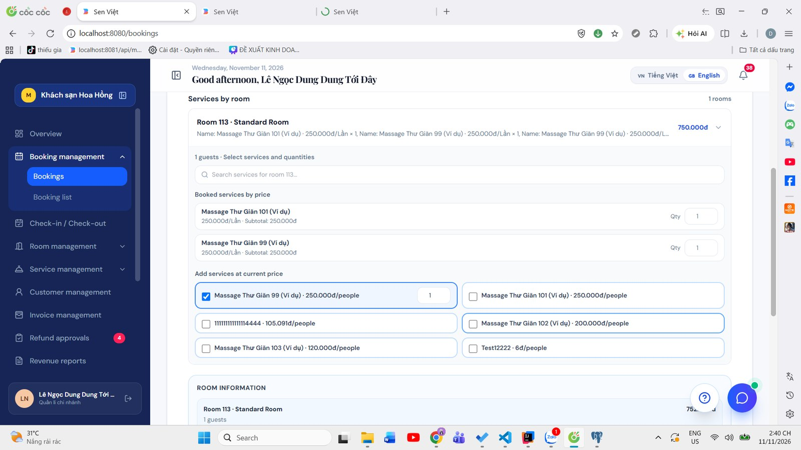<figcaption style="margin-top:4px;font-size:0.82em">Select additional services by room</figcaption></figure>
<figure style="display:inline-block;vertical-align:top;width:49%;margin:0 0 12px">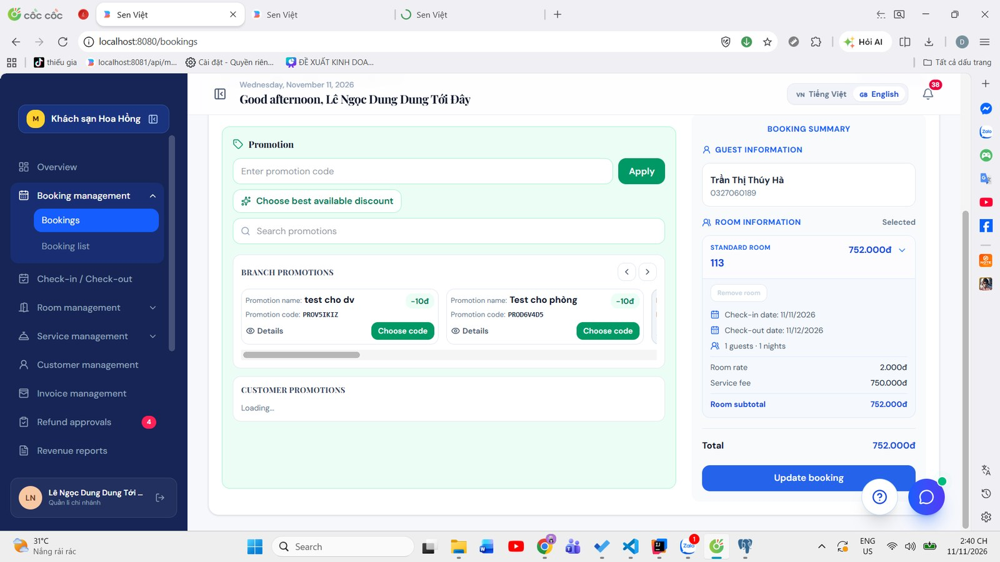<figcaption style="margin-top:4px;font-size:0.82em">Review service totals</figcaption></figure> <figure style="display:inline-block;vertical-align:top;width:49%;margin:0 0 12px">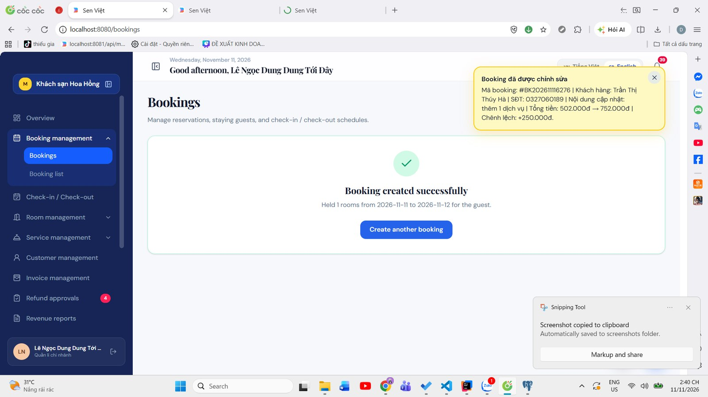<figcaption style="margin-top:4px;font-size:0.82em">Booking updated successfully</figcaption></figure>

## 5. Cancel a booking and refund the guest

Cancellation changes a booking and may create a refund. Check the hotel's policy and the guest's payment before confirming.

**Screen and actions:** **Booking management → Booking list** → **Cancel booking** opens the cancellation dialog. Review the **Preview**, choose cash/bank under **Refund method**, then enter any reason/email and confirm in the same dialog. Bank details can also be added later in **Refund approvals**.

1. In **Booking list**, find and verify the booking. The staff cancellation action is available only for bookings in **Pending** or **Confirmed** status.
2. Choose **Cancel booking**. Wait for the refund preview; it is calculated from the payment and cancellation policy.
3. Review the amount paid, room amount, room penalty, room refund, service refund, total refund, policy tier, and time remaining until check-in. If the preview fails or is missing, retry; do not confirm cancellation without a valid preview.
4. The preview applies these room-penalty tiers: cancellation at least 72 hours before check-in has no room penalty; 24 to under 72 hours has a 50% penalty on the allocated room payment; under 24 hours or no-show has a 100% penalty on the allocated room payment. The service refund is calculated from its allocated payment; the room penalty is deducted from the room portion.
5. Select the refund method:
   - **Cash at hotel:** hand the displayed amount to the guest, then check the confirmation that it was actually handed over. A cash refund is recorded immediately when cancellation is confirmed.
   - **Refund to bank account:** select the bank and enter the account holder and account number if available. Bank details are optional at cancellation and can be added later in Refund approvals. If entered here, provide all required account fields; the account number must contain 6–50 digits. A bank refund waits for manager approval and transfer.
6. Optionally enter a cancellation reason and guest notification email. Check the email spelling if provided.
7. Confirm cancellation once. Verify the success message and the new booking/refund status. For bank refunds, cancellation does not mean the transfer has already been sent; follow the approval workflow in section 12.

<figure style="display:inline-block;vertical-align:top;width:49%;margin:0 0 12px">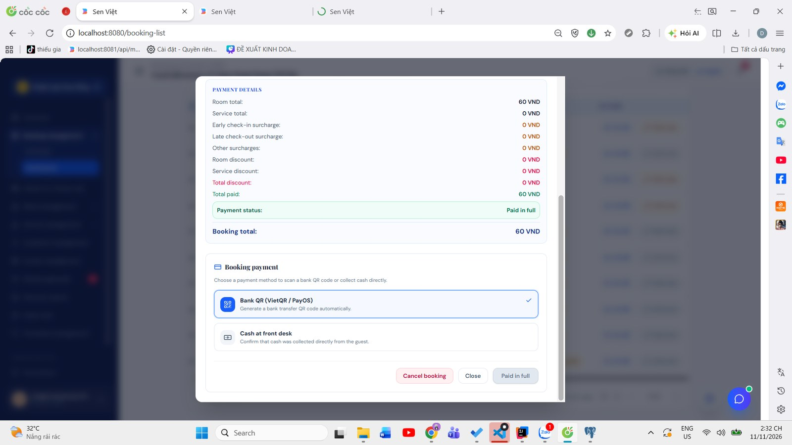<figcaption style="margin-top:4px;font-size:0.82em">Refund preview and payment breakdown</figcaption></figure> <figure style="display:inline-block;vertical-align:top;width:49%;margin:0 0 12px">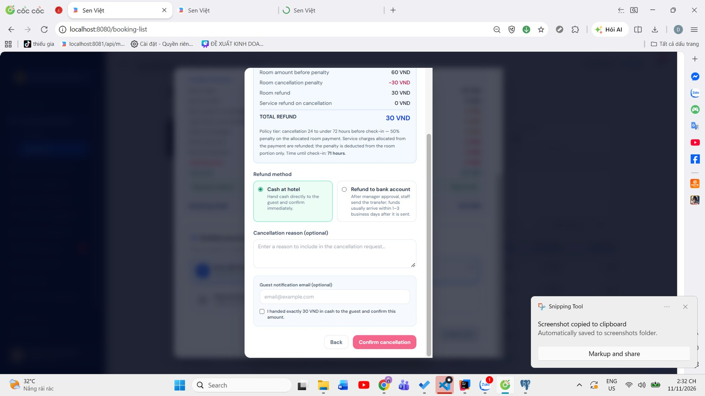<figcaption style="margin-top:4px;font-size:0.82em">Choose cash or bank refund</figcaption></figure>
<figure style="display:inline-block;vertical-align:top;width:49%;margin:0 0 12px">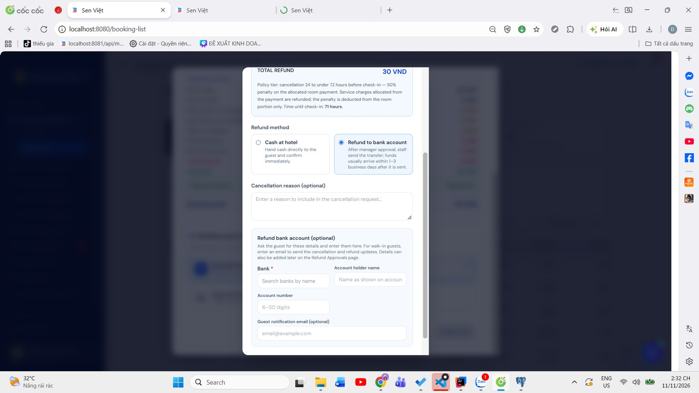<figcaption style="margin-top:4px;font-size:0.82em">Review cancellation conditions</figcaption></figure> <figure style="display:inline-block;vertical-align:top;width:49%;margin:0 0 12px">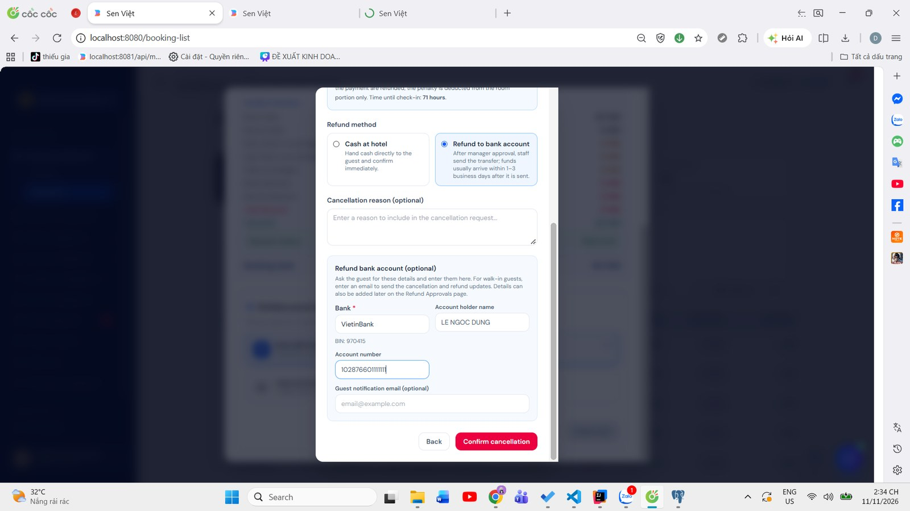<figcaption style="margin-top:4px;font-size:0.82em">Enter bank account details</figcaption></figure>
<figure style="display:inline-block;vertical-align:top;width:49%;margin:0 0 12px">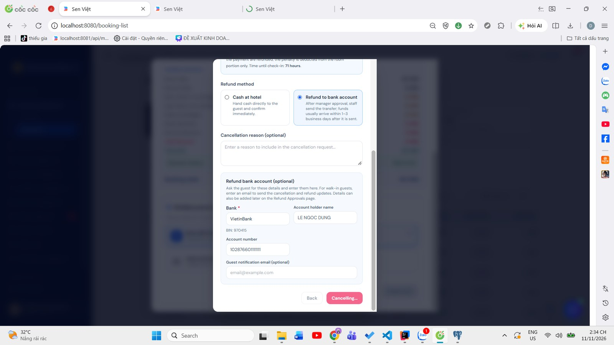<figcaption style="margin-top:4px;font-size:0.82em">Review cancellation details</figcaption></figure> <figure style="display:inline-block;vertical-align:top;width:49%;margin:0 0 12px">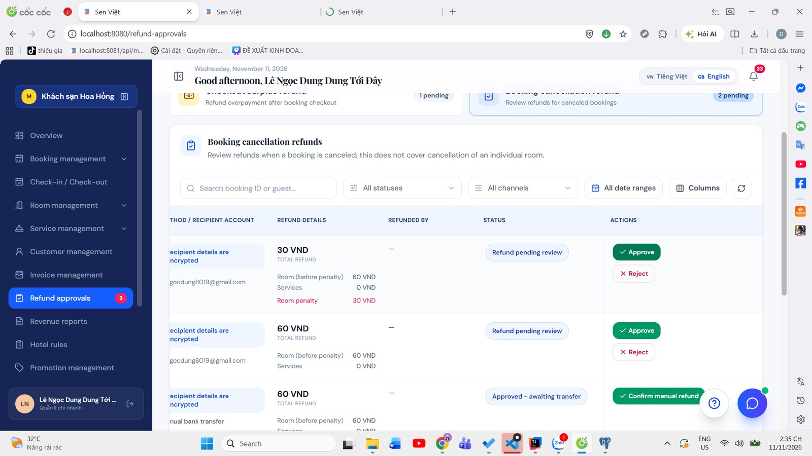<figcaption style="margin-top:4px;font-size:0.82em">Cancellation result</figcaption></figure>
<figure style="display:inline-block;vertical-align:top;width:49%;margin:0 0 12px">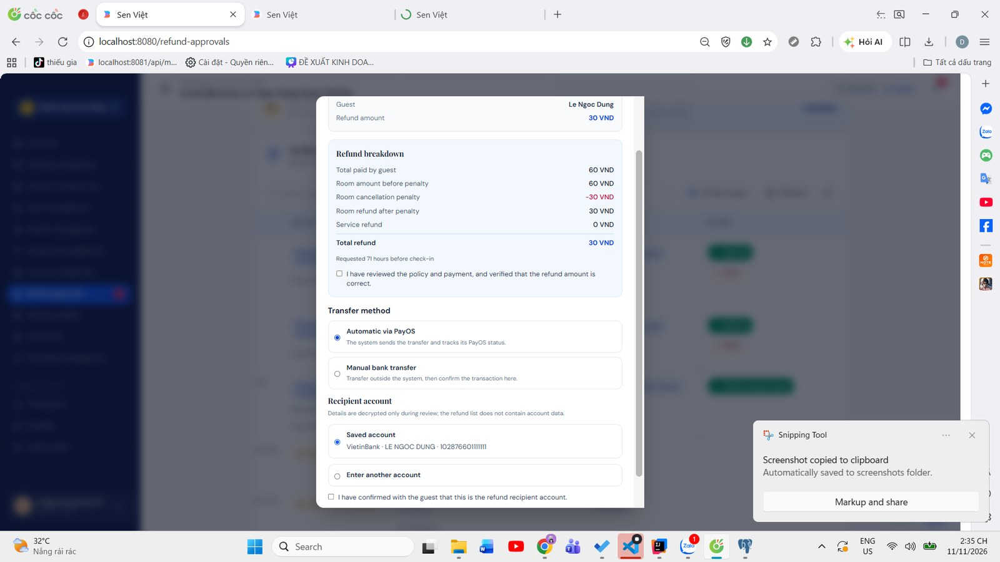<figcaption style="margin-top:4px;font-size:0.82em">Additional cancellation/refund screen</figcaption></figure>

## 6. Check-in, check-out, and surplus refunds

**Screen and actions:** Sidebar → **Check-in / Check-out**. Select the check-in or check-out tab and open a booking to review each room; choose the surplus-refund method in the checkout confirmation form. For batch actions, use the checkboxes in the list.

1. Open **Check-in / Check-out**, select the correct date and the check-in or check-out view, then search for the booking.
2. Open the booking and verify its reference, guest, room, stay dates, guest count, payment state, and any early/late-stay charges.
3. For check-in, explain any applicable early-arrival charge and confirm the room and payment details before completing the action.
4. For check-out, check each room and service against actual use. Do not mark an unused service as consumed. Review late check-out charges and the final amount.
5. If a surplus payment must be refunded, choose **Cash** or **Bank transfer** in the refund-choice section:
   - For cash, return the amount to the guest at the desk and confirm the actual handover.
   - For bank transfer, select the bank and enter the account holder and account number. These fields are required for this checkout bank-refund flow; verify them with the guest before continuing.
6. Recheck the refund amount and booking/room selection, then complete check-out once. A bank refund remains subject to manager approval and transfer in Refund approvals.
7. For group or batch check-out, review the selected rooms individually. A bulk action applies to the selected records, so remove any unintended selection before confirming.

<figure style="display:inline-block;vertical-align:top;width:49%;margin:0 0 12px">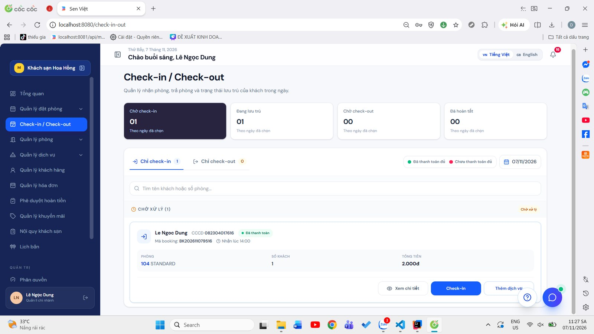<figcaption style="margin-top:4px;font-size:0.82em">Screen 01 - checkinout</figcaption></figure> <figure style="display:inline-block;vertical-align:top;width:49%;margin:0 0 12px">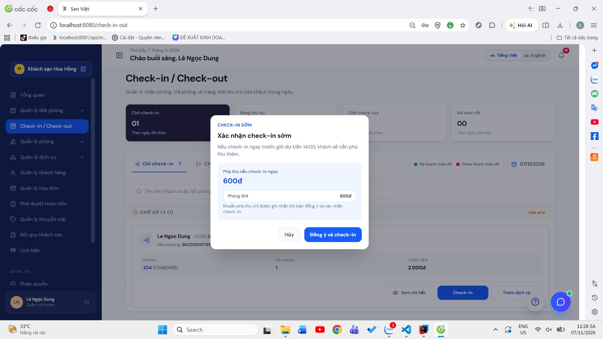<figcaption style="margin-top:4px;font-size:0.82em">Screen 02 - checkinout</figcaption></figure>
<figure style="display:inline-block;vertical-align:top;width:49%;margin:0 0 12px">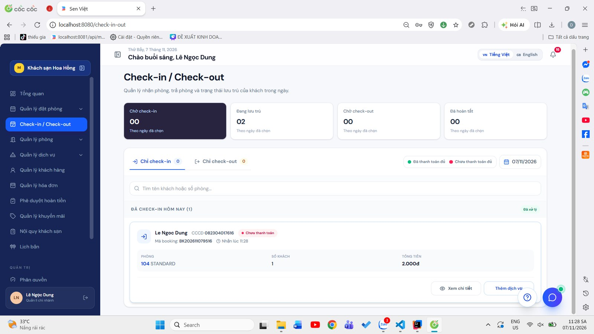<figcaption style="margin-top:4px;font-size:0.82em">Screen 03 - checkinout</figcaption></figure> <figure style="display:inline-block;vertical-align:top;width:49%;margin:0 0 12px">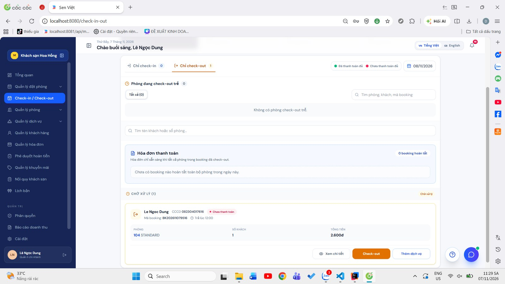<figcaption style="margin-top:4px;font-size:0.82em">Screen 04 - checkinout</figcaption></figure>
<figure style="display:inline-block;vertical-align:top;width:49%;margin:0 0 12px">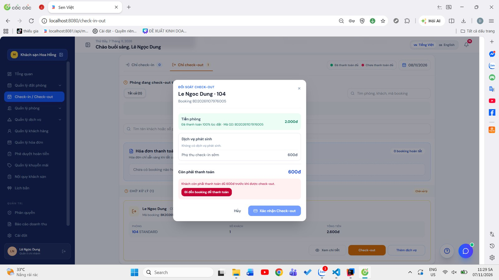<figcaption style="margin-top:4px;font-size:0.82em">Screen 05 - checkinout</figcaption></figure> <figure style="display:inline-block;vertical-align:top;width:49%;margin:0 0 12px">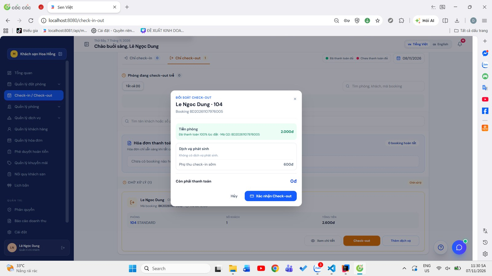<figcaption style="margin-top:4px;font-size:0.82em">Screen 06 - checkinout</figcaption></figure>
<figure style="display:inline-block;vertical-align:top;width:49%;margin:0 0 12px">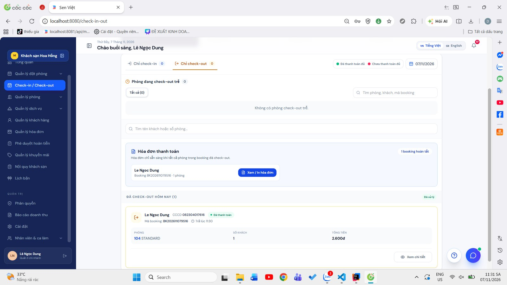<figcaption style="margin-top:4px;font-size:0.82em">Screen 07 - checkinout</figcaption></figure>

## 7. Rooms, rates, buildings, floors, and hotel rules

### Room list and room details

**Screen and actions:** **Room management → Room list management**. Use the table and filters to find a room; select its row or the add/edit action to open room details.

1. Open **Room management → Room list**. Search/filter by room, type, floor, building, and status.
2. Open the correct room to review its details, capacity, amenities, images, and current status.
3. Add or edit a room only if authorized. Check room number, type, building/floor, and capacity before saving.
4. Use the room status that reflects the real situation. Do not mark a room ready until cleaning or inspection is complete.

<figure style="display:inline-block;vertical-align:top;width:49%;margin:0 0 12px">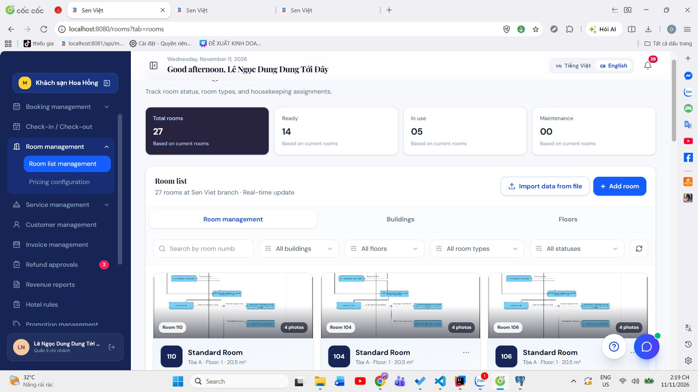<figcaption style="margin-top:4px;font-size:0.82em">Screen 01 - room list</figcaption></figure> <figure style="display:inline-block;vertical-align:top;width:49%;margin:0 0 12px">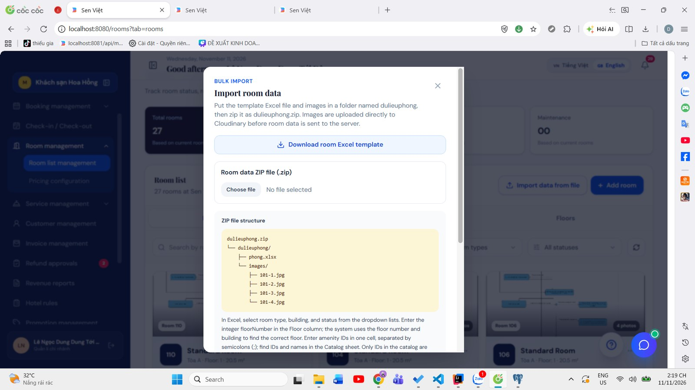<figcaption style="margin-top:4px;font-size:0.82em">Screen 02 - room list</figcaption></figure>
<figure style="display:inline-block;vertical-align:top;width:49%;margin:0 0 12px">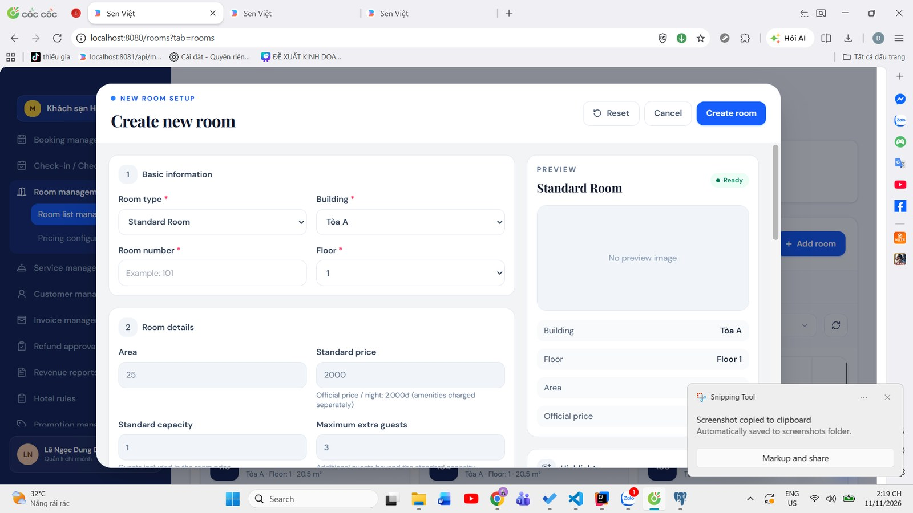<figcaption style="margin-top:4px;font-size:0.82em">Screen 03 - room list</figcaption></figure> <figure style="display:inline-block;vertical-align:top;width:49%;margin:0 0 12px">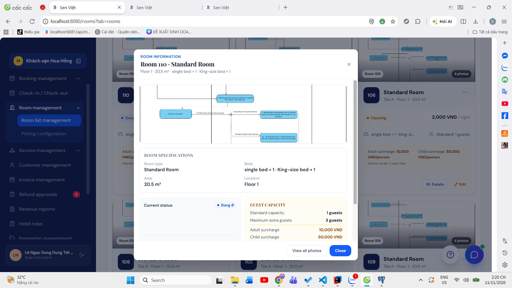<figcaption style="margin-top:4px;font-size:0.82em">Screen 04 - room list</figcaption></figure>
<figure style="display:inline-block;vertical-align:top;width:49%;margin:0 0 12px">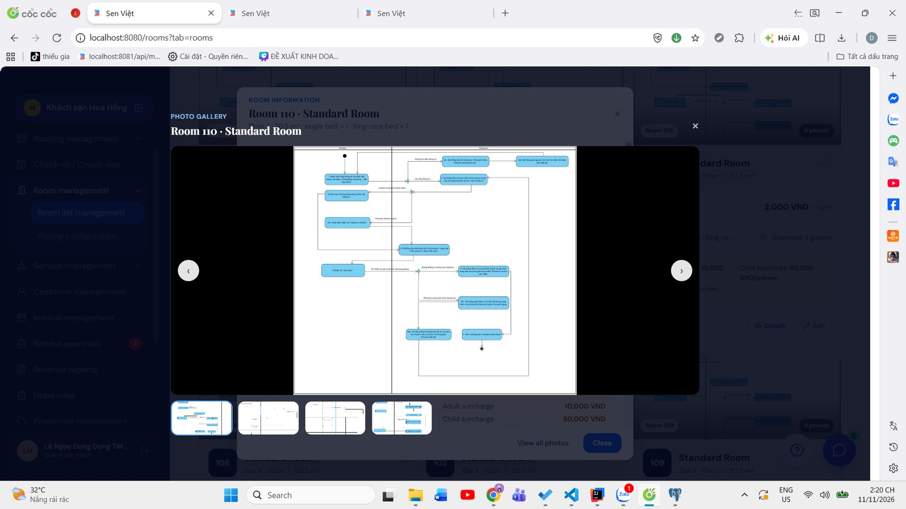<figcaption style="margin-top:4px;font-size:0.82em">Screen 05 - room list</figcaption></figure> <figure style="display:inline-block;vertical-align:top;width:49%;margin:0 0 12px">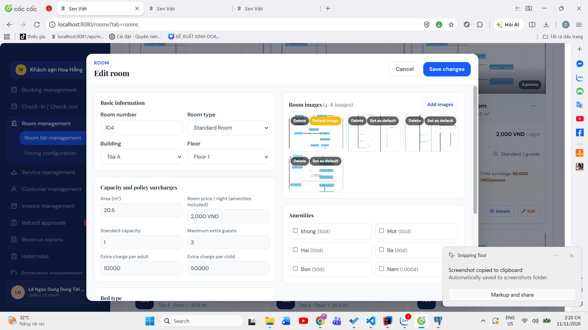<figcaption style="margin-top:4px;font-size:0.82em">Screen 06 - room list</figcaption></figure>

### Base room rates

**Screen and actions:** **Room management → Pricing configuration → Pricing by room type**. Select a room-type card to review or edit the base rate.

1. Open **Room management → Pricing configuration → Pricing by room type**.
2. Select the correct room type and check the nightly rate, standard capacity, extra-guest limit, and adult/child surcharges.
3. Update a rate only after confirming the approved pricing. Save once and recheck the room-type card.

### Event-based pricing

**Screen and actions:** On **Pricing configuration**, switch to the **Pricing by event** tab to filter event rules or select **Create pricing event** to open its form.

1. Select the **Pricing by event** tab to review pricing rules. Use search, date, status, or room-type filters to find an event.
2. Select **Create pricing event**. Enter the event name and the exact start and end dates.
3. In each pricing group, select the room types it covers and enter the **applicable room price (VND)** for that group. Verify that every intended room type is assigned to the correct group.
4. Save only after reviewing the name, date range, room types, and prices in every group. Find the event in the table to verify its status, validity period, and prices.

### Buildings and floors

**Screen and actions:** **Room management → Room list** → **Buildings** or **Floors** tab. Add/edit opens the corresponding form; Excel/CSV import is in the floors tab.

1. In **Room list management**, open the **Buildings** tab to search, add, or edit a building. When adding, enter its name; the building code is generated after saving.
2. Open **Floors**, select the correct building, and add each floor as a positive whole number.
3. For Excel/CSV import, download the template and provide the building (it may be blank to use the selected building) and floor numbers. Existing duplicate floors are skipped; review the floor list after import.

<figure style="display:inline-block;vertical-align:top;width:49%;margin:0 0 12px">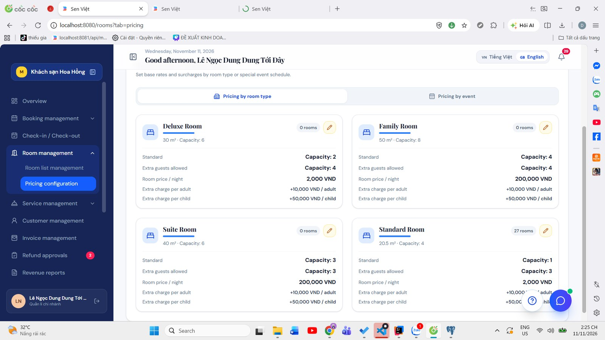<figcaption style="margin-top:4px;font-size:0.82em">Base prices by room type</figcaption></figure> <figure style="display:inline-block;vertical-align:top;width:49%;margin:0 0 12px">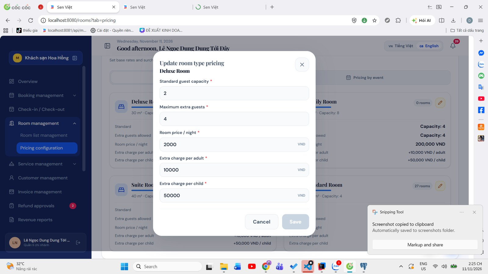<figcaption style="margin-top:4px;font-size:0.82em">Edit a room-type price</figcaption></figure>
<figure style="display:inline-block;vertical-align:top;width:49%;margin:0 0 12px">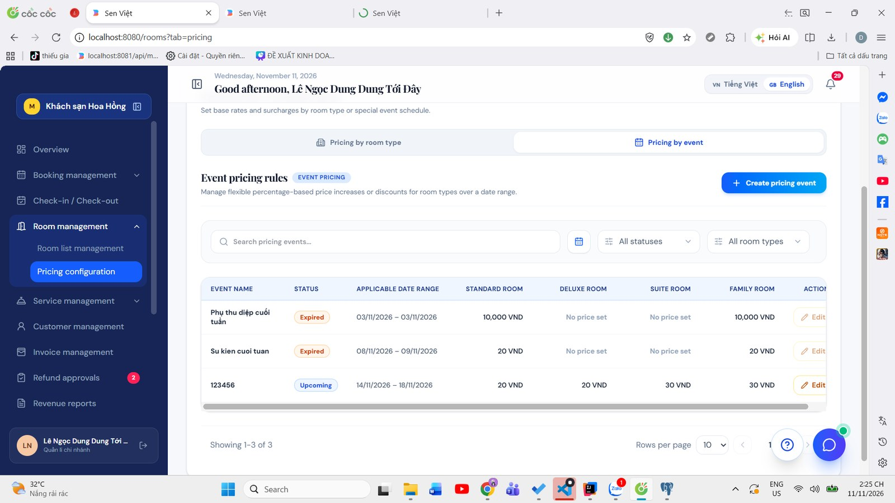<figcaption style="margin-top:4px;font-size:0.82em">Event pricing list</figcaption></figure> <figure style="display:inline-block;vertical-align:top;width:49%;margin:0 0 12px">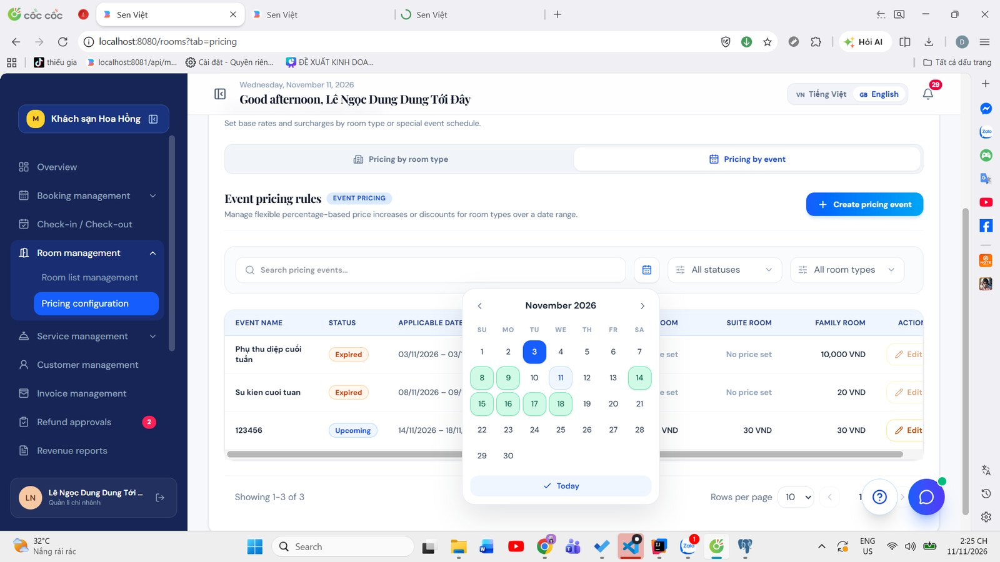<figcaption style="margin-top:4px;font-size:0.82em">Filter events by date</figcaption></figure>
<figure style="display:inline-block;vertical-align:top;width:49%;margin:0 0 12px">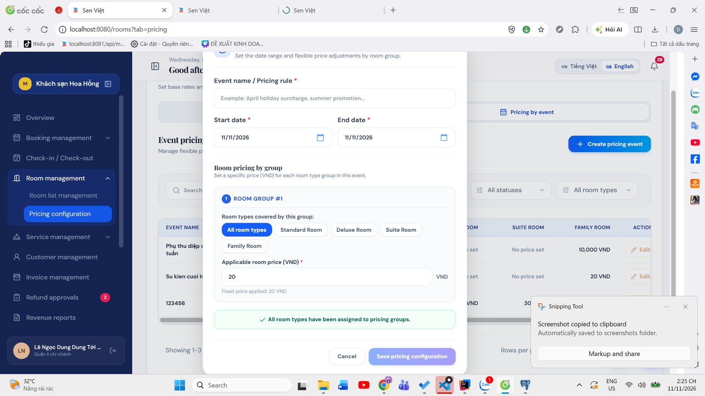<figcaption style="margin-top:4px;font-size:0.82em">Create an event-pricing rule</figcaption></figure>

<figure style="display:inline-block;vertical-align:top;width:49%;margin:0 0 12px">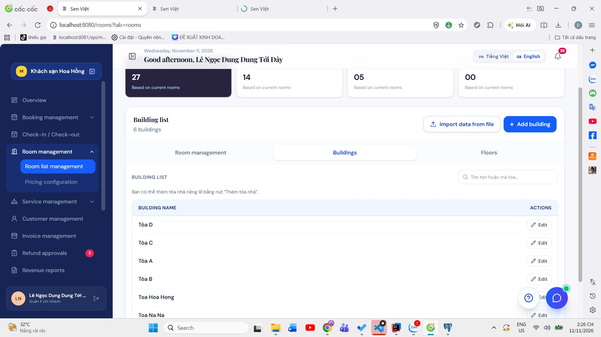<figcaption style="margin-top:4px;font-size:0.82em">Building list</figcaption></figure> <figure style="display:inline-block;vertical-align:top;width:49%;margin:0 0 12px"><figcaption style="margin-top:4px;font-size:0.82em">Create or edit a building</figcaption></figure>
<figure style="display:inline-block;vertical-align:top;width:49%;margin:0 0 12px">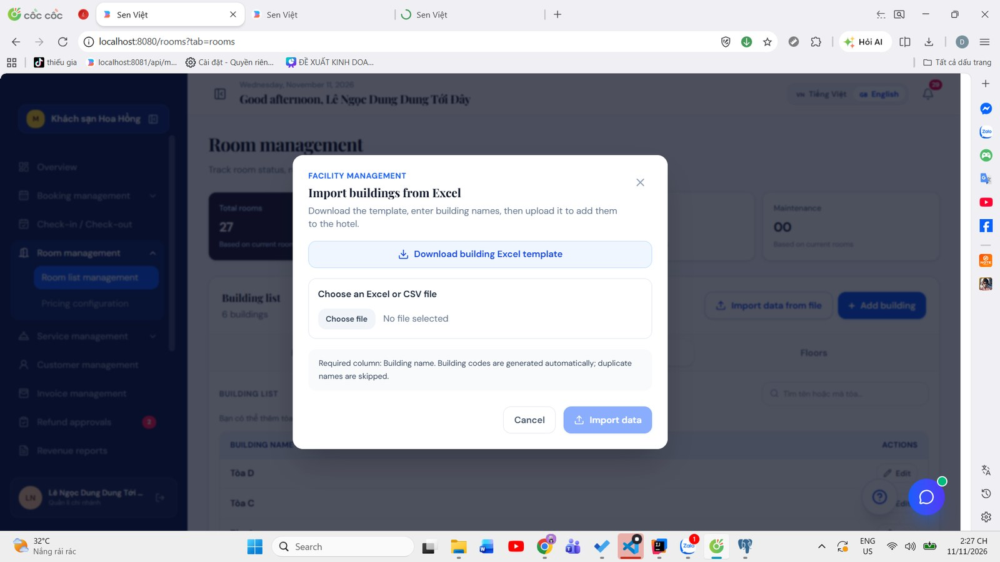<figcaption style="margin-top:4px;font-size:0.82em">Building setup</figcaption></figure> <figure style="display:inline-block;vertical-align:top;width:49%;margin:0 0 12px">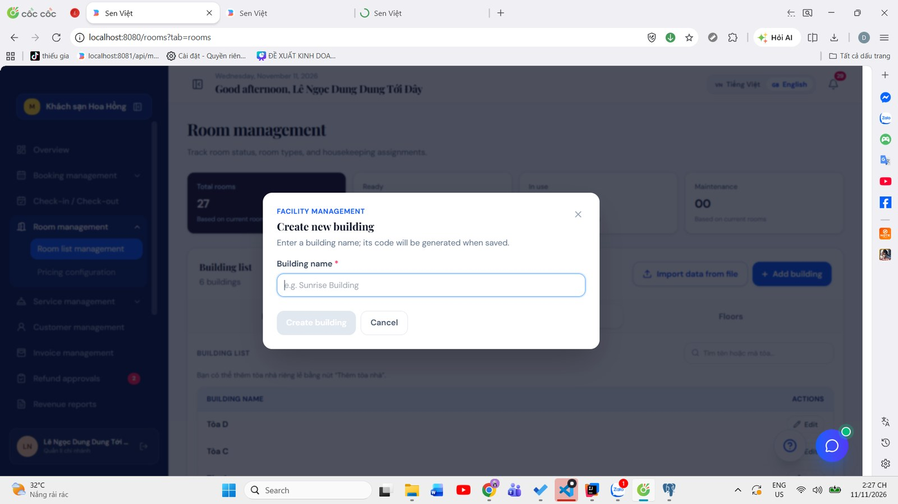<figcaption style="margin-top:4px;font-size:0.82em">Floors for the selected building</figcaption></figure>
<figure style="display:inline-block;vertical-align:top;width:49%;margin:0 0 12px"><figcaption style="margin-top:4px;font-size:0.82em">Import floors from a spreadsheet</figcaption></figure> <figure style="display:inline-block;vertical-align:top;width:49%;margin:0 0 12px"><figcaption style="margin-top:4px;font-size:0.82em">Add or edit a floor</figcaption></figure>

### Hotel rules

**Screen and actions:** Sidebar → **Hotel rules**. Read check-in/check-out times, cancellation, and service policies here; this is a policy reference page, not the booking-cancellation screen.

Open **Hotel rules** to check the branch's check-in/check-out times, cancellation terms, and service policies before advising a guest. Follow the published rule and refer unclear exceptions to a manager.

## 8. Service catalog and guest service usage

### Service catalog

**Screen and actions:** **Service management → Service catalog management** (employees may see **Service list**). Search the service table; add/edit opens the service form, and bulk import is in the same module.

1. Open **Service management → Service catalog**. Search/filter the list and review the service name, category, price, unit, image, and active state.
2. Open details to inspect the description. Managers with permission can add or edit a service; employees may have read-only access.
3. When adding a service, complete the required name, price, unit, category, image, and description. Review the preview and save once.
4. Use bulk import only with the supplied ZIP/Excel structure. Match each image filename to the spreadsheet row and review validation errors before sending the import.

<figure style="display:inline-block;vertical-align:top;width:49%;margin:0 0 12px"><figcaption style="margin-top:4px;font-size:0.82em">Screen 01 - service catalog</figcaption></figure> <figure style="display:inline-block;vertical-align:top;width:49%;margin:0 0 12px"><figcaption style="margin-top:4px;font-size:0.82em">Screen 02 - service catalog</figcaption></figure>
<figure style="display:inline-block;vertical-align:top;width:49%;margin:0 0 12px"><figcaption style="margin-top:4px;font-size:0.82em">Screen 03 - service catalog</figcaption></figure> <figure style="display:inline-block;vertical-align:top;width:49%;margin:0 0 12px"><figcaption style="margin-top:4px;font-size:0.82em">Screen 04 - service catalog</figcaption></figure>

### Confirm services used by a guest

**Screen and actions:** **Service management → Customer service operations**. Open a pending booking/service, enter the actual usage quantity, and confirm on this screen.

1. Open **Service management → Guest service usage** and find the booking/service waiting for confirmation.
2. Verify the guest, booking, room, service, unit, and remaining quantity.
3. Enter only the amount actually used and confirm. Do not confirm an unused service; ask the guest or manager if usage is unclear.
4. Check the usage history after saving.

<figure style="display:inline-block;vertical-align:top;width:49%;margin:0 0 12px"><figcaption style="margin-top:4px;font-size:0.82em">Screen 01 - service usage</figcaption></figure> <figure style="display:inline-block;vertical-align:top;width:49%;margin:0 0 12px"><figcaption style="margin-top:4px;font-size:0.82em">Screen 02 - service usage</figcaption></figure>

## 9. Customers, orders, and invoices

### Customers

**Screen and actions:** Sidebar → **Customer management**. Search the list and open a customer profile to view its details and booking history.

Search by the available name, phone, or email fields and verify the profile before opening it. Review booking history as needed. Add or edit customer details only when authorized, and keep personal information private.

<figure style="display:inline-block;vertical-align:top;width:49%;margin:0 0 12px"><figcaption style="margin-top:4px;font-size:0.82em">Screen 01 - customer management</figcaption></figure> <figure style="display:inline-block;vertical-align:top;width:49%;margin:0 0 12px"><figcaption style="margin-top:4px;font-size:0.82em">Screen 02 - customer management</figcaption></figure>
<figure style="display:inline-block;vertical-align:top;width:49%;margin:0 0 12px"><figcaption style="margin-top:4px;font-size:0.82em">Screen 03 - customer management</figcaption></figure> <figure style="display:inline-block;vertical-align:top;width:49%;margin:0 0 12px"><figcaption style="margin-top:4px;font-size:0.82em">Screen 04 - customer management</figcaption></figure>

### Orders and invoices

**Screen and actions:** Sidebar → **Invoice management**. Find the invoice/order record here and open its details to reconcile the booking, charges, and payments.

Use **Order management** to review the order list and its status/details. Use **Invoice management** to find the correct invoice, inspect its booking, charges, payments, and balance, and reconcile it with the original booking. Do not change a financial record outside your permission.

<figure style="display:inline-block;vertical-align:top;width:49%;margin:0 0 12px"><figcaption style="margin-top:4px;font-size:0.82em">Screen 01 - order management</figcaption></figure> <figure style="display:inline-block;vertical-align:top;width:49%;margin:0 0 12px"><figcaption style="margin-top:4px;font-size:0.82em">Screen 02 - order management</figcaption></figure>

## 10. Promotion management

**Screen and actions:** Sidebar → **Promotion management**. Date/status filters and summary cards are on the list page; select a promotion or the create/edit action to open its details/form.

1. Open **Promotion management** and choose the relevant date/month. Use search and status/scope filters to locate an offer.
2. Review summary cards and the promotion list. The summary describes the selected reporting period; check the date range before interpreting it.
3. Open a promotion's details to inspect discount type/value, scope, minimum amounts, validity, usage limits, and status.
4. Authorized managers can create or edit a promotion. Enter the required dates, scope, discount, limits, and status; validate the fields and review the saved record.
5. Before applying a code to a booking, confirm that it is active, within its validity dates, and meets the booking's scope and minimum-value requirements.

<figure style="display:inline-block;vertical-align:top;width:49%;margin:0 0 12px"><figcaption style="margin-top:4px;font-size:0.82em">Screen 01 - promotion management</figcaption></figure> <figure style="display:inline-block;vertical-align:top;width:49%;margin:0 0 12px"><figcaption style="margin-top:4px;font-size:0.82em">Screen 02 - promotion management</figcaption></figure>
<figure style="display:inline-block;vertical-align:top;width:49%;margin:0 0 12px"><figcaption style="margin-top:4px;font-size:0.82em">Screen 03 - promotion management</figcaption></figure>

## 11. Staff, shifts, and tasks

### Staff directory

**Screen and actions:** **Staff & shifts → Employee directory**. Search the table and select an employee or add/edit action to open the employee record.

Search for the correct employee and check branch, role, and active status. Only authorized managers should add or edit employee records or role assignments.

<figure style="display:inline-block;vertical-align:top;width:49%;margin:0 0 12px"><figcaption style="margin-top:4px;font-size:0.82em">Screen 01 - staff directory</figcaption></figure> <figure style="display:inline-block;vertical-align:top;width:49%;margin:0 0 12px"><figcaption style="margin-top:4px;font-size:0.82em">Screen 02 - staff directory</figcaption></figure>
<figure style="display:inline-block;vertical-align:top;width:49%;margin:0 0 12px"><figcaption style="margin-top:4px;font-size:0.82em">Screen 03 - staff directory</figcaption></figure> <figure style="display:inline-block;vertical-align:top;width:49%;margin:0 0 12px"><figcaption style="margin-top:4px;font-size:0.82em">Screen 04 - staff directory</figcaption></figure>

### Shifts

**Screen and actions:** **Staff & shifts → Shifts** to view the schedule; use **Assign shifts** to create or assign them. Employees view their own shifts in the staff page.

1. Open the shift schedule and select the week/date to review.
2. For a new shift, select the employee, date, and shift/time slot. Check for duplicate or overlapping shifts and verify the employee belongs to the correct branch.
3. Save/publish once and confirm that the shift appears on the schedule. Staff should check their own assigned shifts before starting work.

<figure style="display:inline-block;vertical-align:top;width:49%;margin:0 0 12px"><figcaption style="margin-top:4px;font-size:0.82em">Screen 01 - staff weekly shifts</figcaption></figure> <figure style="display:inline-block;vertical-align:top;width:49%;margin:0 0 12px"><figcaption style="margin-top:4px;font-size:0.82em">Screen 02 - staff weekly shifts</figcaption></figure>

<figure style="display:inline-block;vertical-align:top;width:49%;margin:0 0 12px"><figcaption style="margin-top:4px;font-size:0.82em">Screen 01 - staff assign shifts</figcaption></figure> <figure style="display:inline-block;vertical-align:top;width:49%;margin:0 0 12px"><figcaption style="margin-top:4px;font-size:0.82em">Screen 02 - staff assign shifts</figcaption></figure>
<figure style="display:inline-block;vertical-align:top;width:49%;margin:0 0 12px"><figcaption style="margin-top:4px;font-size:0.82em">Screen 03 - staff assign shifts</figcaption></figure>

### Tasks

**Screen and actions:** Managers: **Staff & shifts → Assign tasks**. Employees: **Housekeeping assignments** in the staff page. Assignment and status updates are performed in the screen available to each role.

Managers open **Task assignment**, select the room/task and the eligible on-duty employee, then review the assignment before saving. Staff open their task list, check the room and instructions, and update the status only when the work has actually progressed or finished.

<figure style="display:inline-block;vertical-align:top;width:49%;margin:0 0 12px"><figcaption style="margin-top:4px;font-size:0.82em">Screen 01 - staff tasks</figcaption></figure> <figure style="display:inline-block;vertical-align:top;width:49%;margin:0 0 12px"><figcaption style="margin-top:4px;font-size:0.82em">Screen 02 - staff tasks</figcaption></figure>

## 12. Refund approvals

**Screen and actions:** Sidebar → **Refund approvals**. Select a request in the queue to open its details; add bank details, approve/reject, and verify status on this screen.

1. Open **Refund approvals** and review the pending queue. Open a request and verify its booking, guest, amount, refund method, reason, and bank details.
2. For bank refunds, confirm the account details with the guest before approving. If details are missing or incorrect, use the available action to request or enter the correct details; do not approve an unverified destination.
3. Approve or reject only if your role allows it and the request matches policy. Record/perform the transfer through the hotel's authorized process.
4. Verify the resulting status. A bank refund is complete only after the approval/transfer process is recorded; do not tell a guest the funds have arrived before confirmation.
5. Cash-refund requests should be reconciled with the actual handover and the system's recorded status.

<figure style="display:inline-block;vertical-align:top;width:49%;margin:0 0 12px"><figcaption style="margin-top:4px;font-size:0.82em">Screen 01 - refund approvals</figcaption></figure> <figure style="display:inline-block;vertical-align:top;width:49%;margin:0 0 12px"><figcaption style="margin-top:4px;font-size:0.82em">Screen 02 - refund approvals</figcaption></figure>
<figure style="display:inline-block;vertical-align:top;width:49%;margin:0 0 12px"><figcaption style="margin-top:4px;font-size:0.82em">Screen 03 - refund approvals</figcaption></figure>

## 13. Settings, roles, and permissions

### Settings

**Screen and actions:** Sidebar → **Settings**. Change only account/branch fields available to your role and verify them after saving.

Open **Settings** to review the account and branch details available to you. Change only fields assigned to your role. Verify any updated branch details or images after saving.

<figure style="display:inline-block;vertical-align:top;width:49%;margin:0 0 12px"><figcaption style="margin-top:4px;font-size:0.82em">Screen 01 - settings</figcaption></figure> <figure style="display:inline-block;vertical-align:top;width:49%;margin:0 0 12px"><figcaption style="margin-top:4px;font-size:0.82em">Screen 02 - settings</figcaption></figure>
<figure style="display:inline-block;vertical-align:top;width:49%;margin:0 0 12px"><figcaption style="margin-top:4px;font-size:0.82em">Screen 03 - settings</figcaption></figure>

### Roles and permissions

**Screen and actions:** Use **Role management** to review/edit roles and **Permissions** to inspect access by role. These are separate screens in the administration area.

Use **Role management** to review or maintain roles only if authorized. In **Permissions**, inspect the role and its available access. Ask an administrator to change access when a menu or action is unavailable; never bypass access controls.

<figure style="display:inline-block;vertical-align:top;width:49%;margin:0 0 12px"><figcaption style="margin-top:4px;font-size:0.82em">Screen 01 - roles</figcaption></figure>

<figure style="display:inline-block;vertical-align:top;width:49%;margin:0 0 12px"><figcaption style="margin-top:4px;font-size:0.82em">Screen 01 - permissions</figcaption></figure>

## 14. Troubleshooting and safe operation

**Screen and actions:** Check the page where the issue occurred (Booking list, Check-in / Check-out, Refund approvals, or Service catalog). If a menu/action is missing, review access in **Permissions** with a manager.

- **A booking or room is missing:** check the selected branch, date, tab, search terms, and filters; clear filters and reload before assuming the record does not exist.
- **A refund preview or amount is unavailable:** retry the preview. Do not cancel or check out with an unverified amount.
- **A bank refund cannot continue:** verify the bank, account holder, and account number with the guest. Cancellation can be completed with bank details added later where the screen allows it; checkout requires its displayed bank details before submission.
- **A service is missing or has the wrong quantity:** verify the active room and service catalog, then reopen the booking. Do not confirm more usage than the guest received.
- **A save appears to be taking a long time:** wait for the result and check the record before submitting again, to avoid duplicate actions.
- **A menu or button is unavailable:** ask a manager to confirm permissions.
- Before any action affecting money, bookings, rooms, or employee schedules, verify the record and values one final time.
