# Hướng dẫn sử dụng phần mềm quản lý khách sạn

Tài liệu dành cho nhân viên và quản lý chi nhánh. Menu và thao tác tùy theo vai trò, chi nhánh của tài khoản đang đăng nhập. Chỉ thực hiện những chức năng được phân quyền. Ảnh trong tài liệu này là giao diện **tiếng Việt**; ảnh giao diện tiếng Anh được tách riêng trong [USER_GUIDE_EN.md](./USER_GUIDE_EN.md).

Mỗi phần dưới đây ghi rõ **giao diện cần mở** và thao tác thực hiện tại đó. Tên menu in đậm khớp với tên trong thanh điều hướng; ảnh bên dưới từng phần minh họa màn hình hoặc hộp thoại được nhắc đến.

> **Trước khi chia sẻ:** ảnh chụp có thể chứa dữ liệu mẫu về khách, nhân viên, booking hoặc thanh toán. Hãy kiểm tra và che thông tin cá nhân/tài chính trước khi phát hành tài liệu ra ngoài phạm vi khách sạn.

## Mục lục

1. [Đăng nhập, ngôn ngữ và điều hướng](#1-đăng-nhập-ngôn-ngữ-và-điều-hướng)
2. [Tổng quan và báo cáo](#2-tổng-quan-và-báo-cáo)
3. [Tạo và tra cứu booking](#3-tạo-và-tra-cứu-booking)
4. [Chỉnh sửa booking và thêm dịch vụ](#4-chỉnh-sửa-booking-và-thêm-dịch-vụ)
5. [Hủy booking và hoàn tiền cho khách](#5-hủy-booking-và-hoàn-tiền-cho-khách)
6. [Check-in, check-out và hoàn tiền dư](#6-check-in-check-out-và-hoàn-tiền-dư)
7. [Phòng, giá, tòa nhà, tầng và nội quy](#7-phong-gia-toa-nha-tang-va-noi-quy)
8. [Danh mục dịch vụ và xác nhận dịch vụ khách dùng](#8-danh-mục-dịch-vụ-và-xác-nhận-dịch-vụ-khách-dùng)
9. [Khách hàng, đơn hàng và hóa đơn](#9-khách-hàng-đơn-hàng-và-hóa-đơn)
10. [Quản lý khuyến mãi](#10-quản-lý-khuyến-mãi)
11. [Nhân viên, ca làm và công việc](#11-nhân-viên-ca-làm-và-công-việc)
12. [Phê duyệt hoàn tiền](#12-phê-duyệt-hoàn-tiền)
13. [Cài đặt, vai trò và phân quyền](#13-cài-đặt-vai-trò-và-phân-quyền)
14. [Xử lý sự cố và thao tác an toàn](#14-xử-lý-sự-cố-và-thao-tác-an-toàn)

## 1. Đăng nhập, ngôn ngữ và điều hướng

**Giao diện thao tác:** Màn hình **Đăng nhập** để vào hệ thống; sau khi đăng nhập, dùng thanh điều hướng bên trái để mở trang, thanh đầu trang để đổi ngôn ngữ và thẻ tài khoản ở cuối thanh bên để đăng xuất.

1. Đăng nhập bằng tài khoản nhân viên hoặc quản lý được cấp. Kiểm tra chi nhánh hiển thị trên thanh bên trước khi thay đổi dữ liệu.
2. Dùng menu bên trái để mở phân hệ. Bấm mũi tên cạnh mục có menu con để xem thêm trang; trên màn hình nhỏ, dùng nút menu để mở/đóng điều hướng.
3. Chọn **Tiếng Việt** trên thanh đầu trang để dùng giao diện tiếng Việt. Đổi ngôn ngữ chỉ đổi nhãn giao diện; tên, ghi chú hoặc nội dung do người dùng nhập có thể không đổi.
4. Nếu không thấy menu cần dùng, hãy nhờ quản lý kiểm tra vai trò thay vì dùng tài khoản của người khác.
5. Đăng xuất khi dùng xong, nhất là trên thiết bị dùng chung.

## 2. Tổng quan và báo cáo

### Tổng quan

Trang Tổng quan để theo dõi nhanh; khi cần xử lý, hãy mở hồ sơ booking để kiểm tra đầy đủ.

**Giao diện thao tác:** Thanh bên → **Tổng quan**. Thẻ số liệu ở đầu trang, lịch nhận/trả phòng và danh sách dịch vụ chờ xác nhận nằm trên trang này; mở phân hệ tương ứng để thực hiện giao dịch.

1. Mở **Tổng quan** và xem các thẻ số liệu hoạt động của chi nhánh.
2. Kiểm tra ngày đang chọn; dùng điều khiển ngày để xem ngày khác hoặc quay lại hôm nay.
3. Chọn danh sách khách chờ nhận phòng, chờ trả phòng hoặc nhận phòng sớm để tìm booking liên quan.
4. Kiểm tra khách và phòng trước khi mở dòng; tiếp tục xử lý tại Check-in / Check-out hoặc Quản lý đặt phòng.
5. Ở danh sách dịch vụ chờ xác nhận, so sánh dịch vụ và số lượng đã đặt với lượng khách thực tế sử dụng trước khi xác nhận.

<figure style="display:inline-block;vertical-align:top;width:49%;margin:0 0 12px">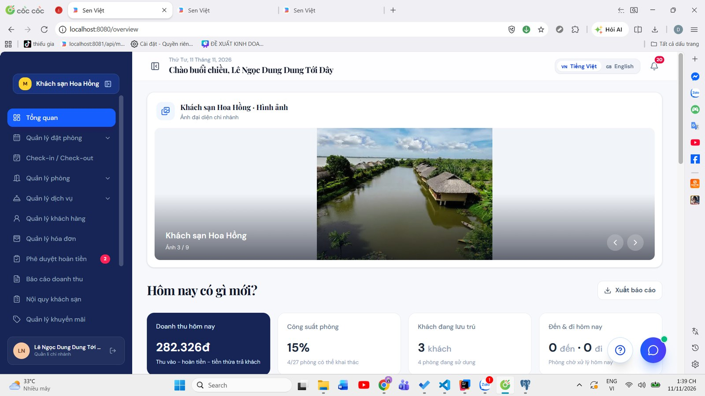<figcaption style="margin-top:4px;font-size:0.82em">Tổng quan chi nhánh</figcaption></figure> <figure style="display:inline-block;vertical-align:top;width:49%;margin:0 0 12px">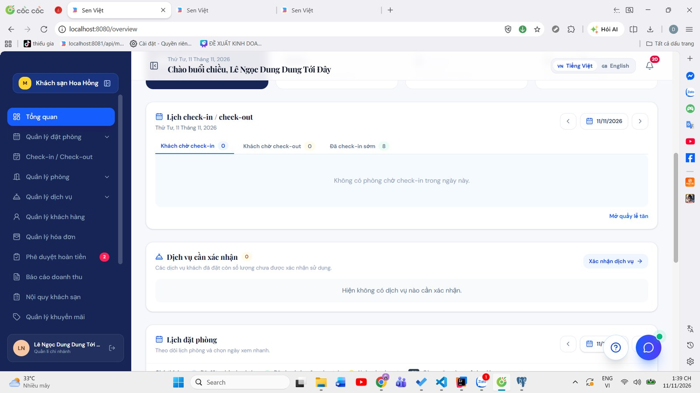<figcaption style="margin-top:4px;font-size:0.82em">Lịch nhận phòng, trả phòng</figcaption></figure>
<figure style="display:inline-block;vertical-align:top;width:49%;margin:0 0 12px">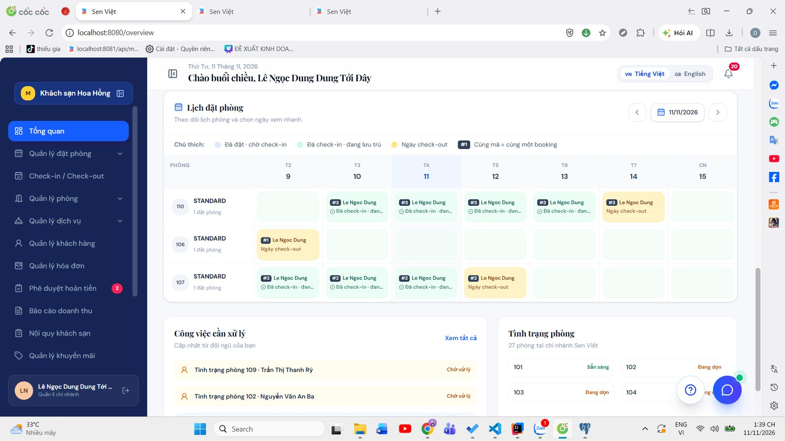<figcaption style="margin-top:4px;font-size:0.82em">Dịch vụ chờ xác nhận</figcaption></figure>

### Báo cáo doanh thu

**Giao diện thao tác:** Thanh bên → **Báo cáo doanh thu**. Chọn kỳ báo cáo ở bộ lọc đầu trang, sau đó xem từng tab/bảng thống kê.

1. Mở **Báo cáo doanh thu** và chọn khoảng ngày trước khi xem số liệu.
2. Xem các phần tổng quan, phòng, dịch vụ, khuyến mãi, trạng thái booking và booking bị hủy.
3. Dùng tab/bộ lọc để xem từng nhóm. Nếu khoảng ngày chưa đúng hoặc dữ liệu đang tải, hãy chỉnh lại hoặc tải lại trước khi xuất/chia sẻ.
4. Đối chiếu chênh lệch với booking và hóa đơn gốc; không coi báo cáo trống hoặc lỗi là số 0.

<figure style="display:inline-block;vertical-align:top;width:49%;margin:0 0 12px">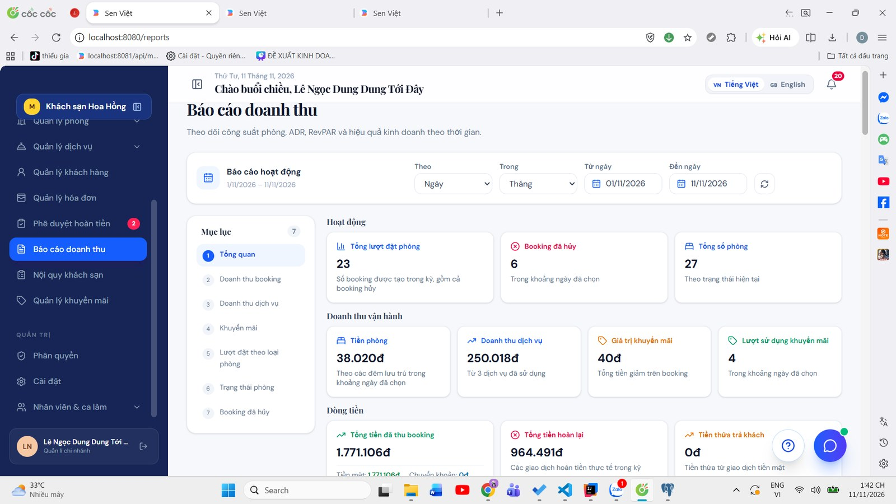<figcaption style="margin-top:4px;font-size:0.82em">Màn hình 01 – Báo cáo doanh thu</figcaption></figure> <figure style="display:inline-block;vertical-align:top;width:49%;margin:0 0 12px">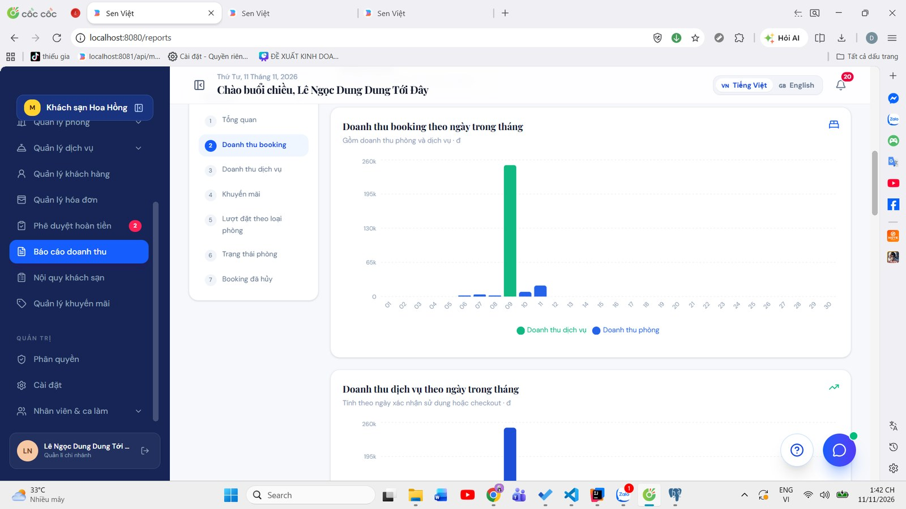<figcaption style="margin-top:4px;font-size:0.82em">Màn hình 02 – Báo cáo doanh thu</figcaption></figure>
<figure style="display:inline-block;vertical-align:top;width:49%;margin:0 0 12px">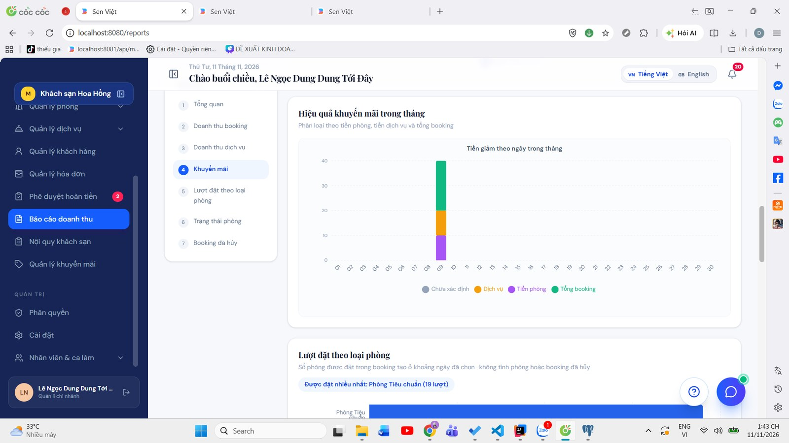<figcaption style="margin-top:4px;font-size:0.82em">Màn hình 03 – Báo cáo doanh thu</figcaption></figure> <figure style="display:inline-block;vertical-align:top;width:49%;margin:0 0 12px">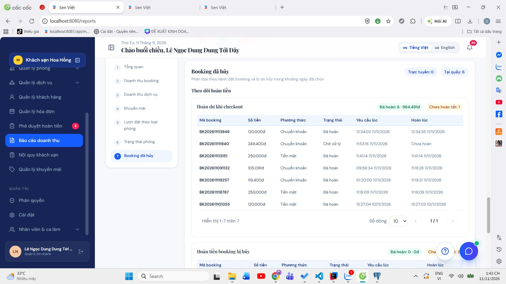<figcaption style="margin-top:4px;font-size:0.82em">Màn hình 04 – Báo cáo doanh thu</figcaption></figure>

## 3. Tạo và tra cứu booking

### Tạo booking

**Giao diện thao tác:** **Quản lý đặt phòng → Đặt phòng** → **Đặt phòng mới**. Các bước trên cùng biểu mẫu lần lượt là **Ngày & phòng → Thông tin đặt phòng → Dịch vụ → Khuyến mãi/tổng kết**.

1. Mở **Quản lý đặt phòng → Đặt phòng**, chọn **Đặt phòng mới**.
2. Ở bước ngày và phòng, chọn ngày nhận phòng rồi ngày trả phòng. Kiểm tra số đêm và chú giải lịch để phân biệt phòng còn trống với phòng không thể chọn.
3. Tìm/lọc theo loại phòng, tầng hoặc tòa nhà. Chọn các ô phòng còn trống; bấm lại ô đã chọn để bỏ. Với booking nhiều phòng, kiểm tra từng phòng và ngày trước khi tiếp tục.
4. Tìm khách đã có hoặc nhập thông tin theo biểu mẫu. Kiểm tra hồ sơ khách được chọn, thông tin liên hệ, số người mỗi phòng, sức chứa và phụ thu hiển thị.
5. Chọn dịch vụ cho tất cả phòng hoặc cấu hình riêng từng phòng. Kiểm tra đơn vị, số lượng, phòng áp dụng và chi phí dự kiến. Không chọn dịch vụ khách không yêu cầu.
6. Tìm hoặc nhập mã khuyến mãi. Mở chi tiết để kiểm tra phạm vi áp dụng, giá trị tối thiểu, thời hạn và trạng thái trước khi chọn.
7. Rà soát khách, phòng, ngày ở, dịch vụ, khuyến mãi và tổng tiền. Chỉ gửi một lần, chờ thông báo thành công và ghi lại mã booking.

<figure style="display:inline-block;vertical-align:top;width:49%;margin:0 0 12px">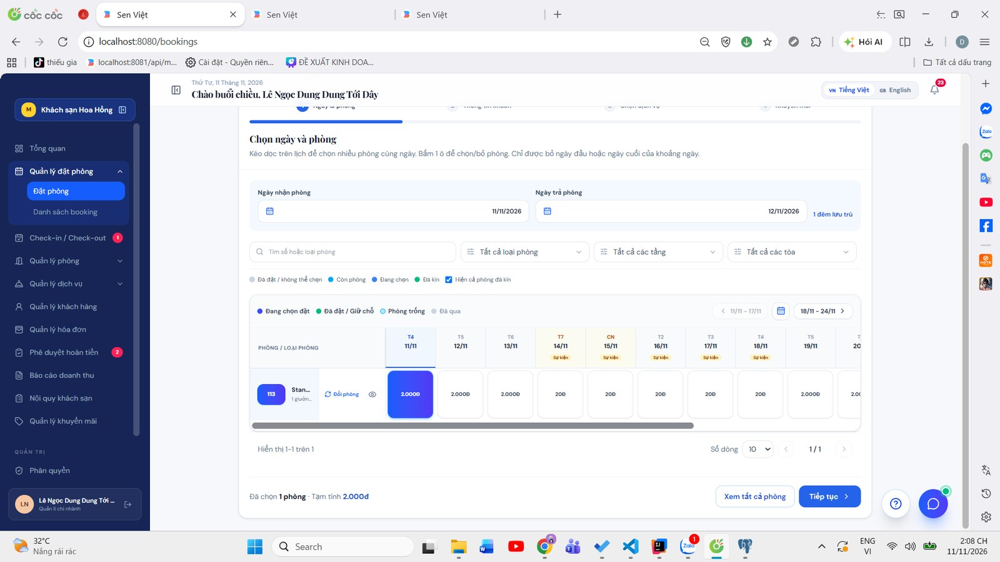<figcaption style="margin-top:4px;font-size:0.82em">Màn hình 01 – Tạo booking</figcaption></figure> <figure style="display:inline-block;vertical-align:top;width:49%;margin:0 0 12px">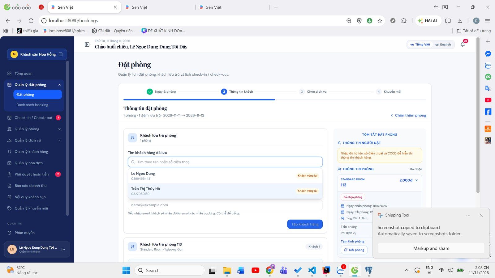<figcaption style="margin-top:4px;font-size:0.82em">Màn hình 02 – Tạo booking</figcaption></figure>
<figure style="display:inline-block;vertical-align:top;width:49%;margin:0 0 12px">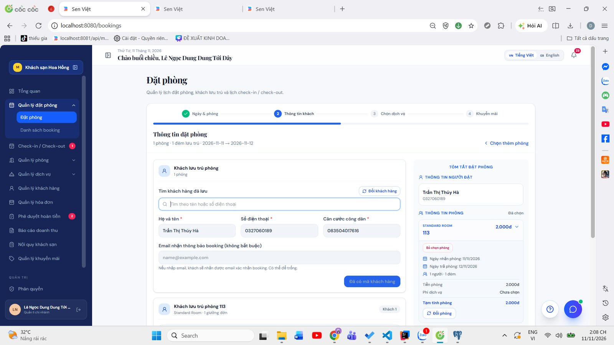<figcaption style="margin-top:4px;font-size:0.82em">Màn hình 03 – Tạo booking</figcaption></figure> <figure style="display:inline-block;vertical-align:top;width:49%;margin:0 0 12px">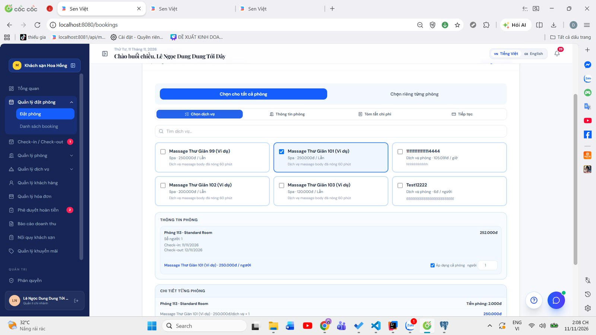<figcaption style="margin-top:4px;font-size:0.82em">Màn hình 04 – Tạo booking</figcaption></figure>
<figure style="display:inline-block;vertical-align:top;width:49%;margin:0 0 12px">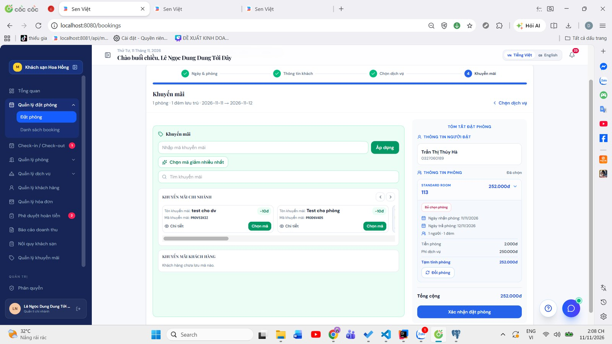<figcaption style="margin-top:4px;font-size:0.82em">Màn hình 05 – Tạo booking</figcaption></figure> <figure style="display:inline-block;vertical-align:top;width:49%;margin:0 0 12px">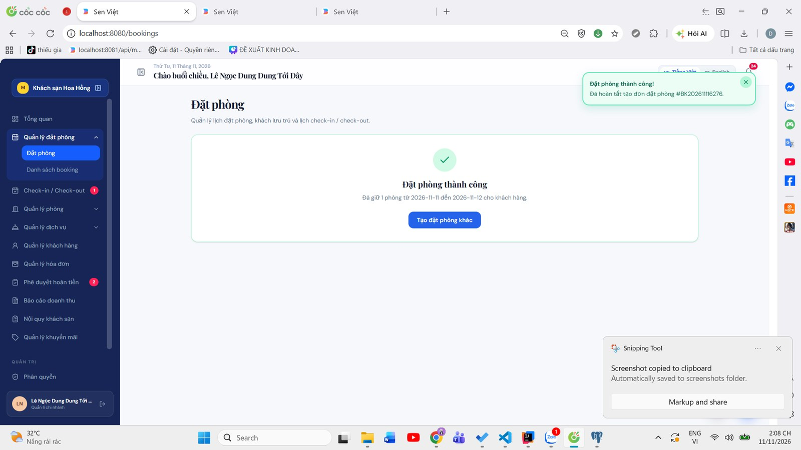<figcaption style="margin-top:4px;font-size:0.82em">Màn hình 06 – Tạo booking</figcaption></figure>

### Tra cứu và xem booking

**Giao diện thao tác:** **Quản lý đặt phòng → Danh sách booking**. Tìm booking ở bảng danh sách, chọn dòng/thao tác chi tiết để mở hồ sơ và lịch sử thanh toán.

1. Mở **Quản lý đặt phòng → Danh sách booking**. Tìm kiếm và lọc theo các trường ngày, khách, booking hoặc trạng thái có trên màn hình.
2. Kiểm tra mã booking, khách, ngày ở, phòng, trạng thái thanh toán và tổng tiền trước khi mở/chỉnh sửa.
3. Dùng chi tiết booking và lịch sử thanh toán để đối chiếu số tiền. Chỉ chỉnh sửa khi trạng thái booking cho phép.
4. Sau khi lưu, mở lại hoặc tải lại hồ sơ để xác nhận trạng thái và thông tin mới.

<figure style="display:inline-block;vertical-align:top;width:49%;margin:0 0 12px">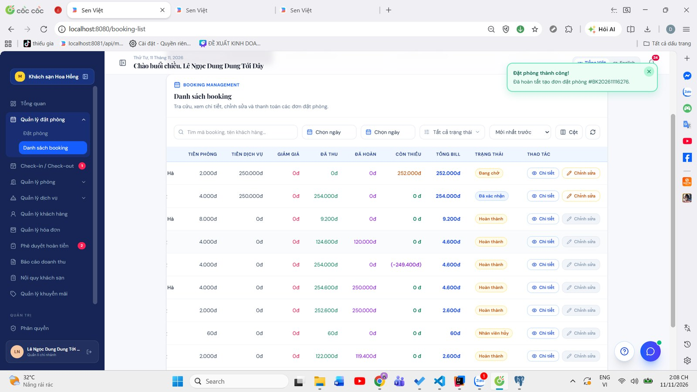<figcaption style="margin-top:4px;font-size:0.82em">Màn hình 01 – Danh sách booking</figcaption></figure> <figure style="display:inline-block;vertical-align:top;width:49%;margin:0 0 12px">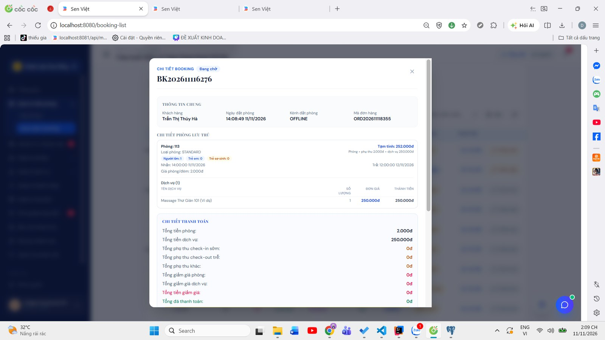<figcaption style="margin-top:4px;font-size:0.82em">Màn hình 02 – Danh sách booking</figcaption></figure>
<figure style="display:inline-block;vertical-align:top;width:49%;margin:0 0 12px">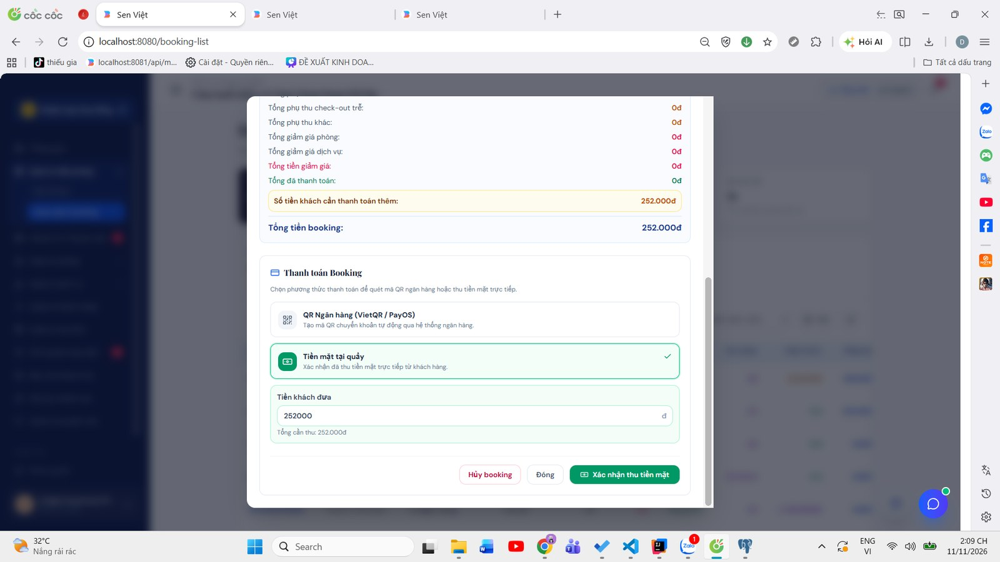<figcaption style="margin-top:4px;font-size:0.82em">Màn hình 03 – Danh sách booking</figcaption></figure> <figure style="display:inline-block;vertical-align:top;width:49%;margin:0 0 12px">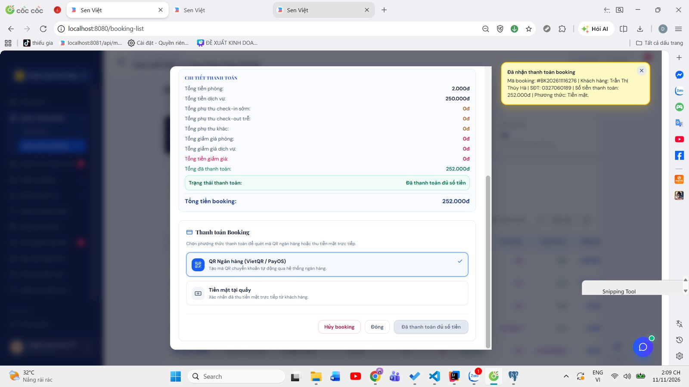<figcaption style="margin-top:4px;font-size:0.82em">Màn hình 04 – Danh sách booking</figcaption></figure>

## 4. Chỉnh sửa booking và thêm dịch vụ

Dùng luồng này khi khách muốn đặt thêm dịch vụ cho booking hiện có. Đây là thao tác khác với thêm dịch vụ mới vào danh mục khách sạn.

**Giao diện thao tác:** **Quản lý đặt phòng → Danh sách booking** → chọn booking → **Chỉnh sửa**. Trong biểu mẫu chỉnh sửa, dùng mục **Thêm dịch vụ phát sinh cho các phòng đang chọn**; nút **Cập nhật** lưu thay đổi booking.

1. Trong **Danh sách booking**, tìm đúng booking và mở thao tác chỉnh sửa. Xác nhận mã booking và khách trước khi thay đổi.
2. Kiểm tra các phòng và dịch vụ hiện tại. Phần chọn dịch vụ mới áp dụng cho phòng còn hoạt động; không thể thêm dịch vụ cho phòng đã hủy/không còn hoạt động.
3. Ở mục **Thêm dịch vụ phát sinh cho các phòng đang chọn**, mở đúng phòng, chọn dịch vụ khách yêu cầu, nhập số lượng và kiểm tra đơn vị/giá hiển thị.
4. Lặp lại cho từng phòng cần thêm. Không chọn dịch vụ cho mọi phòng nếu khách chỉ yêu cầu ở một số phòng.
5. Rà soát số lượng cũ và lựa chọn mới. Bỏ chọn dịch vụ nhầm, xác nhận lại phòng và số lượng.
6. Chọn **Cập nhật** một lần, chờ kết quả lưu rồi mở lại booking để kiểm tra dịch vụ và số lượng đã ghi nhận.
7. Giải thích khoản phí phát sinh cho khách và kiểm tra hóa đơn/số dư mới theo quy trình của chi nhánh.

<figure style="display:inline-block;vertical-align:top;width:49%;margin:0 0 12px">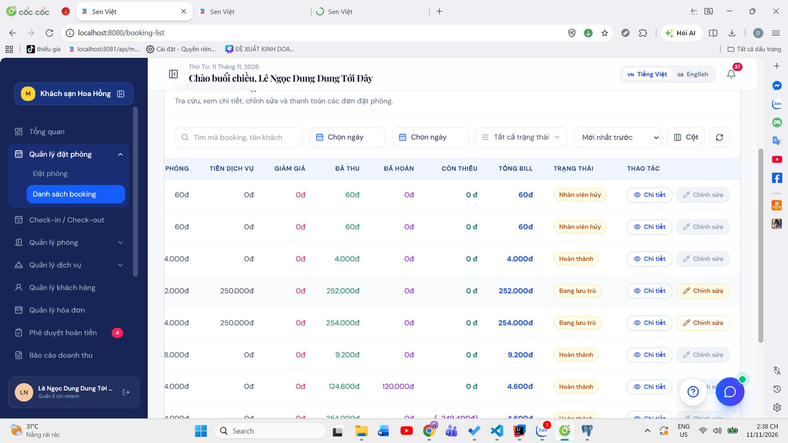<figcaption style="margin-top:4px;font-size:0.82em">Danh sách booking trước khi chỉnh sửa</figcaption></figure> <figure style="display:inline-block;vertical-align:top;width:49%;margin:0 0 12px">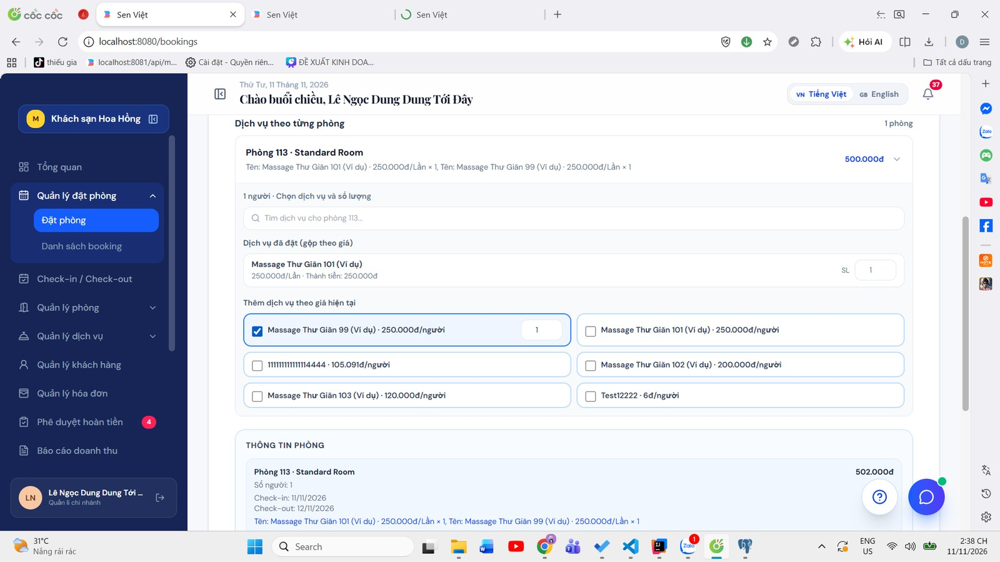<figcaption style="margin-top:4px;font-size:0.82em">Chọn dịch vụ bổ sung cho từng phòng</figcaption></figure>
<figure style="display:inline-block;vertical-align:top;width:49%;margin:0 0 12px">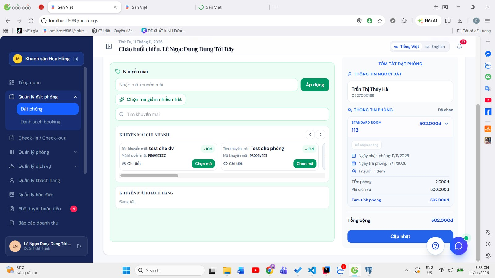<figcaption style="margin-top:4px;font-size:0.82em">Kiểm tra tổng tiền dịch vụ</figcaption></figure> <figure style="display:inline-block;vertical-align:top;width:49%;margin:0 0 12px">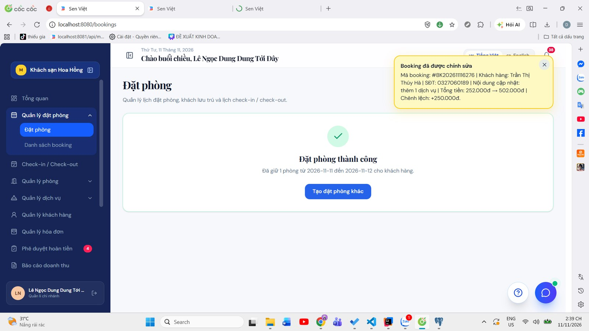<figcaption style="margin-top:4px;font-size:0.82em">Booking đã được cập nhật</figcaption></figure>

## 5. Hủy booking và hoàn tiền cho khách

Hủy booking làm thay đổi trạng thái đặt phòng và có thể phát sinh hoàn tiền. Kiểm tra chính sách khách sạn và khoản khách đã thanh toán trước khi xác nhận.

**Giao diện thao tác:** **Quản lý đặt phòng → Danh sách booking** → **Hủy booking** mở hộp thoại hủy. Xem tiền hoàn ở bước **Xem trước**, chọn tiền mặt/chuyển khoản ở phần **Phương thức hoàn tiền**, rồi nhập lý do/email và xác nhận trong cùng hộp thoại. Thông tin ngân hàng có thể nhập tại đây hoặc bổ sung trong **Phê duyệt hoàn tiền**.

1. Trong **Danh sách booking**, tìm và xác nhận đúng booking. Thao tác nhân viên hủy chỉ khả dụng với booking ở trạng thái **Đang chờ** hoặc **Đã xác nhận**.
2. Chọn **Hủy booking**. Chờ hệ thống xem trước khoản hoàn dựa trên số tiền đã thanh toán và chính sách hủy.
3. Đối chiếu tiền đã thanh toán, tiền phòng, tiền phạt phòng, tiền phòng được hoàn, tiền dịch vụ được hoàn, tổng hoàn, mốc chính sách và số giờ còn lại đến giờ nhận phòng. Nếu xem trước lỗi hoặc không có dữ liệu, hãy thử lại; không xác nhận hủy khi chưa có số tiền chính xác.
4. Các mốc phạt tiền phòng trong phần xem trước:
   - Hủy trước giờ nhận phòng từ 72 giờ trở lên: không phạt tiền phòng.
   - Hủy trước từ 24 đến dưới 72 giờ: phạt 50% khoản thanh toán tiền phòng được phân bổ.
   - Hủy dưới 24 giờ hoặc khách không đến: phạt 100% khoản thanh toán tiền phòng được phân bổ.
   - Tiền dịch vụ được hoàn theo phần thanh toán đã phân bổ; khoản phạt chỉ trừ vào tiền phòng.
5. Chọn phương thức hoàn:
   - **Tiền mặt tại khách sạn:** giao đúng số tiền hiển thị cho khách, sau đó tích xác nhận đã giao tiền. Hệ thống ghi nhận hoàn tiền mặt ngay khi xác nhận hủy.
   - **Chuyển khoản vào tài khoản:** chọn ngân hàng, nhập tên chủ tài khoản và số tài khoản nếu đã có thông tin. Thông tin ngân hàng có thể để trống lúc hủy và bổ sung sau ở **Phê duyệt hoàn tiền**. Nếu nhập, điền đủ trường bắt buộc; số tài khoản phải có 6–50 chữ số. Khoản hoàn chuyển khoản cần quản lý duyệt và nhân viên thực hiện chuyển.
6. Có thể nhập lý do hủy và email thông báo cho khách. Kiểm tra chính tả email nếu có nhập.
7. Xác nhận hủy một lần. Kiểm tra thông báo thành công cùng trạng thái booking/hoàn tiền mới. Booking đã hủy chưa đồng nghĩa tiền chuyển khoản đã được gửi; tiếp tục theo luồng phê duyệt ở mục 12.

<figure style="display:inline-block;vertical-align:top;width:49%;margin:0 0 12px">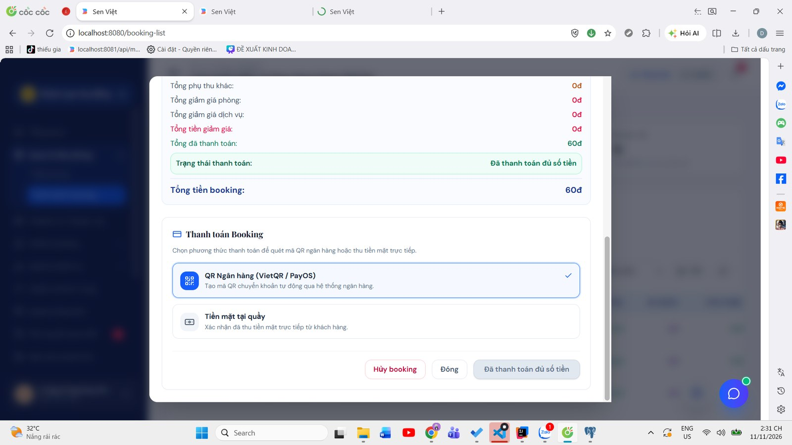<figcaption style="margin-top:4px;font-size:0.82em">Xem trước tiền hoàn và chi tiết thanh toán</figcaption></figure> <figure style="display:inline-block;vertical-align:top;width:49%;margin:0 0 12px">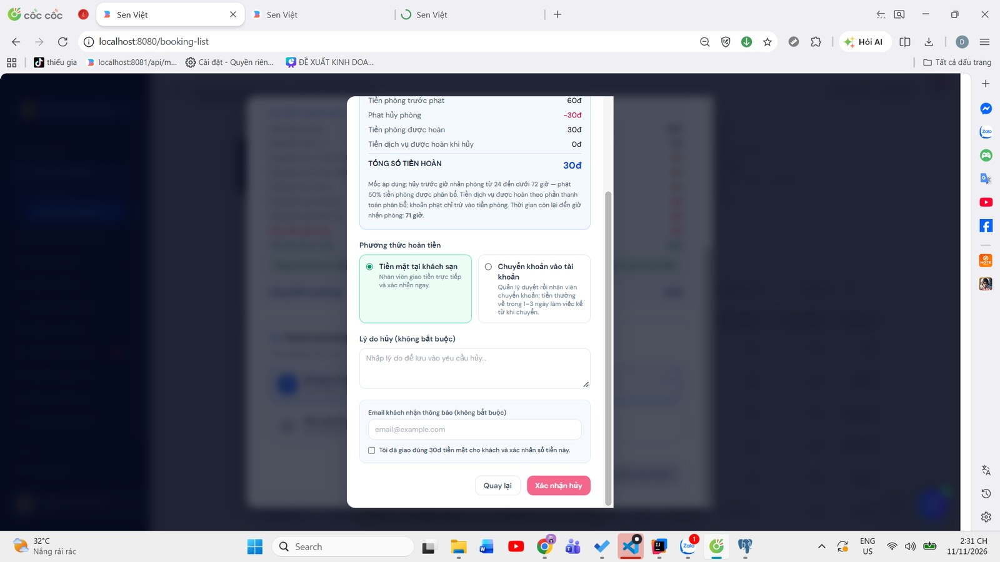<figcaption style="margin-top:4px;font-size:0.82em">Chọn hoàn tiền mặt hoặc chuyển khoản</figcaption></figure>
<figure style="display:inline-block;vertical-align:top;width:49%;margin:0 0 12px">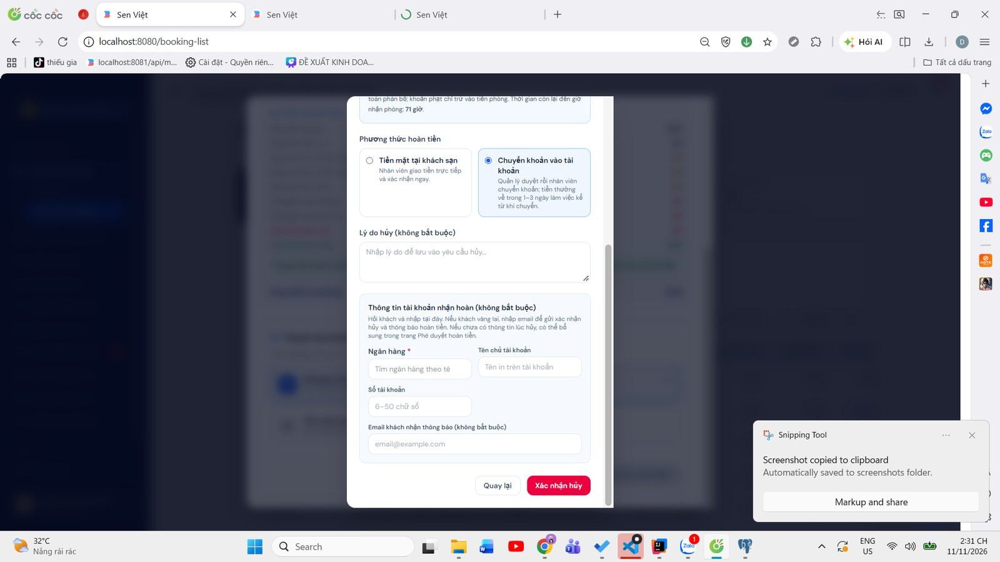<figcaption style="margin-top:4px;font-size:0.82em">Kiểm tra điều kiện hủy</figcaption></figure> <figure style="display:inline-block;vertical-align:top;width:49%;margin:0 0 12px">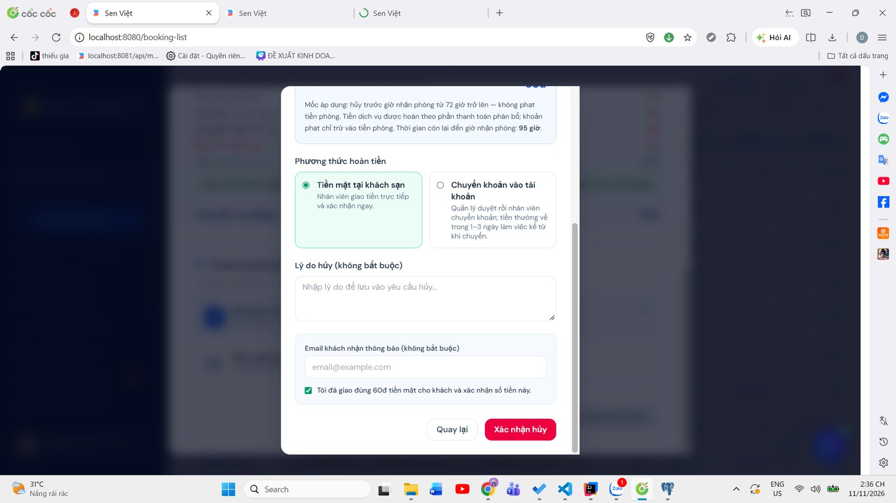<figcaption style="margin-top:4px;font-size:0.82em">Nhập thông tin tài khoản ngân hàng</figcaption></figure>
<figure style="display:inline-block;vertical-align:top;width:49%;margin:0 0 12px">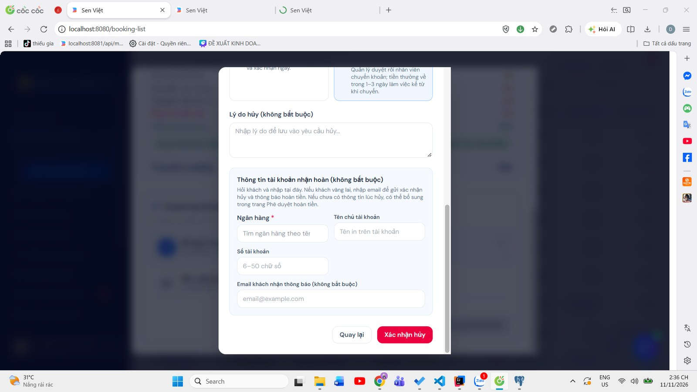<figcaption style="margin-top:4px;font-size:0.82em">Kiểm tra thông tin hủy booking</figcaption></figure> <figure style="display:inline-block;vertical-align:top;width:49%;margin:0 0 12px">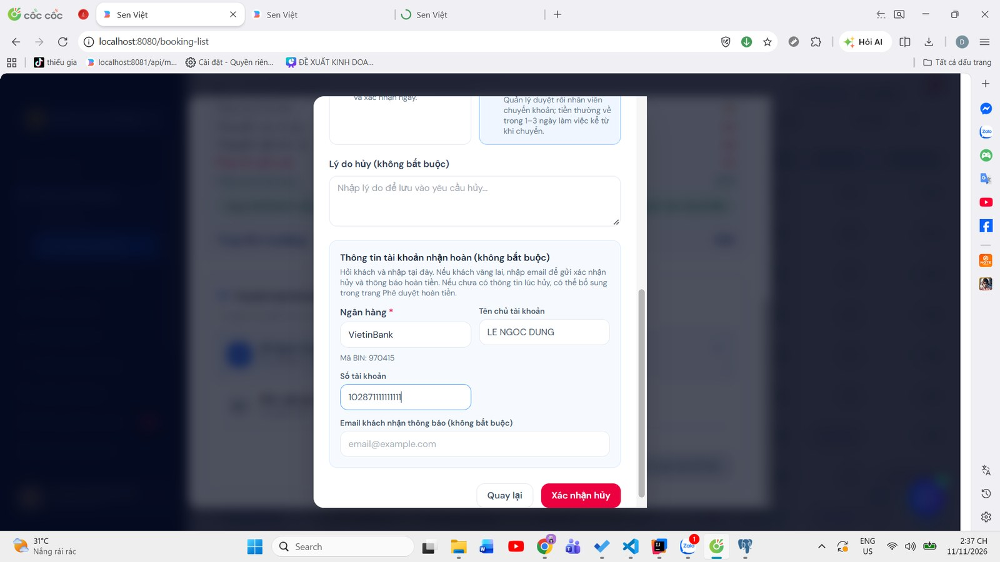<figcaption style="margin-top:4px;font-size:0.82em">Kết quả hủy booking</figcaption></figure>
<figure style="display:inline-block;vertical-align:top;width:49%;margin:0 0 12px">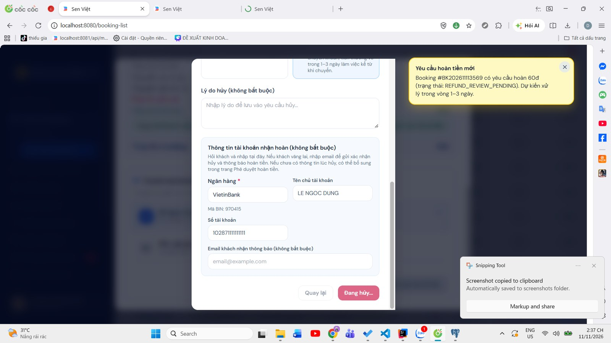<figcaption style="margin-top:4px;font-size:0.82em">Màn hình bổ sung về hủy và hoàn tiền</figcaption></figure> <figure style="display:inline-block;vertical-align:top;width:49%;margin:0 0 12px">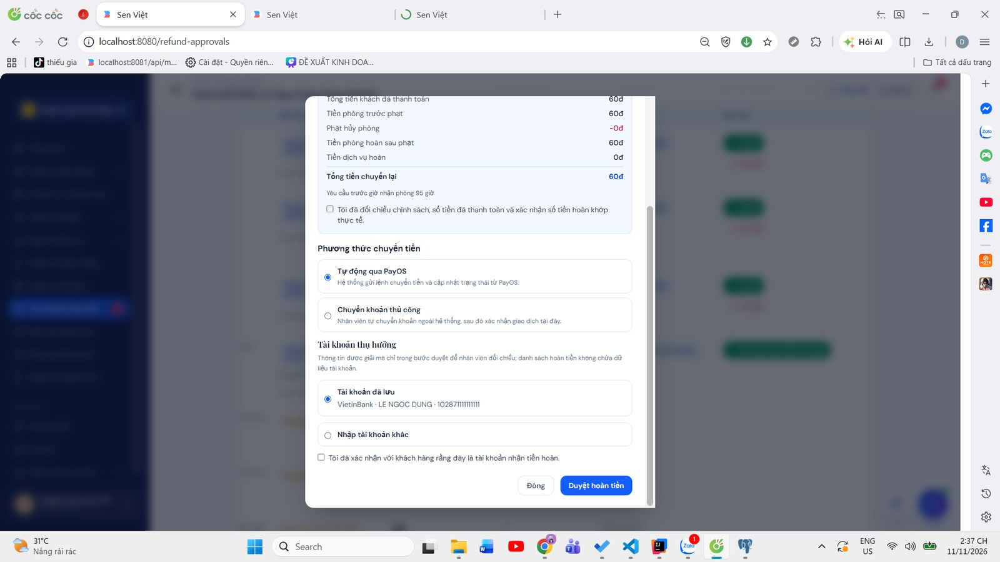<figcaption style="margin-top:4px;font-size:0.82em">Màn hình 08 – Hủy booking</figcaption></figure>

## 6. Check-in, check-out và hoàn tiền dư

**Giao diện thao tác:** Thanh bên → **Check-in / Check-out**. Chọn tab nhận phòng hoặc trả phòng, mở booking để rà soát từng phòng; chọn phương thức hoàn dư trong biểu mẫu xác nhận trả phòng. Với thao tác nhóm, dùng các ô chọn trên danh sách.

1. Mở **Check-in / Check-out**, chọn đúng ngày và tab nhận phòng hoặc trả phòng, sau đó tìm booking.
2. Mở booking và xác nhận mã, khách, phòng, thời gian lưu trú, số người, tình trạng thanh toán và khoản phụ thu đến sớm/trả muộn nếu có.
3. Khi nhận phòng, thông báo khoản phí đến sớm nếu có; kiểm tra phòng và thông tin thanh toán trước khi hoàn tất.
4. Khi trả phòng, kiểm tra từng phòng và dịch vụ theo thực tế. Không xác nhận dịch vụ chưa dùng. Kiểm tra khoản trả muộn và số tiền cuối cùng.
5. Nếu cần hoàn khoản thu dư, chọn **Tiền mặt** hoặc **Chuyển khoản** trong phần phương thức hoàn:
   - Với tiền mặt, giao lại tiền cho khách tại quầy và xác nhận đã giao.
   - Với chuyển khoản, chọn ngân hàng và nhập tên chủ tài khoản, số tài khoản. Các trường này bắt buộc trong luồng hoàn dư khi check-out; xác minh với khách trước khi tiếp tục.
6. Kiểm tra lại số tiền hoàn và các phòng/booking được chọn rồi hoàn tất check-out một lần. Hoàn chuyển khoản vẫn cần quản lý duyệt và xử lý ở mục **Phê duyệt hoàn tiền**.
7. Với check-out nhóm/hàng loạt, kiểm tra từng phòng được chọn. Thao tác hàng loạt tác động lên các dòng đã chọn; bỏ các lựa chọn không liên quan trước khi xác nhận.

<figure style="display:inline-block;vertical-align:top;width:49%;margin:0 0 12px">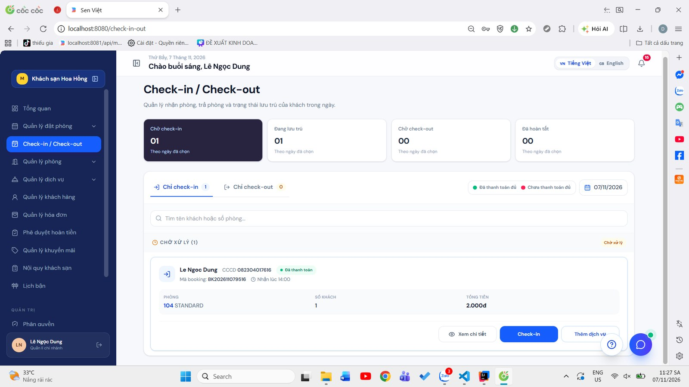<figcaption style="margin-top:4px;font-size:0.82em">Màn hình 01 – Check-in và check-out</figcaption></figure> <figure style="display:inline-block;vertical-align:top;width:49%;margin:0 0 12px"><figcaption style="margin-top:4px;font-size:0.82em">Màn hình 02 – Check-in và check-out</figcaption></figure>
<figure style="display:inline-block;vertical-align:top;width:49%;margin:0 0 12px"><figcaption style="margin-top:4px;font-size:0.82em">Màn hình 03 – Check-in và check-out</figcaption></figure> <figure style="display:inline-block;vertical-align:top;width:49%;margin:0 0 12px">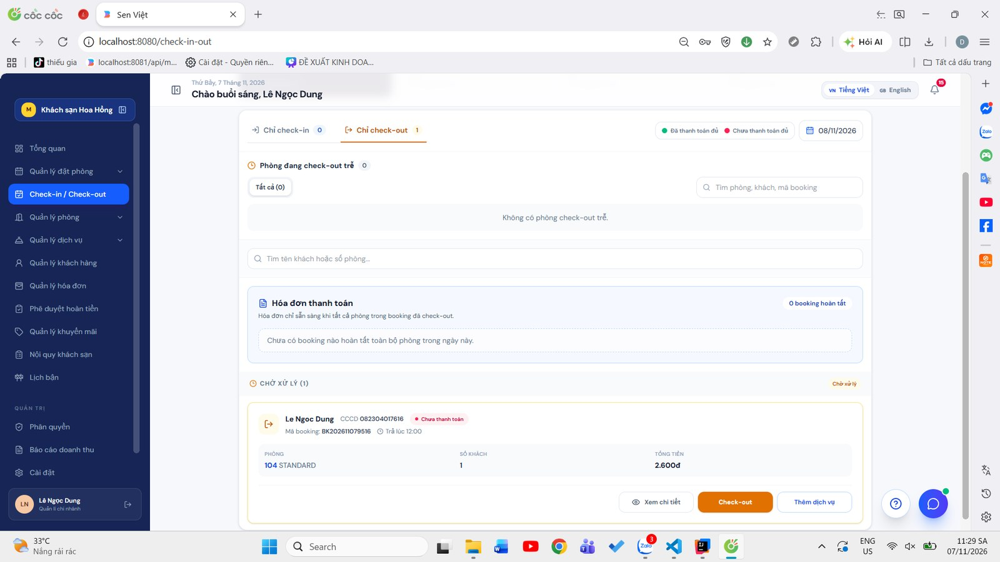<figcaption style="margin-top:4px;font-size:0.82em">Màn hình 04 – Check-in và check-out</figcaption></figure>
<figure style="display:inline-block;vertical-align:top;width:49%;margin:0 0 12px">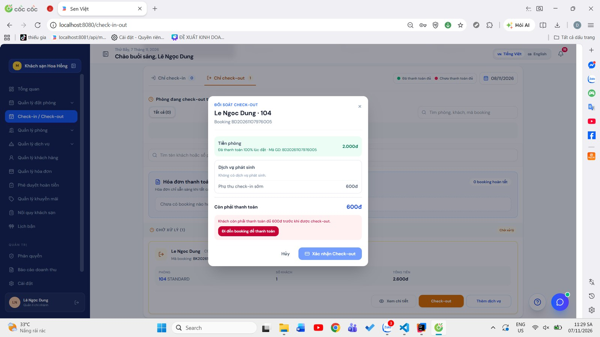<figcaption style="margin-top:4px;font-size:0.82em">Màn hình 05 – Check-in và check-out</figcaption></figure> <figure style="display:inline-block;vertical-align:top;width:49%;margin:0 0 12px"><figcaption style="margin-top:4px;font-size:0.82em">Màn hình 06 – Check-in và check-out</figcaption></figure>
<figure style="display:inline-block;vertical-align:top;width:49%;margin:0 0 12px"><figcaption style="margin-top:4px;font-size:0.82em">Màn hình 07 – Check-in và check-out</figcaption></figure>

## 7. Phòng, giá, tòa nhà, tầng và nội quy

### Danh sách phòng và chi tiết phòng

**Giao diện thao tác:** **Quản lý phòng → Quản lý danh sách phòng**. Bảng phòng và bộ lọc dùng để tra cứu; chọn dòng hoặc nút thêm/sửa để mở chi tiết phòng.

1. Mở **Quản lý phòng → Quản lý danh sách phòng**. Tìm/lọc theo phòng, loại, tầng, tòa nhà và trạng thái.
2. Mở đúng phòng để xem thông tin, sức chứa, tiện nghi, hình ảnh và trạng thái.
3. Chỉ thêm/chỉnh sửa phòng khi được phân quyền. Kiểm tra số phòng, loại, tòa/tầng và sức chứa trước khi lưu.
4. Chọn trạng thái đúng với tình hình thực tế. Không chuyển phòng sang sẵn sàng trước khi dọn/kiểm tra xong.

<figure style="display:inline-block;vertical-align:top;width:49%;margin:0 0 12px">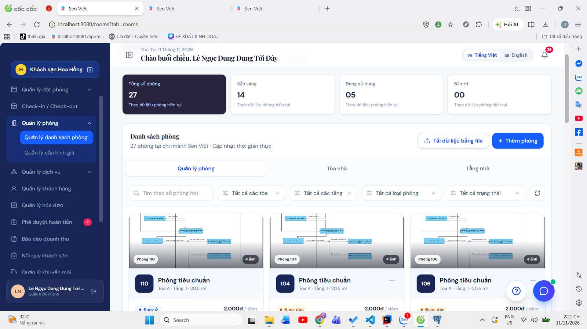<figcaption style="margin-top:4px;font-size:0.82em">Màn hình 01 – Danh sách phòng</figcaption></figure> <figure style="display:inline-block;vertical-align:top;width:49%;margin:0 0 12px">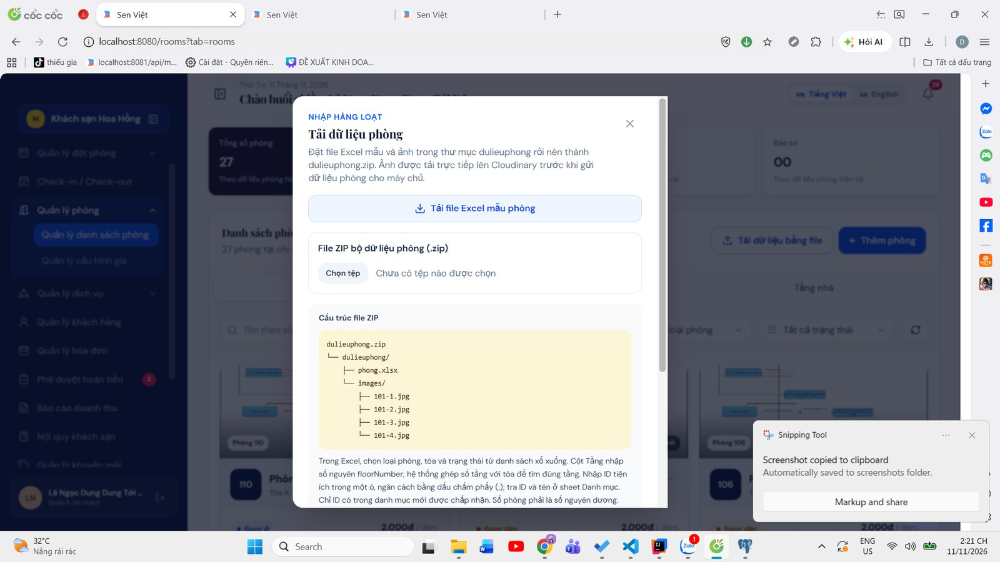<figcaption style="margin-top:4px;font-size:0.82em">Màn hình 02 – Danh sách phòng</figcaption></figure>
<figure style="display:inline-block;vertical-align:top;width:49%;margin:0 0 12px">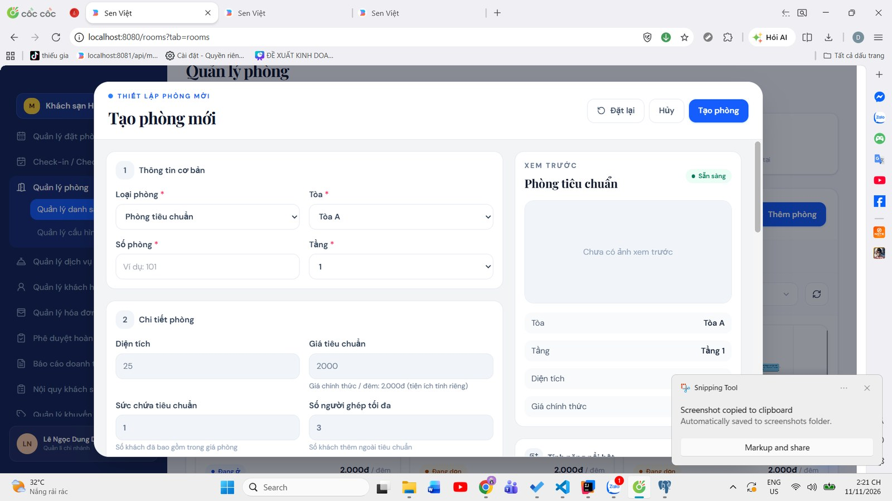<figcaption style="margin-top:4px;font-size:0.82em">Màn hình 03 – Danh sách phòng</figcaption></figure> <figure style="display:inline-block;vertical-align:top;width:49%;margin:0 0 12px">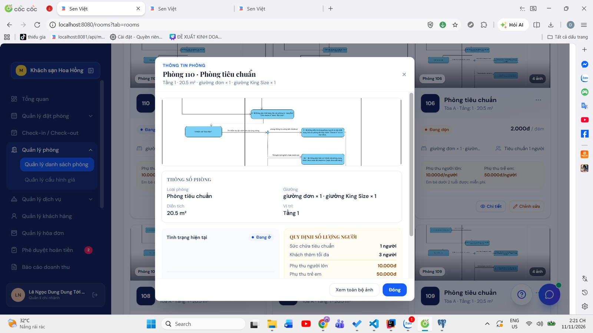<figcaption style="margin-top:4px;font-size:0.82em">Màn hình 04 – Danh sách phòng</figcaption></figure>
<figure style="display:inline-block;vertical-align:top;width:49%;margin:0 0 12px">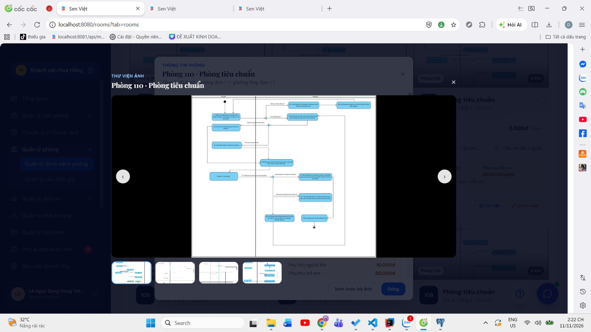<figcaption style="margin-top:4px;font-size:0.82em">Màn hình 05 – Danh sách phòng</figcaption></figure> <figure style="display:inline-block;vertical-align:top;width:49%;margin:0 0 12px">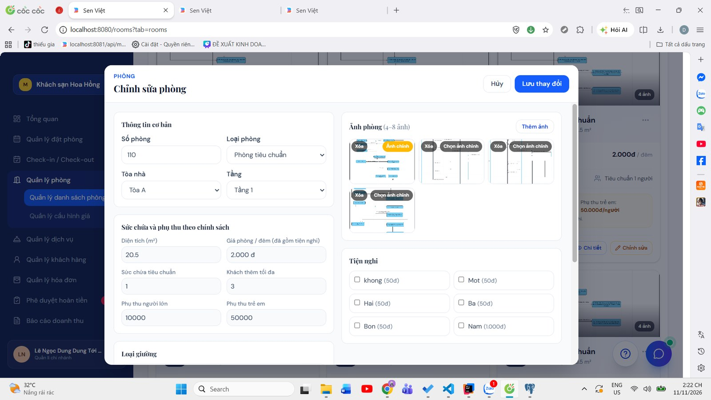<figcaption style="margin-top:4px;font-size:0.82em">Màn hình 06 – Danh sách phòng</figcaption></figure>

### Giá phòng và cấu hình tòa/tầng

**Giá cơ bản**

**Giao diện thao tác:** **Quản lý phòng → Quản lý cấu hình giá → Cấu hình giá theo loại phòng**. Chọn thẻ loại phòng để xem hoặc sửa giá cơ bản.

1. Mở **Quản lý phòng → Quản lý cấu hình giá → Cấu hình giá theo loại phòng**.
2. Chọn đúng loại phòng, kiểm tra giá theo đêm, sức chứa tiêu chuẩn, giới hạn khách ghép và phụ thu người lớn/trẻ em.
3. Chỉ cập nhật giá sau khi đã xác nhận quy định áp dụng; lưu một lần rồi kiểm tra lại thẻ loại phòng.

**Giá theo sự kiện**

**Giao diện thao tác:** Cùng trang **Quản lý cấu hình giá**, chuyển sang tab **Cấu hình giá theo sự kiện** để lọc danh sách hoặc chọn **Tạo sự kiện giá mới** để mở biểu mẫu.

1. Chọn tab **Cấu hình giá theo sự kiện** để xem danh sách quy tắc; dùng tìm kiếm, ngày, trạng thái hoặc loại phòng để lọc.
2. Chọn **Tạo sự kiện giá mới**. Nhập tên sự kiện và ngày bắt đầu/kết thúc chính xác.
3. Trong từng nhóm giá, chọn loại phòng áp dụng và nhập **giá áp dụng (đồng)** cho nhóm đó. Kiểm tra mỗi loại phòng được xếp đúng nhóm theo kế hoạch giá.
4. Chỉ lưu khi tên, khoảng ngày, loại phòng và giá của tất cả nhóm đã đúng. Tìm lại sự kiện trong bảng để kiểm tra trạng thái, thời hạn và giá.

**Tòa nhà và tầng**

**Giao diện thao tác:** **Quản lý phòng → Quản lý danh sách phòng** → tab **Tòa nhà** hoặc **Tầng nhà**. Nút thêm/sửa mở biểu mẫu tương ứng; chức năng nhập Excel/CSV nằm trong tab tầng.

1. Trong **Quản lý danh sách phòng**, mở tab **Tòa nhà** để tìm, thêm hoặc chỉnh sửa tòa. Khi tạo, nhập tên tòa; mã tòa được hệ thống tạo sau khi lưu.
2. Mở tab **Tầng nhà**, chọn đúng tòa rồi thêm tầng bằng số nguyên dương.
3. Nếu nhập từ Excel/CSV, tải mẫu, điền tòa nhà (có thể để trống để dùng tòa đang chọn) và số tầng, rồi chọn file để nhập. Các tầng trùng đã có sẽ được bỏ qua; kiểm tra danh sách sau khi nhập.

<figure style="display:inline-block;vertical-align:top;width:49%;margin:0 0 12px">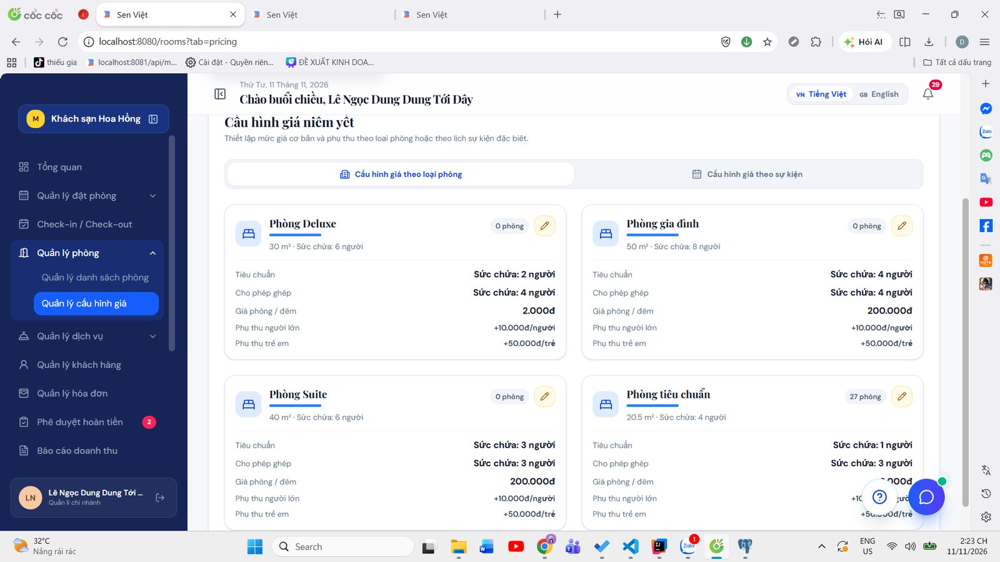<figcaption style="margin-top:4px;font-size:0.82em">Giá cơ bản theo loại phòng</figcaption></figure> <figure style="display:inline-block;vertical-align:top;width:49%;margin:0 0 12px">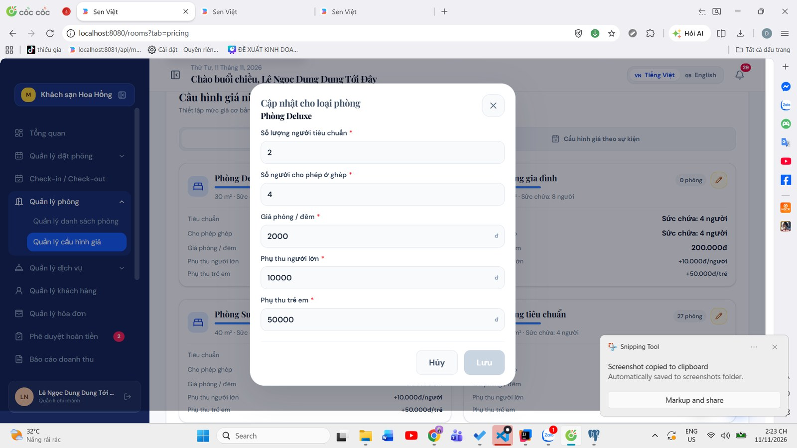<figcaption style="margin-top:4px;font-size:0.82em">Chỉnh sửa giá loại phòng</figcaption></figure>
<figure style="display:inline-block;vertical-align:top;width:49%;margin:0 0 12px">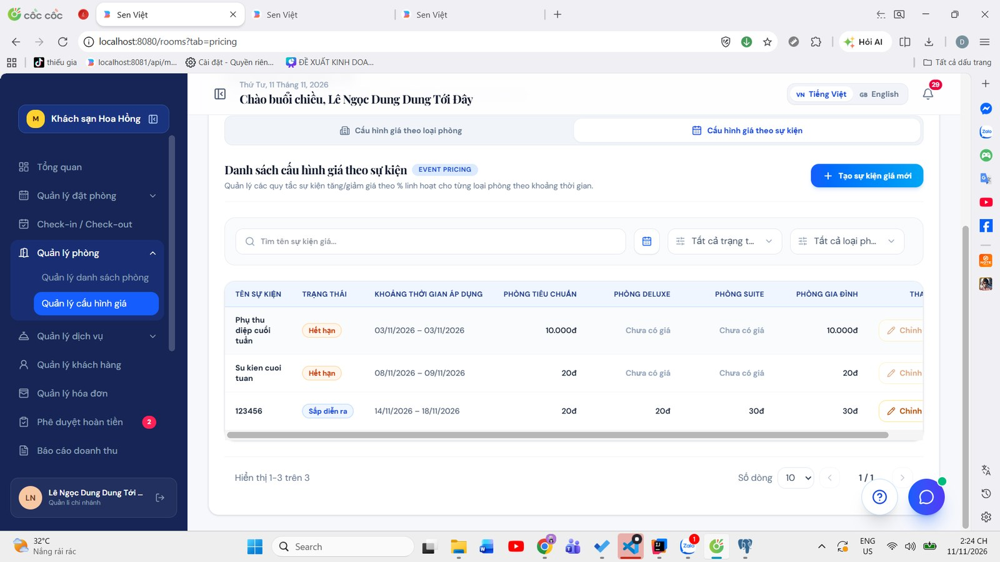<figcaption style="margin-top:4px;font-size:0.82em">Danh sách giá sự kiện</figcaption></figure> <figure style="display:inline-block;vertical-align:top;width:49%;margin:0 0 12px">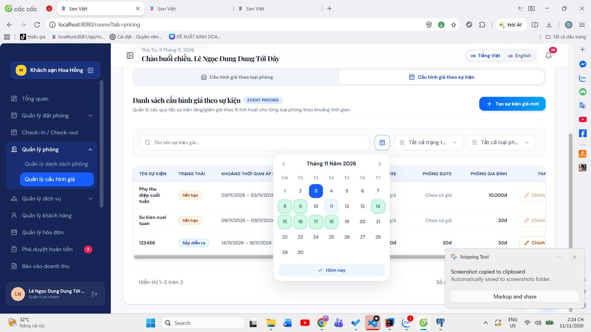<figcaption style="margin-top:4px;font-size:0.82em">Lọc sự kiện theo ngày</figcaption></figure>
<figure style="display:inline-block;vertical-align:top;width:49%;margin:0 0 12px">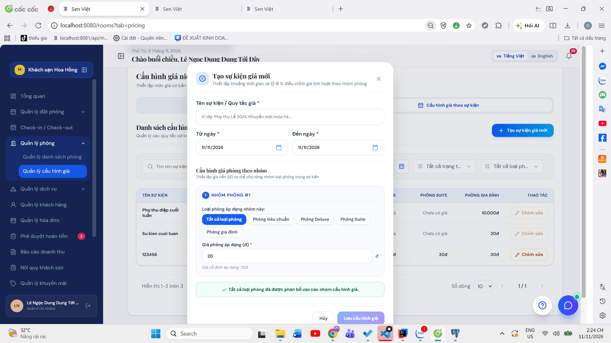<figcaption style="margin-top:4px;font-size:0.82em">Tạo quy tắc giá sự kiện</figcaption></figure>

<figure style="display:inline-block;vertical-align:top;width:49%;margin:0 0 12px">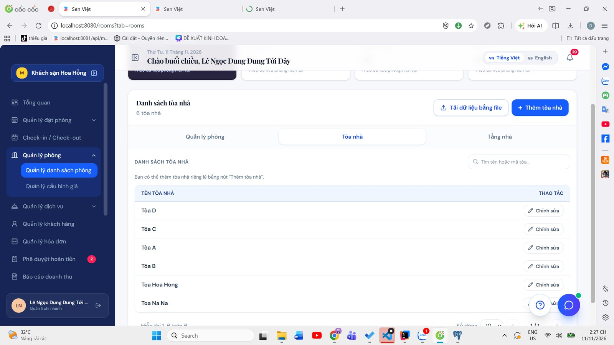<figcaption style="margin-top:4px;font-size:0.82em">Danh sách tòa nhà</figcaption></figure> <figure style="display:inline-block;vertical-align:top;width:49%;margin:0 0 12px">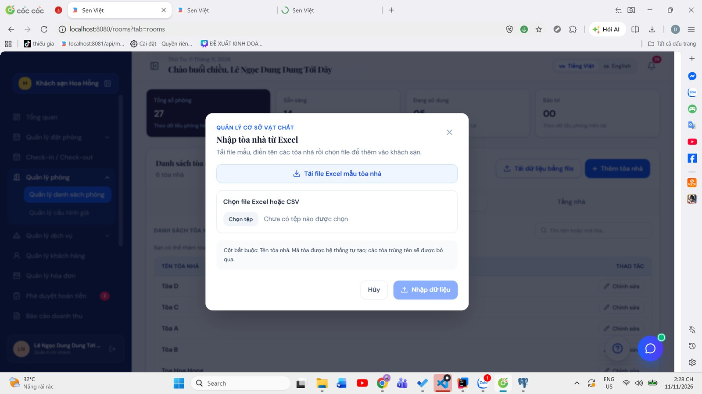<figcaption style="margin-top:4px;font-size:0.82em">Tạo hoặc sửa tòa nhà</figcaption></figure>
<figure style="display:inline-block;vertical-align:top;width:49%;margin:0 0 12px">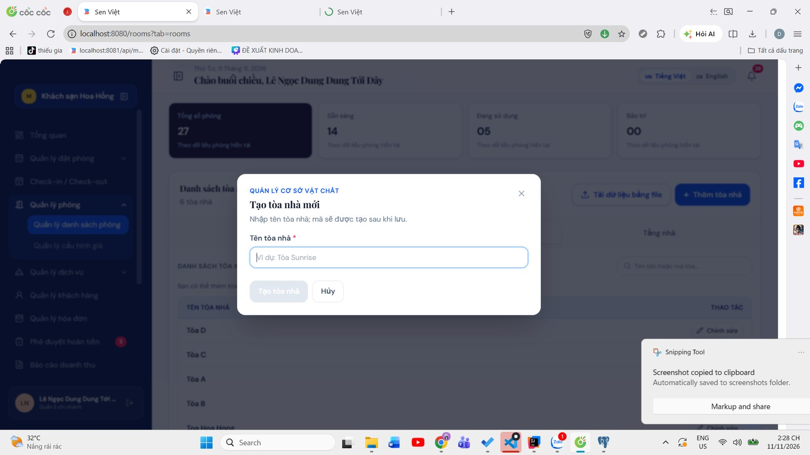<figcaption style="margin-top:4px;font-size:0.82em">Cấu hình tòa nhà</figcaption></figure> <figure style="display:inline-block;vertical-align:top;width:49%;margin:0 0 12px">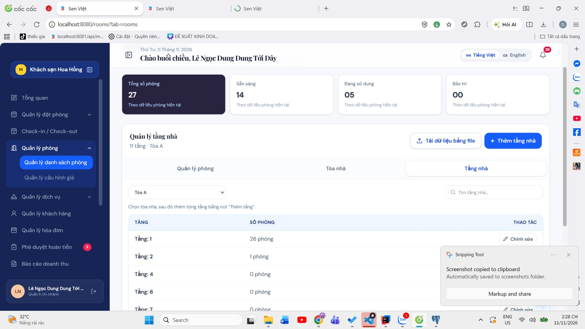<figcaption style="margin-top:4px;font-size:0.82em">Danh sách tầng của tòa đã chọn</figcaption></figure>
<figure style="display:inline-block;vertical-align:top;width:49%;margin:0 0 12px">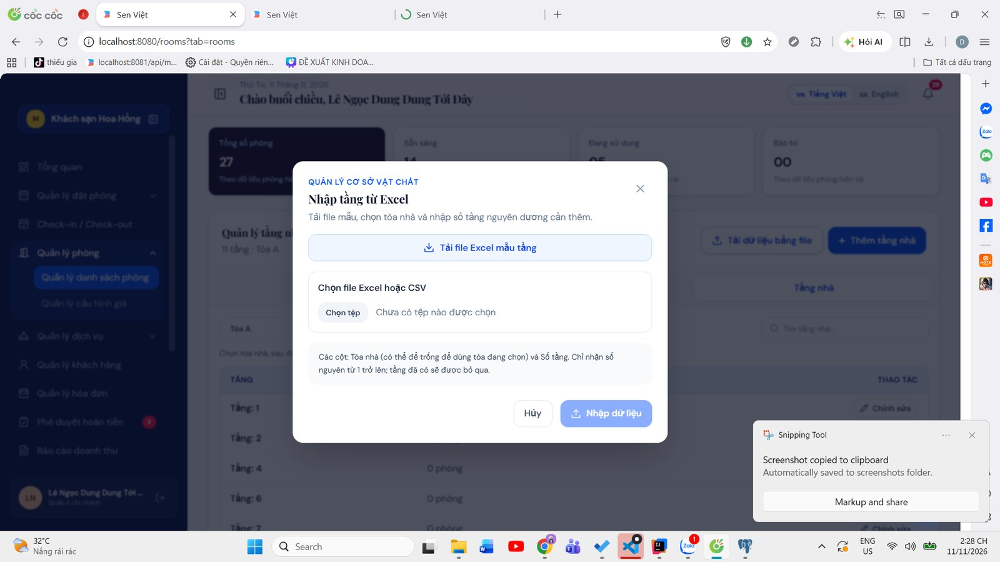<figcaption style="margin-top:4px;font-size:0.82em">Nhập tầng từ Excel/CSV</figcaption></figure> <figure style="display:inline-block;vertical-align:top;width:49%;margin:0 0 12px">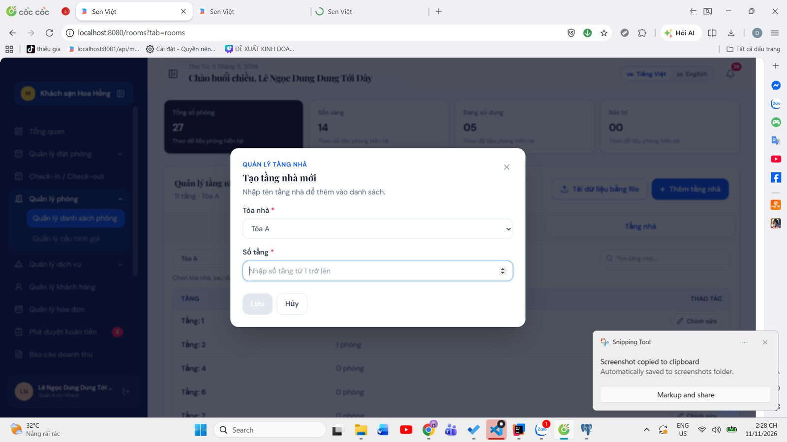<figcaption style="margin-top:4px;font-size:0.82em">Thêm hoặc sửa tầng</figcaption></figure>

### Nội quy khách sạn

**Giao diện thao tác:** Thanh bên → **Nội quy khách sạn**. Đọc các mục giờ nhận/trả phòng, hủy và dịch vụ; đây là trang tra cứu chính sách, không phải nơi hủy booking.

Mở **Nội quy khách sạn** để tra giờ nhận/trả phòng, chính sách hủy và quy định dịch vụ của chi nhánh trước khi tư vấn. Hỏi quản lý nếu có trường hợp ngoại lệ chưa rõ.

<figure style="display:inline-block;vertical-align:top;width:49%;margin:0 0 12px">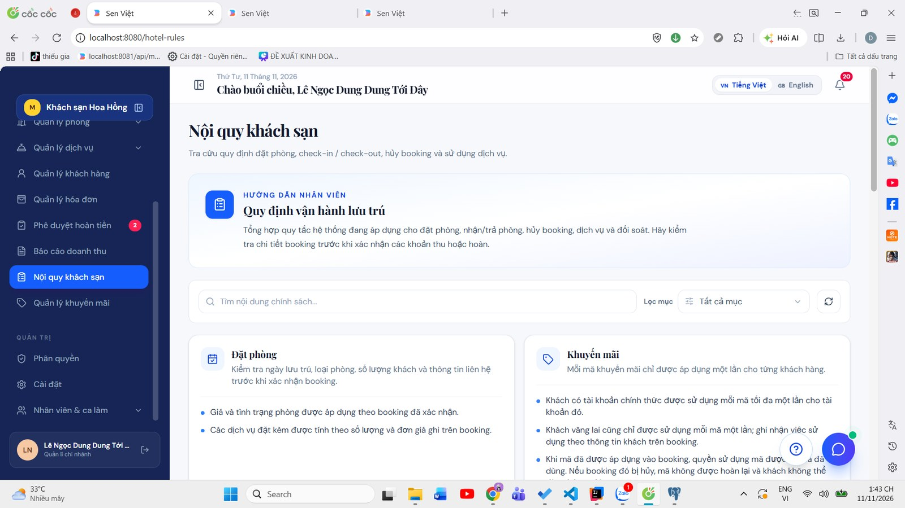<figcaption style="margin-top:4px;font-size:0.82em">Màn hình 01 – Nội quy khách sạn</figcaption></figure>

## 8. Danh mục dịch vụ và xác nhận dịch vụ khách dùng

### Danh mục dịch vụ

**Giao diện thao tác:** **Quản lý dịch vụ → Quản lý danh mục dịch vụ**. Dùng bảng để tìm dịch vụ; nút thêm/sửa mở biểu mẫu thông tin dịch vụ; chức năng nhập hàng loạt nằm trong cùng phân hệ.

1. Mở **Quản lý dịch vụ → Quản lý danh mục dịch vụ**. Tìm/lọc danh sách và kiểm tra tên, danh mục, giá, đơn vị, ảnh và trạng thái hoạt động.
2. Mở chi tiết để xem mô tả. Quản lý được phân quyền có thể thêm/sửa; tài khoản nhân viên có thể chỉ được xem.
3. Khi thêm dịch vụ, điền tên, giá, đơn vị, danh mục, ảnh và mô tả bắt buộc. Xem lại thông tin rồi lưu một lần.
4. Chỉ nhập hàng loạt theo cấu trúc ZIP/Excel được cung cấp. Đối chiếu tên ảnh trong Excel với file ảnh và xem kết quả kiểm tra trước khi gửi nhập.

<figure style="display:inline-block;vertical-align:top;width:49%;margin:0 0 12px"><figcaption style="margin-top:4px;font-size:0.82em">Màn hình 01 – Danh mục dịch vụ</figcaption></figure> <figure style="display:inline-block;vertical-align:top;width:49%;margin:0 0 12px"><figcaption style="margin-top:4px;font-size:0.82em">Màn hình 02 – Danh mục dịch vụ</figcaption></figure>
<figure style="display:inline-block;vertical-align:top;width:49%;margin:0 0 12px"><figcaption style="margin-top:4px;font-size:0.82em">Màn hình 03 – Danh mục dịch vụ</figcaption></figure> <figure style="display:inline-block;vertical-align:top;width:49%;margin:0 0 12px"><figcaption style="margin-top:4px;font-size:0.82em">Màn hình 04 – Danh mục dịch vụ</figcaption></figure>

### Xác nhận dịch vụ khách đã sử dụng

**Giao diện thao tác:** **Quản lý dịch vụ → Thao tác dịch vụ khách hàng**. Mở booking/dòng dịch vụ đang chờ, nhập lượng sử dụng thực tế và xác nhận tại màn hình này.

1. Mở **Quản lý dịch vụ → Thao tác dịch vụ khách hàng**, tìm booking/dịch vụ đang chờ xác nhận.
2. Kiểm tra khách, booking, phòng, dịch vụ, đơn vị và số lượng còn lại.
3. Chỉ nhập lượng khách thực tế đã dùng rồi xác nhận. Không xác nhận dịch vụ chưa dùng; hỏi khách hoặc quản lý nếu chưa rõ.
4. Kiểm tra lịch sử sử dụng sau khi lưu.

<figure style="display:inline-block;vertical-align:top;width:49%;margin:0 0 12px"><figcaption style="margin-top:4px;font-size:0.82em">Màn hình 01 – Xác nhận sử dụng dịch vụ</figcaption></figure> <figure style="display:inline-block;vertical-align:top;width:49%;margin:0 0 12px"><figcaption style="margin-top:4px;font-size:0.82em">Màn hình 02 – Xác nhận sử dụng dịch vụ</figcaption></figure>
<figure style="display:inline-block;vertical-align:top;width:49%;margin:0 0 12px"><figcaption style="margin-top:4px;font-size:0.82em">Màn hình 03 – Xác nhận sử dụng dịch vụ</figcaption></figure>

## 9. Khách hàng, đơn hàng và hóa đơn

### Khách hàng

**Giao diện thao tác:** Thanh bên → **Khách hàng**. Tìm và mở hồ sơ khách trong danh sách để xem thông tin và lịch sử booking.

Tìm khách bằng tên, số điện thoại hoặc email trên màn hình; xác nhận đúng hồ sơ trước khi mở. Xem lịch sử booking khi cần. Chỉ thêm/sửa thông tin khi được phân quyền và luôn bảo mật dữ liệu cá nhân.

<figure style="display:inline-block;vertical-align:top;width:49%;margin:0 0 12px"><figcaption style="margin-top:4px;font-size:0.82em">Màn hình 01 – Quản lý khách hàng</figcaption></figure> <figure style="display:inline-block;vertical-align:top;width:49%;margin:0 0 12px"><figcaption style="margin-top:4px;font-size:0.82em">Màn hình 02 – Quản lý khách hàng</figcaption></figure>
<figure style="display:inline-block;vertical-align:top;width:49%;margin:0 0 12px"><figcaption style="margin-top:4px;font-size:0.82em">Màn hình 03 – Quản lý khách hàng</figcaption></figure> <figure style="display:inline-block;vertical-align:top;width:49%;margin:0 0 12px"><figcaption style="margin-top:4px;font-size:0.82em">Màn hình 04 – Quản lý khách hàng</figcaption></figure>

### Đơn hàng và hóa đơn

**Giao diện thao tác:** Thanh bên → **Quản lý hóa đơn**. Tìm hồ sơ hóa đơn/đơn hàng trên trang này rồi mở chi tiết để đối chiếu booking, khoản phí và thanh toán.

Dùng **Quản lý hóa đơn** để tìm đúng hóa đơn, xem booking, các khoản phí, thanh toán và số dư; đối chiếu với booking gốc trước khi giải thích cho khách. Không thay đổi giao dịch tài chính ngoài quyền được cấp.

<figure style="display:inline-block;vertical-align:top;width:49%;margin:0 0 12px"><figcaption style="margin-top:4px;font-size:0.82em">Màn hình 01 – Hóa đơn</figcaption></figure> <figure style="display:inline-block;vertical-align:top;width:49%;margin:0 0 12px"><figcaption style="margin-top:4px;font-size:0.82em">Màn hình 02 – Hóa đơn</figcaption></figure>

## 10. Quản lý khuyến mãi

**Giao diện thao tác:** Thanh bên → **Quản lý khuyến mãi**. Bộ lọc ngày/trạng thái và các thẻ tổng kết ở trang danh sách; chọn chương trình hoặc nút tạo/sửa để mở chi tiết/biểu mẫu.

1. Mở **Quản lý khuyến mãi**, chọn ngày/tháng phù hợp. Dùng tìm kiếm và bộ lọc trạng thái/phạm vi để tìm chương trình.
2. Xem các thẻ tổng kết và danh sách khuyến mãi. Thẻ tổng kết theo kỳ đang chọn; kiểm tra ngày/tháng trước khi diễn giải số liệu.
3. Mở chi tiết chương trình để kiểm tra kiểu/mức giảm, phạm vi, mức tối thiểu, thời hạn, giới hạn lượt dùng và trạng thái.
4. Quản lý có quyền có thể tạo/sửa khuyến mãi. Nhập ngày, phạm vi, mức giảm, giới hạn và trạng thái; rà soát lỗi trường và kiểm tra lại sau khi lưu.
5. Trước khi áp dụng mã cho booking, xác nhận mã đang hoạt động, còn thời hạn và booking thỏa mãn phạm vi cùng giá trị tối thiểu.

<figure style="display:inline-block;vertical-align:top;width:49%;margin:0 0 12px"><figcaption style="margin-top:4px;font-size:0.82em">Màn hình 01 – Khuyến mãi</figcaption></figure> <figure style="display:inline-block;vertical-align:top;width:49%;margin:0 0 12px"><figcaption style="margin-top:4px;font-size:0.82em">Màn hình 02 – Khuyến mãi</figcaption></figure>
<figure style="display:inline-block;vertical-align:top;width:49%;margin:0 0 12px"><figcaption style="margin-top:4px;font-size:0.82em">Màn hình 03 – Khuyến mãi</figcaption></figure>

## 11. Nhân viên, ca làm và công việc

### Danh sách nhân viên

**Giao diện thao tác:** **Nhân viên & ca làm → Danh sách nhân viên**. Tìm nhân viên trên bảng; chọn dòng hoặc nút thêm/sửa để mở hồ sơ.

Tìm đúng nhân viên và kiểm tra chi nhánh, vai trò, trạng thái hoạt động. Chỉ quản lý có quyền mới thêm/sửa hồ sơ hoặc phân vai trò nhân viên.

<figure style="display:inline-block;vertical-align:top;width:49%;margin:0 0 12px"><figcaption style="margin-top:4px;font-size:0.82em">Màn hình 01 – Danh sách nhân viên</figcaption></figure> <figure style="display:inline-block;vertical-align:top;width:49%;margin:0 0 12px"><figcaption style="margin-top:4px;font-size:0.82em">Màn hình 02 – Danh sách nhân viên</figcaption></figure>
<figure style="display:inline-block;vertical-align:top;width:49%;margin:0 0 12px"><figcaption style="margin-top:4px;font-size:0.82em">Màn hình 03 – Danh sách nhân viên</figcaption></figure> <figure style="display:inline-block;vertical-align:top;width:49%;margin:0 0 12px"><figcaption style="margin-top:4px;font-size:0.82em">Màn hình 04 – Danh sách nhân viên</figcaption></figure>

### Ca làm

**Giao diện thao tác:** **Nhân viên & ca làm → Ca trực** để xem lịch; tab **Phân ca làm** để tạo hoặc phân ca. Nhân viên xem ca của mình tại trang nhân viên.

1. Mở lịch ca và chọn tuần/ngày cần xem.
2. Khi tạo ca, chọn nhân viên, ngày và khung giờ. Kiểm tra ca trùng/chồng giờ và xác nhận nhân viên thuộc đúng chi nhánh.
3. Lưu/đăng lịch một lần rồi kiểm tra ca xuất hiện đúng. Nhân viên cần tự xem ca được xếp trước khi bắt đầu làm.

<figure style="display:inline-block;vertical-align:top;width:49%;margin:0 0 12px"><figcaption style="margin-top:4px;font-size:0.82em">Màn hình 01 – Lịch ca nhân viên</figcaption></figure> <figure style="display:inline-block;vertical-align:top;width:49%;margin:0 0 12px"><figcaption style="margin-top:4px;font-size:0.82em">Màn hình 02 – Lịch ca nhân viên</figcaption></figure>

<figure style="display:inline-block;vertical-align:top;width:49%;margin:0 0 12px"><figcaption style="margin-top:4px;font-size:0.82em">Màn hình 01 – Phân ca làm việc</figcaption></figure> <figure style="display:inline-block;vertical-align:top;width:49%;margin:0 0 12px"><figcaption style="margin-top:4px;font-size:0.82em">Màn hình 02 – Phân ca làm việc</figcaption></figure>
<figure style="display:inline-block;vertical-align:top;width:49%;margin:0 0 12px"><figcaption style="margin-top:4px;font-size:0.82em">Màn hình 03 – Phân ca làm việc</figcaption></figure> <figure style="display:inline-block;vertical-align:top;width:49%;margin:0 0 12px"><figcaption style="margin-top:4px;font-size:0.82em">Màn hình 04 – Phân ca làm việc</figcaption></figure>

### Công việc

**Giao diện thao tác:** Quản lý: **Nhân viên & ca làm → Phân công công việc**. Nhân viên: **Phân công dọn phòng** trong trang nhân viên. Thao tác phân công và cập nhật trạng thái nằm ở hai màn hình theo vai trò này.

Quản lý mở **Phân công công việc**, chọn phòng/công việc và nhân viên đang trong ca phù hợp, rồi rà soát trước khi lưu. Nhân viên mở danh sách công việc, kiểm tra phòng và hướng dẫn; chỉ cập nhật trạng thái khi công việc thực sự bắt đầu/hoàn thành.

<figure style="display:inline-block;vertical-align:top;width:49%;margin:0 0 12px"><figcaption style="margin-top:4px;font-size:0.82em">Màn hình 01 – Phân công công việc</figcaption></figure> <figure style="display:inline-block;vertical-align:top;width:49%;margin:0 0 12px"><figcaption style="margin-top:4px;font-size:0.82em">Màn hình 02 – Phân công công việc</figcaption></figure>

## 12. Phê duyệt hoàn tiền

**Giao diện thao tác:** Thanh bên → **Phê duyệt hoàn tiền**. Chọn yêu cầu trong hàng chờ để mở chi tiết; bổ sung tài khoản, duyệt/từ chối và kiểm tra trạng thái tại màn hình này.

1. Mở **Phê duyệt hoàn tiền** và xem hàng chờ. Mở yêu cầu, đối chiếu booking, khách, số tiền, phương thức, lý do và thông tin tài khoản ngân hàng.
2. Với hoàn chuyển khoản, xác nhận thông tin tài khoản với khách trước khi duyệt. Nếu thiếu/sai, dùng thao tác bổ sung hoặc yêu cầu cập nhật theo màn hình; không duyệt tài khoản nhận chưa xác minh.
3. Chỉ duyệt/từ chối khi tài khoản có quyền và yêu cầu phù hợp chính sách. Thực hiện/ghi nhận chuyển khoản theo quy trình được khách sạn ủy quyền.
4. Kiểm tra trạng thái sau thao tác. Hoàn chuyển khoản chỉ hoàn tất sau khi hệ thống ghi nhận bước duyệt/chuyển; không báo khách đã nhận tiền trước khi có xác nhận.
5. Với hoàn tiền mặt, đối chiếu trạng thái hệ thống với việc giao tiền thực tế.

<figure style="display:inline-block;vertical-align:top;width:49%;margin:0 0 12px"><figcaption style="margin-top:4px;font-size:0.82em">Màn hình 01 – Phê duyệt hoàn tiền</figcaption></figure> <figure style="display:inline-block;vertical-align:top;width:49%;margin:0 0 12px"><figcaption style="margin-top:4px;font-size:0.82em">Màn hình 02 – Phê duyệt hoàn tiền</figcaption></figure>
<figure style="display:inline-block;vertical-align:top;width:49%;margin:0 0 12px"><figcaption style="margin-top:4px;font-size:0.82em">Màn hình 03 – Phê duyệt hoàn tiền</figcaption></figure>

## 13. Cài đặt, vai trò và phân quyền

### Cài đặt

**Giao diện thao tác:** Thanh bên → **Cài đặt**. Sửa các trường tài khoản/chi nhánh được cấp quyền trên trang cài đặt rồi kiểm tra lại sau khi lưu.

Mở **Cài đặt** để xem thông tin tài khoản/chi nhánh. Chỉ thay đổi trường được giao quản lý; sau khi lưu, kiểm tra lại thông tin hoặc hình ảnh hiển thị.

<figure style="display:inline-block;vertical-align:top;width:49%;margin:0 0 12px"><figcaption style="margin-top:4px;font-size:0.82em">Màn hình 01 – Cài đặt</figcaption></figure> <figure style="display:inline-block;vertical-align:top;width:49%;margin:0 0 12px"><figcaption style="margin-top:4px;font-size:0.82em">Màn hình 02 – Cài đặt</figcaption></figure>
<figure style="display:inline-block;vertical-align:top;width:49%;margin:0 0 12px"><figcaption style="margin-top:4px;font-size:0.82em">Màn hình 03 – Cài đặt</figcaption></figure>

### Vai trò và phân quyền

**Giao diện thao tác:** **Quản lý vai trò** để xem/sửa vai trò; **Phân quyền** để xem quyền truy cập theo vai trò. Đây là hai màn hình riêng trong khu vực quản trị.

Dùng **Quản lý vai trò** để xem/quản lý vai trò khi được cấp quyền. Trong **Phân quyền**, kiểm tra vai trò và các quyền được cấp. Nếu thiếu menu hoặc nút, nhờ quản trị viên kiểm tra; không tìm cách vượt quyền.

<figure style="display:inline-block;vertical-align:top;width:49%;margin:0 0 12px"><figcaption style="margin-top:4px;font-size:0.82em">Màn hình 01 – Phân quyền</figcaption></figure>

## 14. Xử lý sự cố và thao tác an toàn

**Giao diện thao tác:** Đối chiếu lỗi ngay tại trang phát sinh (Danh sách booking, Check-in / Check-out, Phê duyệt hoàn tiền hoặc Danh mục dịch vụ). Nếu menu/nút bị ẩn, kiểm tra quyền ở **Phân quyền** cùng quản lý.

- **Không thấy booking/phòng:** kiểm tra chi nhánh, ngày, tab, từ khóa và bộ lọc; xóa bộ lọc rồi tải lại trước khi kết luận không có dữ liệu.
- **Không có bảng xem trước hoặc số tiền hoàn:** tải lại phần xem trước. Không hủy booking hoặc check-out với số tiền chưa xác minh.
- **Không tiếp tục được hoàn chuyển khoản:** xác minh ngân hàng, tên chủ tài khoản và số tài khoản với khách. Khi hủy booking có thể bổ sung tài khoản sau nếu màn hình cho phép; luồng check-out yêu cầu nhập thông tin ngân hàng trước khi gửi.
- **Thiếu dịch vụ hoặc sai số lượng:** kiểm tra phòng còn hoạt động và danh mục dịch vụ, sau đó mở lại booking. Không xác nhận số lượng vượt quá phần khách đã dùng.
- **Lưu lâu chưa có kết quả:** chờ thông báo rồi kiểm tra lại hồ sơ trước khi gửi lần nữa để tránh thao tác trùng.
- **Menu hoặc nút không xuất hiện:** nhờ quản lý xác nhận quyền của tài khoản.
- Trước thao tác ảnh hưởng đến tiền, booking, phòng hoặc lịch nhân viên, hãy kiểm tra lại đối tượng và giá trị một lần cuối.
