# Hướng dẫn sử dụng hệ thống quản lý khách sạn / Hotel Management System User Guide

> **Phạm vi / Scope:** Hướng dẫn bao gồm hai giao diện hiện có trong môi trường làm việc: cổng khách hàng tại `E:\SenViet_Customer_FE` và cổng quản lý tại repository này. Quyền truy cập và nút thao tác hiển thị tùy theo tài khoản, vai trò và cấu hình hiện tại.  
> This guide covers both applications available in this workspace: the customer portal at `E:\SenViet_Customer_FE` and the management portal in this repository. Access and available actions depend on the signed-in account, role, and current configuration.

> **Ảnh chụp / Screenshots:** Các ảnh của cổng quản lý là ảnh chụp giao diện thực tế bằng tiếng Việt; thông tin nhận diện tài khoản, chi nhánh, lịch và nhân viên đã được làm mờ. Chưa có ảnh chụp cổng khách hàng hoặc cổng quản trị hệ thống vì hiện chưa có phiên đăng nhập/môi trường truy cập phù hợp.  
> Management-portal images are real screenshots of the Vietnamese interface; identifying account, branch, schedule, and staff details have been blurred. Customer-portal and system-administration screenshots are not included because an appropriate signed-in environment is not currently available.

## 1. Đăng nhập và ngôn ngữ / Sign-in and language

### Tiếng Việt

1. Mở trang đăng nhập và nhập email cùng mật khẩu được cấp.
2. Nếu quên mật khẩu, chọn luồng đặt lại mật khẩu, yêu cầu mã OTP gửi đến email, nhập OTP và đặt mật khẩu mới. OTP có thời hạn; nếu nhập sai quá số lần cho phép, yêu cầu mã mới.
3. Sau khi đăng nhập, tài khoản quản trị hệ thống vào cổng quản trị; tài khoản chi nhánh vào Tổng quan.
4. Chọn **Tiếng Việt / English** ở thanh đầu trang để đổi ngôn ngữ giao diện. Lựa chọn được lưu cho lần truy cập sau.
5. Việc đổi ngôn ngữ dịch các chuỗi giao diện và trạng thái hệ thống đã được hỗ trợ; tên khách, tên dịch vụ, ghi chú, tiêu đề lịch bận và nội dung do người dùng nhập vẫn giữ nguyên ngôn ngữ ban đầu. Hãy nhập bản dịch phù hợp vào dữ liệu nếu cần hiển thị song ngữ.

### English

1. Open the sign-in page and enter the email and password provided to you.
2. If you forget your password, start the password-reset flow, request an OTP by email, enter it, and set a new password. The OTP expires; if too many attempts fail, request a new code.
3. After sign-in, system-administrator accounts open the administration portal; branch accounts open Overview.
4. Select **Tiếng Việt / English** in the top bar to change the interface language. The selection is saved for your next visit.
5. Changing language translates supported interface text and system statuses. Guest names, service names, notes, busy-schedule titles, and other user-entered content remain in their original language. Enter suitable translations in the data when bilingual content is required.

## 2. Điều hướng và quyền truy cập / Navigation and access

### Tiếng Việt

- Dùng menu bên trái để mở các phân hệ; một số mục có mũi tên để mở danh mục con.
- Trên điện thoại, menu có thể mở/đóng từ nút menu. Trên máy tính, có thể thu gọn thanh điều hướng.
- Nếu không thấy một mục, tài khoản có thể không có quyền hoặc mục đó chỉ dành cho vai trò quản lý/quản trị.
- Nhân viên thường thấy các mục phục vụ ca trực và công việc được giao. Quản lý chi nhánh có thêm thao tác quản lý nhân sự, phân ca, phân công việc và danh mục dịch vụ. Quản trị hệ thống có cổng riêng để cấu hình toàn hệ thống.
- Đăng xuất bằng thẻ hồ sơ ở cuối menu hoặc nút đăng xuất.

### English

- Use the left navigation to open modules; some items have an arrow to reveal submenus.
- On mobile, open or close navigation with the menu button. On desktop, the sidebar can be collapsed.
- If a menu item is missing, the account may not have permission, or that feature may be restricted to managers/administrators.
- Staff generally see shift and assigned-work tools. Branch managers have additional staff, shift, task-assignment, and service-catalog controls. System administrators use a separate portal for system-wide configuration.
- Sign out from the profile card at the bottom of the navigation or the sign-out control.

## 3. Tài khoản nhân viên và quản lý chi nhánh / Staff and branch-manager accounts

### 3.1 Tổng quan / Overview

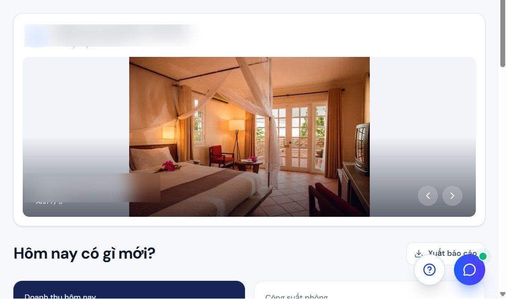
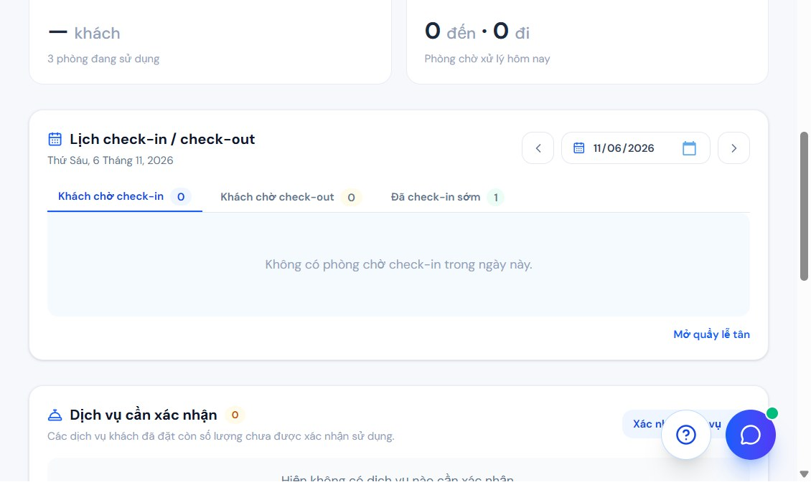

**Tiếng Việt**

- Trang Tổng quan hiển thị tình hình chi nhánh như doanh thu hôm nay, công suất phòng, khách đang lưu trú, lượt đến/trả phòng, dịch vụ cần xác nhận, lịch check-in/check-out, công việc và trạng thái phòng.
- Chọn ngày trên lịch check-in/check-out để xem danh sách khách dự kiến đến, trả phòng hoặc đã check-in sớm. Dùng nút mũi tên để đổi ngày và nút **Hôm nay** để quay về ngày hiện tại.
- Chọn **Mở quầy lễ tân** để mở màn hình thao tác check-in/check-out.
- Nếu dữ liệu đang tải, lỗi hoặc không đủ để tính chính xác, một số chỉ số có thể hiển thị dấu gạch ngang hoặc thông báo lỗi. Không xem giá trị thiếu dữ liệu là số 0.

**English**

- Overview summarizes branch activity, including today's revenue, room occupancy, guests in-house, arrivals/departures, services awaiting confirmation, the check-in/check-out schedule, tasks, and room status.
- Select a date in the schedule to see expected arrivals, departures, or early check-ins. Use the arrows to change dates and **Today** to return to the current date.
- Select **Open front desk** to open check-in/check-out operations.
- While data is loading, unavailable, or insufficient for an accurate calculation, some figures may show a dash or an error. Do not interpret missing data as zero.

### 3.2 Đặt phòng và danh sách booking / Bookings and booking list

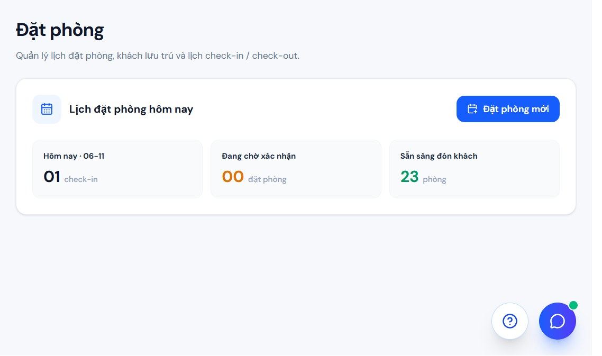
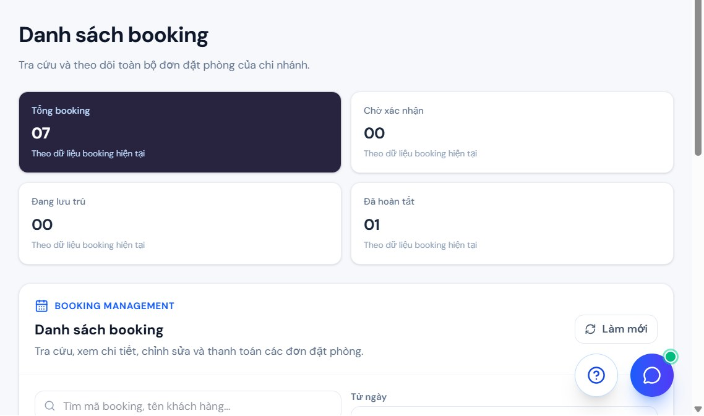

**Tiếng Việt**

- Mở **Quản lý đặt phòng → Đặt phòng** để tạo booking. Chọn ngày nhận/trả phòng, xem phòng còn khả dụng, chọn phòng, nhập thông tin khách, chọn dịch vụ nếu cần, kiểm tra tổng tiền rồi xác nhận.
- Ngày có lịch bận được đánh dấu và không cho chọn phòng/ngày bị ảnh hưởng. Nếu cần đặt trong khoảng này, kiểm tra lại lịch và liên hệ quản lý.
- Mở **Danh sách booking** để tra cứu booking. Dùng bộ lọc/tìm kiếm có sẵn, mở booking để xem chi tiết và chọn thao tác phù hợp với trạng thái booking và quyền tài khoản.
- Khi sửa booking, kiểm tra ngày, phòng, khách, dịch vụ và số tiền trước khi lưu. Các thao tác có thể bị giới hạn với booking đã check-in, checkout, hủy hoặc hoàn tất.

**English**

- Open **Booking management → Create booking**. Choose check-in/check-out dates, review available rooms, select rooms, enter guest information, add services if needed, review the total, and confirm.
- Busy-schedule dates are marked, and affected dates/rooms cannot be selected. If a stay overlaps a busy period, verify the schedule and contact a manager.
- Open **Booking list** to find bookings. Use the available filters/search, open a booking to review its details, and choose an action allowed by the booking status and your permissions.
- Before saving a booking edit, verify dates, rooms, guest information, services, and amounts. Actions may be restricted for checked-in, checked-out, cancelled, or completed bookings.

### 3.3 Check-in và check-out / Check-in and check-out

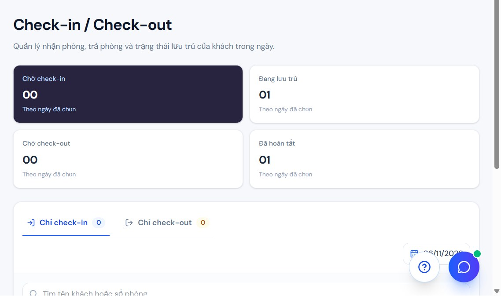

**Tiếng Việt**

1. Mở **Check-in / Check-out**, chọn ngày và loại thao tác cần xử lý.
2. Tìm booking/khách trong danh sách chờ; mở chi tiết để đối chiếu thông tin khách, số điện thoại, phòng, ngày ở, khoản thu và dịch vụ.
3. Thực hiện check-in sau khi xác nhận khách và phòng đúng. Với check-out, kiểm tra các khoản phát sinh, dịch vụ chưa xác nhận, tiền đã thanh toán và khoản hoàn/tiền thừa.
4. Xác nhận lựa chọn hoàn tiền theo đúng yêu cầu và chính sách của khách sạn. Yêu cầu hoàn qua ngân hàng có thể cần chuyển sang mục phê duyệt hoàn tiền.
5. Với booking nhiều phòng, kiểm tra từng phòng/khách và dùng thao tác nhóm nếu phù hợp.

**English**

1. Open **Check-in / Check-out**, select the date and operation type.
2. Find the booking/guest in the waiting list; open its details and verify guest information, phone number, room, stay dates, charges, and services.
3. Complete check-in after confirming the guest and room. For check-out, review extra charges, unconfirmed services, payments, and any refund/change due.
4. Confirm the refund option according to the guest's request and hotel policy. Bank-transfer refund requests may need review in Refund approvals.
5. For multi-room bookings, review each room/guest and use a group action only when appropriate.

### 3.4 Khách hàng, hóa đơn và hoàn tiền / Customers, invoices, and refunds

**Tiếng Việt**

- **Khách hàng:** tìm hồ sơ khách, xem thông tin và lịch sử lưu trú; chỉ người có quyền quản lý mới được tạo/chỉnh sửa hồ sơ.
- **Hóa đơn:** tra cứu hóa đơn và giao dịch theo thông tin có sẵn trên trang. Đối chiếu booking và thanh toán trước khi tư vấn hoặc xử lý sai lệch.
- **Phê duyệt hoàn tiền:** xem yêu cầu chờ xử lý, kiểm tra booking, số tiền và thông tin hoàn, sau đó chọn quyết định theo quyền được cấp. Không xác nhận hoàn nếu chưa đối chiếu giao dịch thực tế.

**English**

- **Customers:** find guest profiles and review their information and stay history. Only users with the required permission can create or edit profiles.
- **Invoices:** find invoices and transactions using the page's available search/filter controls. Reconcile against the booking and payment before advising on or correcting a discrepancy.
- **Refund approvals:** review pending requests, verify the booking, amount, and refund details, then make an authorized decision. Do not confirm a refund without reconciling the actual transaction.

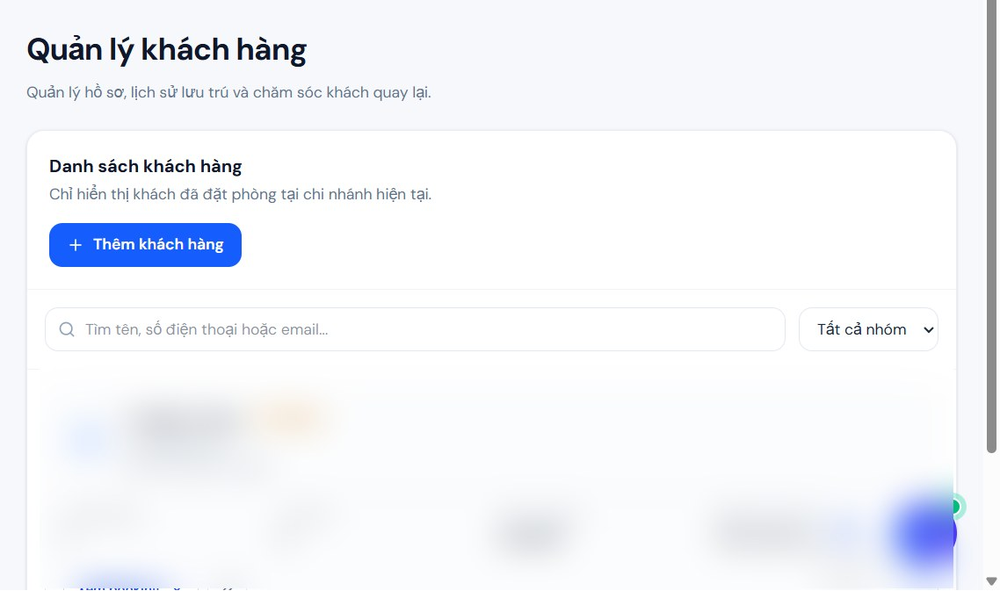
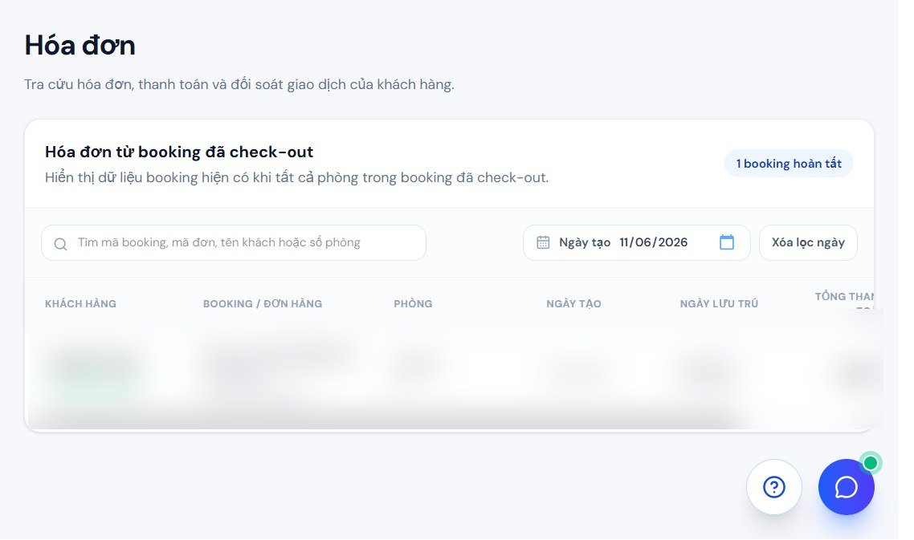
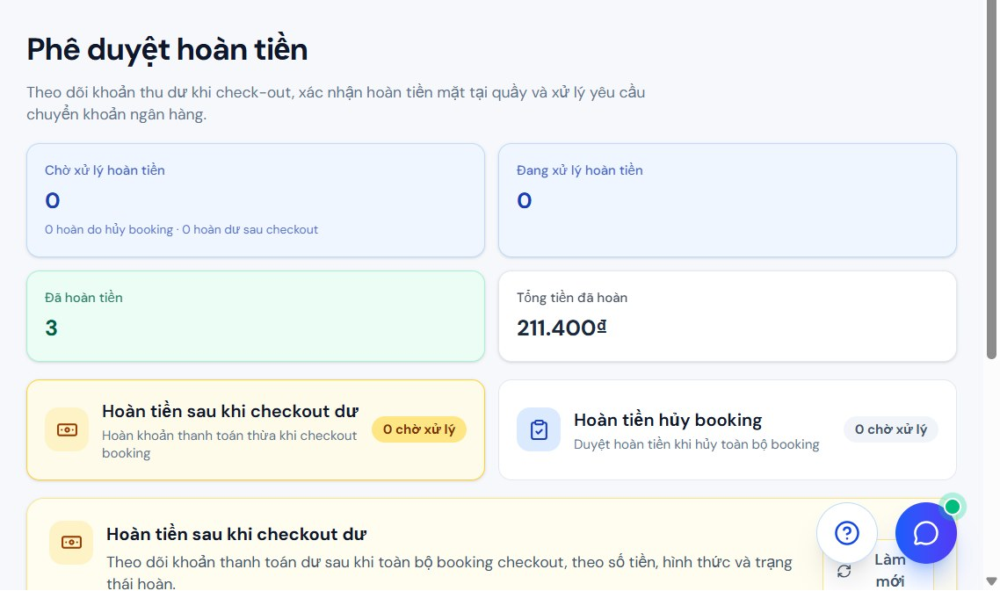

### 3.5 Phòng, lịch bận và nội quy / Rooms, busy schedules, and hotel rules

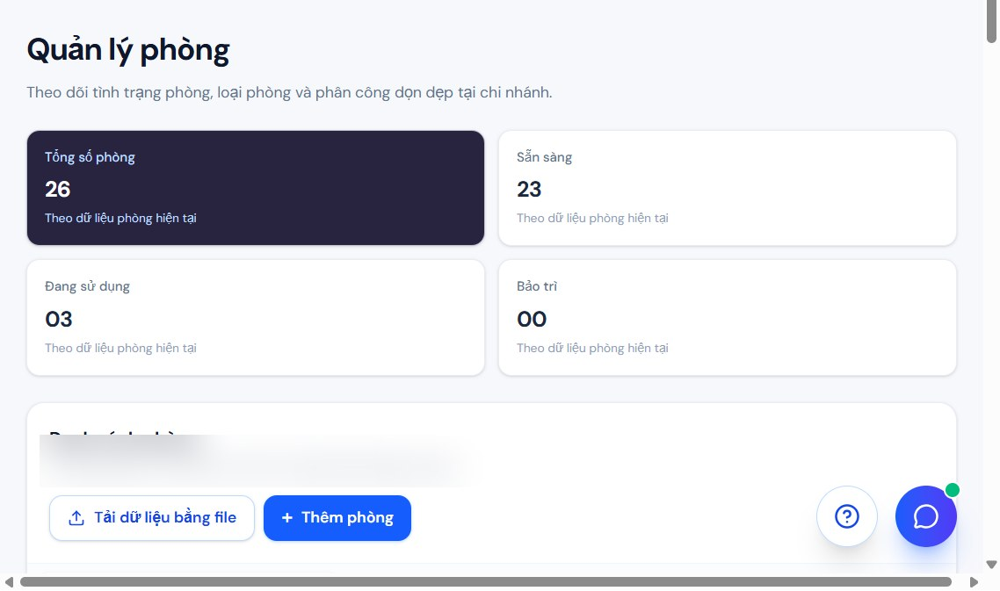

**Tiếng Việt**

- **Quản lý phòng:** xem trạng thái phòng; tùy quyền, quản lý danh sách phòng, tòa/tầng, cấu hình giá, tiện nghi, hình ảnh và phân công dọn phòng.
- Khi cập nhật trạng thái phòng hoặc giao việc dọn phòng, xác nhận đúng số phòng và nhân viên trước khi lưu.
- **Lịch bận:** xem các khoảng ngày tạm ngưng khai thác được thông báo cho chi nhánh. Các ngày này được dùng để tránh tạo booking bị trùng. Quản trị hệ thống tạo lịch và chọn phạm vi chi nhánh; nhân viên chi nhánh xem lịch được áp dụng.
- **Nội quy khách sạn:** tra cứu quy tắc đặt phòng, nhận/trả phòng, hủy, dịch vụ và đối soát. Luôn đối chiếu booking và chính sách thực tế trước khi trao đổi với khách.

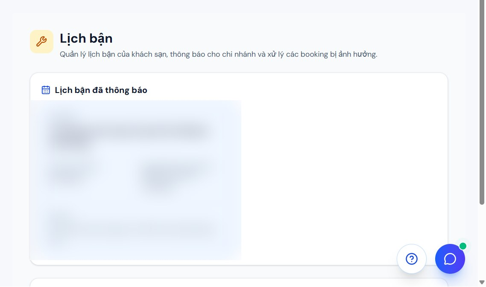
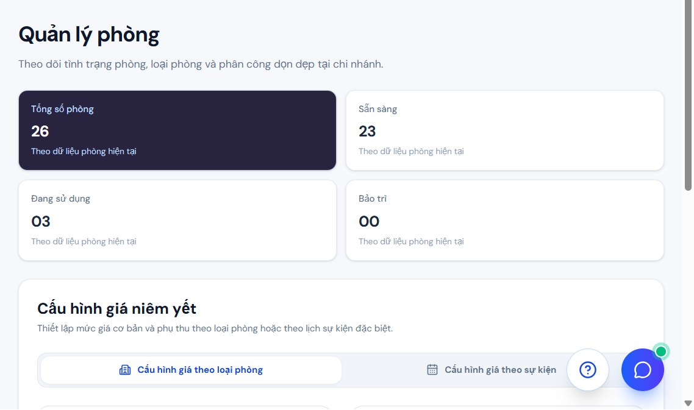
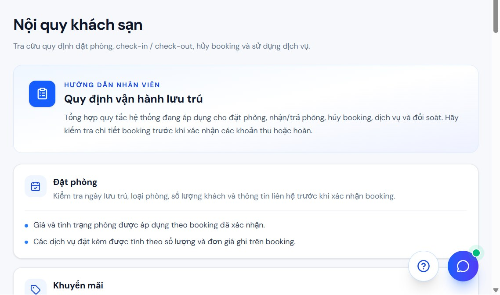

**English**

- **Room management:** review room status. Depending on permissions, manage rooms, buildings/floors, pricing, amenities, images, and housekeeping assignments.
- When changing room status or assigning housekeeping, verify the room number and staff member before saving.
- **Busy schedules:** review notified periods when a branch is unavailable. These dates help prevent overlapping bookings. System administrators create schedules and select branch scope; branch staff view the schedules that apply to them.
- **Hotel rules:** consult booking, check-in/out, cancellation, service, and settlement rules. Verify the booking and actual policy before advising a guest.

### 3.6 Dịch vụ và khuyến mãi / Services and promotions

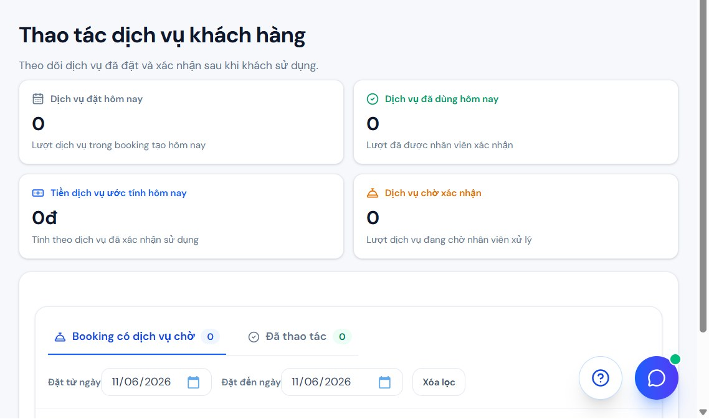

**Tiếng Việt**

- **Thao tác dịch vụ khách hàng:** tìm booking/khách, xem dịch vụ đã đặt, xác nhận số lượng khách đã sử dụng và kiểm tra phần còn chờ xác nhận.
- **Danh mục dịch vụ:** dành cho người có quyền quản lý; có thể tạo/chỉnh sửa thông tin dịch vụ và trạng thái hoạt động.
- **Khuyến mãi:** tra cứu và quản lý mã/ưu đãi theo quyền. Kiểm tra thời hạn, trạng thái và điều kiện áp dụng trước khi sử dụng cho booking.

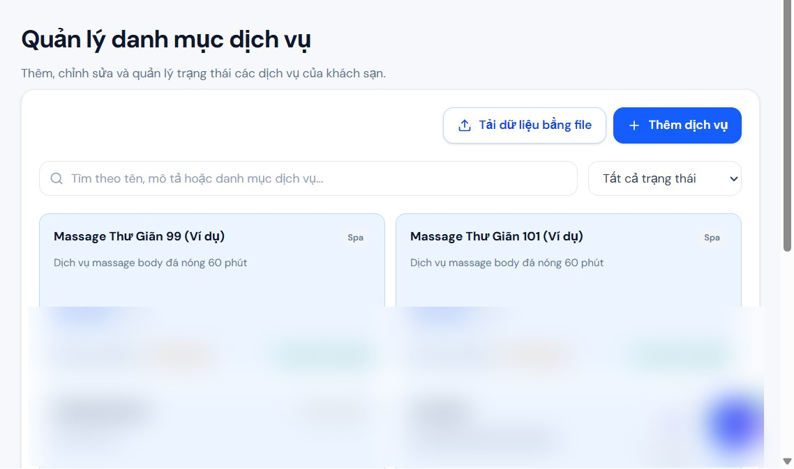
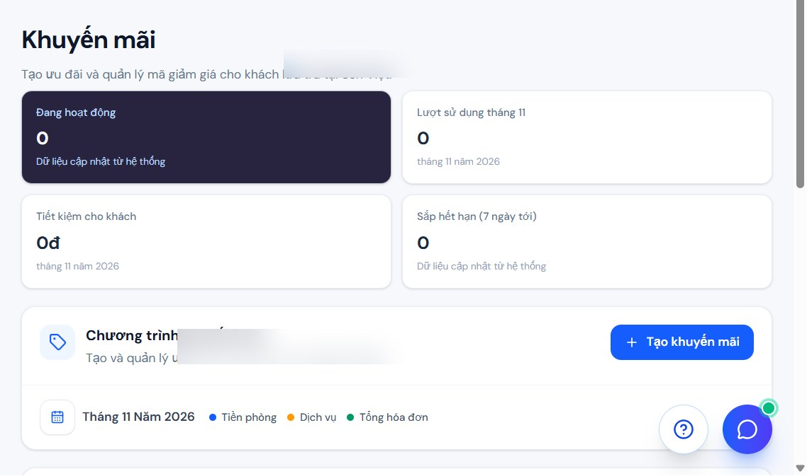

**English**

- **Guest service usage:** find the booking/guest, review booked services, confirm the quantity used, and check any remaining quantity awaiting confirmation.
- **Service catalog:** available to authorized managers to create/edit service details and active status.
- **Promotions:** find and manage promotion codes/offers according to your permissions. Check validity dates, status, and eligibility before applying one to a booking.

### 3.7 Nhân viên, ca làm và công việc / Staff, shifts, and tasks

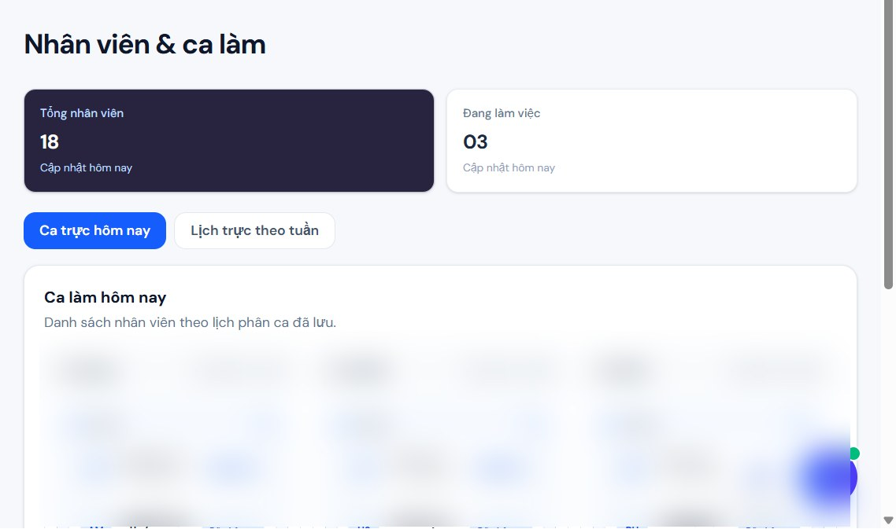
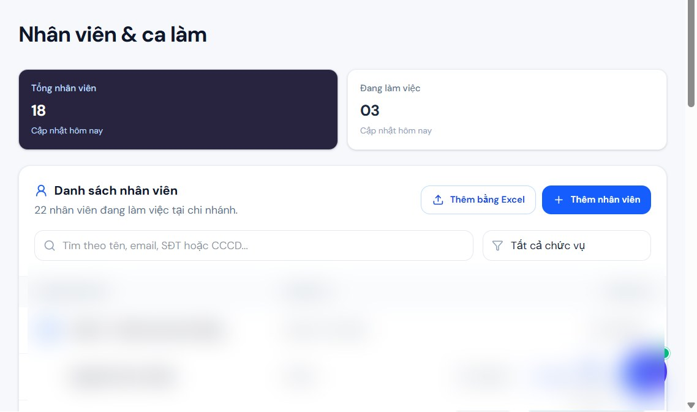
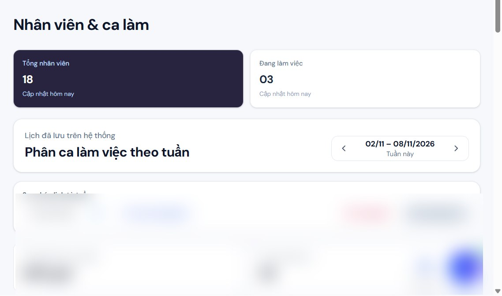
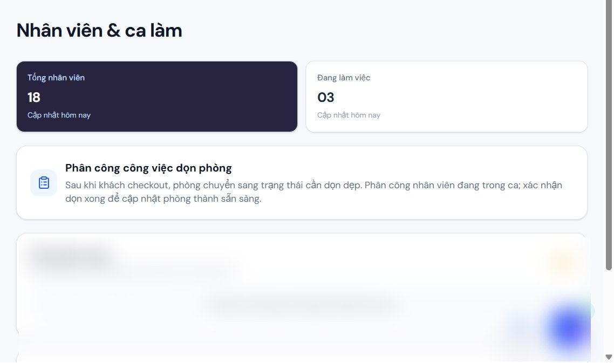

**Tiếng Việt**

- Nhân viên mở **Ca trực** để xem lịch/ca của mình và **Phân công dọn phòng** hoặc mục công việc để xem việc được giao, cập nhật tiến độ theo thao tác trên màn hình.
- Quản lý mở **Danh sách nhân viên** để tra cứu nhân sự; mở **Phân ca làm** để lập lịch ca; mở **Phân công công việc** để giao và theo dõi công việc.
- Kiểm tra nhân viên, ngày, ca và phòng trước khi lưu phân công. Việc quản lý nhân sự và phân ca có thể yêu cầu quyền quản lý.

**English**

- Staff open **My shifts** to review their schedule and **Housekeeping assignment** or the tasks area to see assigned work and update its progress using the available controls.
- Managers open **Employee list** to find staff, **Assign shifts** to schedule shifts, and **Assign tasks** to create and monitor work assignments.
- Verify the staff member, date, shift, and room before saving an assignment. Staff management and shift scheduling may require manager permissions.

### 3.8 Báo cáo và cài đặt / Reports and settings

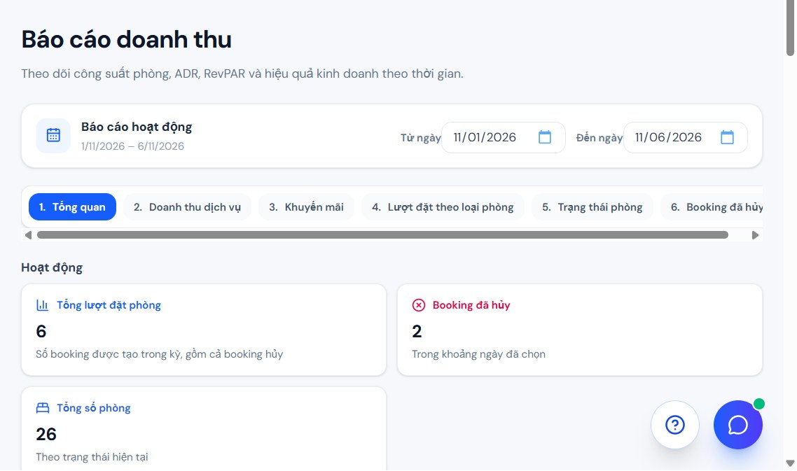
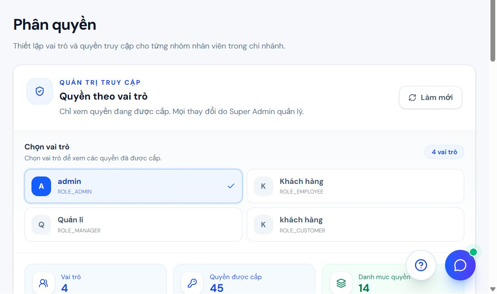
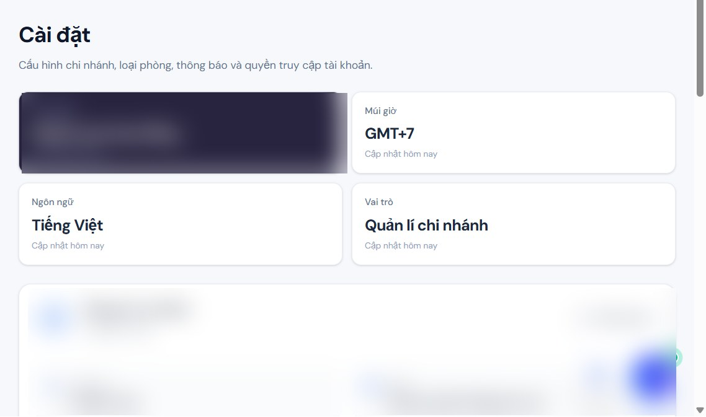

**Tiếng Việt**

- **Báo cáo:** chọn bộ lọc/khoảng thời gian được cung cấp để xem các chỉ số doanh thu, dịch vụ, khuyến mãi hoặc trạng thái phòng. Đối chiếu ngày và chi nhánh trước khi xuất/đọc số liệu.
- **Cài đặt:** cập nhật thông tin cá nhân hoặc cài đặt chi nhánh được cấp quyền; đổi ngôn ngữ tại mục Ngôn ngữ. Một số thay đổi bảo mật có thể yêu cầu xác thực lại.

**English**

- **Reports:** use the available filters/date range to review revenue, services, promotions, or room-status metrics. Verify the date range and branch before exporting or interpreting results.
- **Settings:** update your profile or authorized branch settings and change the interface language under Language. Some security-sensitive changes may require re-authentication.

## 4. Cổng khách hàng / Customer portal

> **Ảnh chụp cổng khách hàng:** Chưa có ảnh chụp thực tế trong tài liệu này vì chưa có phiên đăng nhập/môi trường khách hàng khả dụng.  
> **Customer portal screenshots:** No real screenshots are included because a signed-in customer environment is not currently available.

### Tiếng Việt

1. **Tìm khách sạn:** từ trang chủ, mở danh sách khách sạn hoặc tìm kiếm theo điểm đến/ngày lưu trú. Chọn khách sạn để xem thông tin và chọn **Xem phòng**.
2. **Chọn ngày và phòng:** chọn ngày nhận/trả phòng, giờ dự kiến nếu được yêu cầu, xem ngày tạm đóng và tình trạng còn phòng, sau đó chọn loại phòng/số lượng phòng và số khách phù hợp.
3. **Dịch vụ và thanh toán:** tiếp tục đến trang dịch vụ để thêm dịch vụ nếu cần; tại trang thanh toán, kiểm tra thông tin khách, ngày ở, phòng, dịch vụ, ưu đãi, chính sách và tổng tiền. Chọn phương thức thanh toán được cung cấp và làm theo hướng dẫn trên màn hình.
4. **Kết quả đặt phòng:** sau khi gửi yêu cầu, lưu lại thông tin xác nhận/mã booking hiển thị. Nếu cần, đăng nhập hoặc đăng ký tài khoản để theo dõi booking, hóa đơn và thông tin cá nhân.
5. **Tài khoản:** đăng nhập/đăng ký từ menu tài khoản. Các trang lịch sử booking, hóa đơn, hồ sơ, tài khoản khách hàng và chương trình khách hàng thân thiết yêu cầu đăng nhập. Dùng chức năng quên mật khẩu nếu không đăng nhập được.
6. **Ưu đãi, dịch vụ và đánh giá:** xem danh sách ưu đãi/dịch vụ công khai; đánh giá booking theo luồng được cung cấp. Nội dung đánh giá và thông tin hồ sơ là nội dung do khách nhập.
7. **Ngôn ngữ:** dùng bộ chọn ngôn ngữ trên thanh đầu trang. Nội dung tĩnh được chuyển theo ngôn ngữ hỗ trợ; tên khách sạn, địa chỉ, tên phòng/dịch vụ và nội dung do khách sạn hoặc khách nhập có thể không được tự dịch.

### English

1. **Find a hotel:** from the home page, browse hotels or search by destination/stay dates. Open a hotel to review its details and select **View rooms**.
2. **Choose dates and rooms:** select check-in/check-out dates and estimated arrival time if requested; review closure dates and availability, then choose room type/quantity and guest count.
3. **Services and payment:** continue to the services page to add optional services. On checkout, review guest details, dates, rooms, services, promotions, policies, and the total. Select an available payment method and follow the on-screen instructions.
4. **Booking result:** after submitting the request, save the confirmation/booking reference shown. Sign in or register if you want to manage bookings, invoices, and personal details.
5. **Account:** sign in/register from the account menu. Booking history, invoices, profile, customer account, and loyalty pages require sign-in. Use password recovery if you cannot sign in.
6. **Offers, services, and reviews:** browse public offers/services and review a booking through the available flow. Reviews and profile details are entered by the customer.
7. **Language:** use the language selector in the top bar. Static text changes to a supported language; hotel names, addresses, room/service names, and content entered by a hotel or customer may not be translated automatically.

## 5. Quản trị viên hệ thống / System administrator

> **Ảnh chụp cổng quản trị:** Chưa có ảnh chụp thực tế trong tài liệu này vì chưa có phiên đăng nhập/môi trường quản trị khả dụng.  
> **System administration screenshots:** No real screenshots are included because a signed-in administrator environment is not currently available.

### Tiếng Việt

Quản trị hệ thống vào cổng quản trị sau khi đăng nhập. Các mục có thể gồm:

- **Tổng quan và thông báo:** theo dõi tình trạng toàn hệ thống, lọc/xem thông báo và đánh dấu đã đọc.
- **Tỉnh/thành và chi nhánh:** chọn tỉnh/thành hoặc chi nhánh để xem chi tiết; tạo/cập nhật dữ liệu chi nhánh theo biểu mẫu và quyền được cấp.
- **Lịch tạm đóng:** tạo lịch, đặt tiêu đề/mô tả/ngày bắt đầu/ngày kết thúc, chọn áp dụng toàn hệ thống hoặc các chi nhánh cụ thể, kiểm tra xung đột rồi gửi thông báo.
- **Quản lý danh mục:** quản lý các dữ liệu dùng chung như tiện nghi và loại giường; một số danh mục hỗ trợ nhập từ tệp mẫu.
- **Khuyến mãi và dịch vụ:** quản lý cấu hình dùng chung/toàn hệ thống khi có quyền.
- **Role và quyền:** xem/quản lý vai trò và quyền truy cập. Chỉ thay đổi khi đã xác nhận phạm vi ảnh hưởng.
- **Tài khoản và thống kê tài nguyên:** dùng các mục quản lý tài khoản/thống kê khi cần, kiểm tra đúng đối tượng/phạm vi trước khi lưu.
- **Cá nhân:** quản lý thông tin hồ sơ quản trị.

Khi tạo hoặc cập nhật cấu hình toàn hệ thống, rà soát phạm vi, dữ liệu và ảnh hưởng đến chi nhánh trước khi xác nhận. Không chia sẻ thông tin đăng nhập quản trị.

### English

System administrators open the administration portal after sign-in. Available sections may include:

- **Overview and notifications:** monitor system-wide activity, review/filter notifications, and mark them as read.
- **Provinces and branches:** select a province or branch to review details; create/update branch records using the available form and permissions.
- **Busy schedules:** enter a title, description, start/end dates, choose all branches or specific branches, check for conflicts, and notify the selected scope.
- **Catalog management:** manage shared data such as amenities and bed types; some catalogs support importing from a template file.
- **Promotions and services:** manage shared/system-wide configuration when authorized.
- **Roles and permissions:** review/manage roles and access rights. Change these only after confirming the impact.
- **Accounts and resource statistics:** use account-management and statistics sections as needed, verifying the target and scope before saving.
- **Profile:** manage the administrator profile.

Before confirming a system-wide change, review its scope, data, and branch impact. Never share administrator credentials.

## 6. Thông báo, xử lý lỗi và an toàn dữ liệu / Notifications, errors, and data safety

### Tiếng Việt

- Biểu tượng chuông hiển thị thông báo; mở thông báo để xem chi tiết và dùng thao tác đánh dấu đã đọc nếu cần.
- Nếu trang báo lỗi tải dữ liệu, thử tải lại; nếu lỗi tiếp diễn, ghi nhận tên màn hình, thời điểm và thao tác vừa thực hiện để báo quản trị viên.
- Trước khi lưu các thao tác ảnh hưởng đến booking, tiền, phòng, lịch làm hoặc quyền truy cập, hãy kiểm tra lại dữ liệu và phạm vi.
- Không nhập thông tin thanh toán hoặc dữ liệu cá nhân vào ghi chú không liên quan. Chỉ mở hồ sơ khách khi phục vụ công việc được giao.

### English

- The bell icon shows notifications. Open a notification to review its details and mark it as read when appropriate.
- If a page reports a loading error, retry. If it persists, record the page, time, and action taken and report it to an administrator.
- Before saving changes that affect bookings, money, rooms, shifts, or access rights, verify the information and scope.
- Do not put payment details or personal data in unrelated notes. Access guest profiles only when needed for assigned work.

## 7. Ghi chú về tài liệu / Guide notes

**Tiếng Việt:** Giao diện và quyền có thể thay đổi theo phiên bản, vai trò và cấu hình chi nhánh. Tên menu trong tài liệu mô tả các mục hiện có; tài khoản của bạn có thể không thấy toàn bộ mục. Khi nhãn trong giao diện khác, ưu tiên hướng dẫn của quản lý và quy trình nội bộ.

**English:** The interface and permissions may vary by version, role, and branch configuration. Menu names in this guide describe currently implemented areas; your account may not show every item. If the interface differs, follow your manager's instructions and internal procedures.
