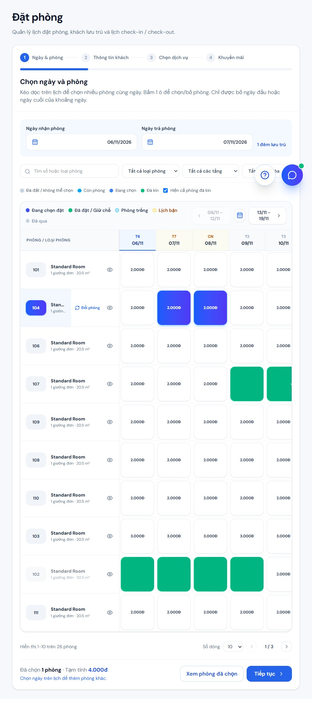
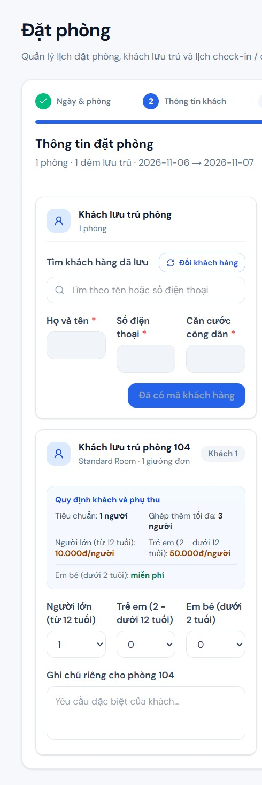
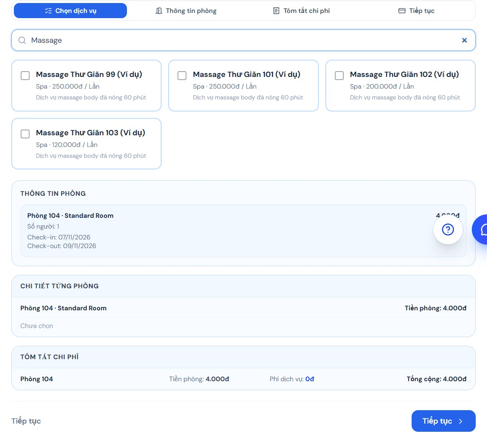
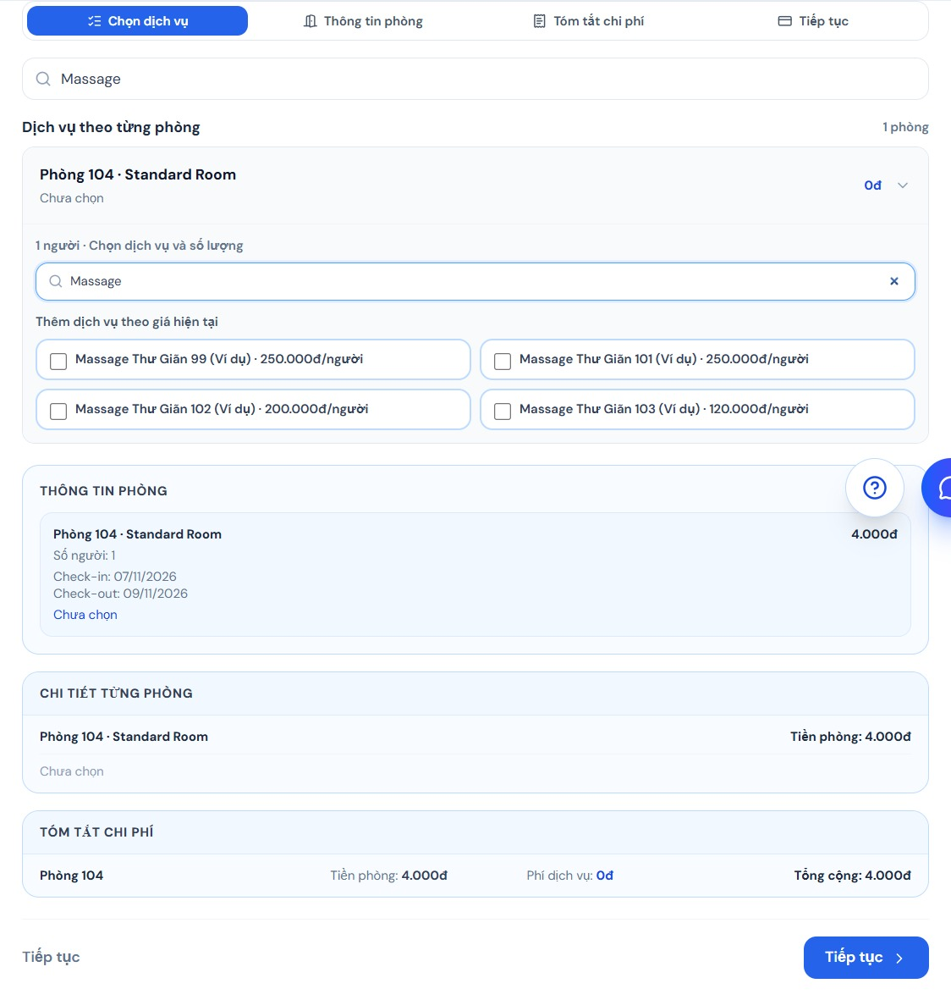
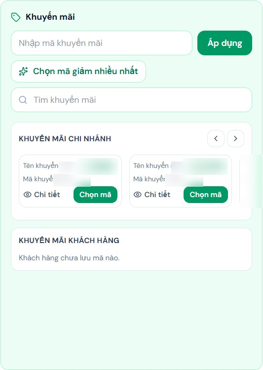

# Hướng dẫn nhân viên và quản lý chi nhánh / Staff and Branch Manager Guide

> **Phạm vi:** Tài liệu này dành riêng cho nhân viên và quản lý chi nhánh sử dụng web quản lý khách sạn. Không hướng dẫn cổng khách hàng hoặc cổng quản trị hệ thống. Các nút và quyền thao tác có thể khác nhau theo tài khoản.
>
> **Scope:** This guide is exclusively for hotel staff and branch managers using the hotel-management web app. It does not cover the customer portal or system-administration portal. Available controls and permissions vary by account.

> Ảnh minh họa là ảnh chụp giao diện quản lý thực tế bằng tiếng Việt; thông tin nhận diện tài khoản, khách, lịch và nhân viên đã được làm mờ.
>
> The illustrations are real screenshots of the Vietnamese management interface; identifying account, guest, schedule, and staff details have been blurred.

## 1. Đăng nhập, ngôn ngữ và điều hướng / Sign-in, language, and navigation

### Tiếng Việt

1. Mở trang đăng nhập của web quản lý.
2. Nhập email và mật khẩu tài khoản nhân viên/quản lý được cấp, sau đó chọn đăng nhập.
3. Nếu quên mật khẩu, chọn chức năng quên/đặt lại mật khẩu, yêu cầu mã OTP gửi đến email, nhập mã còn hạn và tạo mật khẩu mới. Không chia sẻ OTP hoặc mật khẩu.
4. Sau khi đăng nhập, xác nhận bạn đang ở đúng tài khoản và chi nhánh.
5. Dùng menu bên trái để mở các phân hệ. Chọn mũi tên cạnh mục có danh mục con để xem thêm lựa chọn.
6. Trên điện thoại, dùng nút menu để mở/đóng điều hướng; trên máy tính, có thể thu gọn thanh điều hướng.
7. Chọn **Tiếng Việt / English** trên thanh đầu trang để đổi ngôn ngữ giao diện.
8. Lưu ý: nội dung giao diện được hỗ trợ dịch, nhưng tên khách, tên dịch vụ, ghi chú, tiêu đề lịch bận và nội dung do người dùng nhập có thể vẫn giữ ngôn ngữ ban đầu.
9. Nếu không thấy menu cần dùng, không dùng tài khoản khác để vượt quyền; hỏi quản lý để xác nhận vai trò được cấp.
10. Đăng xuất bằng thẻ hồ sơ hoặc nút đăng xuất khi dùng xong, đặc biệt trên máy tính dùng chung.

### English

1. Open the hotel-management sign-in page.
2. Enter the staff/manager email and password provided to you, then sign in.
3. If you forget your password, choose the password-reset option, request an email OTP, enter the unexpired code, and set a new password. Never share your OTP or password.
4. After signing in, verify that you are using the correct account and branch.
5. Use the left menu to open modules. Select the arrow beside a menu item to reveal its submenu.
6. On mobile, use the menu button to open/close navigation; on desktop, the sidebar can be collapsed.
7. Select **Tiếng Việt / English** in the top bar to change the interface language.
8. Note: supported interface text is translated, but guest/service names, notes, busy-schedule titles, and other user-entered content may remain in their original language.
9. If a menu is missing, do not use another account to bypass permissions; ask a manager to confirm your role.
10. Sign out from the profile card or sign-out control when finished, especially on a shared computer.

## 2. Tổng quan chi nhánh / Branch overview

### Tiếng Việt

1. Chọn **Tổng quan** ở menu bên trái.
2. Xem các thẻ đầu trang để nắm nhanh doanh thu, công suất phòng, khách đang lưu trú và lượt đến/trả phòng.
3. Nếu chỉ số đang tải hoặc hiện dấu gạch ngang/lỗi, không hiểu dữ liệu thiếu là 0; mở phân hệ chi tiết để kiểm tra.
4. Cuộn đến lịch check-in/check-out và xác nhận ngày đang xem.
5. Dùng mũi tên hoặc bộ chọn ngày để xem ngày khác; chọn **Hôm nay** để trở về ngày hiện tại.
6. Chọn tab khách chờ nhận phòng, chờ trả phòng hoặc đã nhận phòng sớm.
7. Tìm đúng booking, mở dòng cần xử lý và tiếp tục ở phân hệ tương ứng.
8. Trong khu vực dịch vụ cần xác nhận, mở booking và kiểm tra loại dịch vụ, số lượng, rồi mới xác nhận phần khách đã sử dụng.
9. Dùng Tổng quan để theo dõi nhanh; kiểm tra chi tiết trong Booking, Quầy lễ tân, Dịch vụ hoặc Báo cáo trước khi ra quyết định.

### English

1. Select **Overview** from the left menu.
2. Review the top cards for a quick view of revenue, room occupancy, in-house guests, and arrivals/departures.
3. If a metric is loading or shows a dash/error, do not interpret missing data as zero; check the relevant module.
4. Scroll to the check-in/check-out schedule and verify the displayed date.
5. Use the arrows or date picker to view another day; select **Today** to return to the current date.
6. Select the tab for waiting check-ins, waiting check-outs, or early check-ins.
7. Find the correct booking, open the row, and continue in the relevant module.
8. In services awaiting confirmation, open the booking and verify service type and quantity before confirming actual usage.
9. Use Overview for monitoring; review details in Bookings, Front desk, Services, or Reports before making a decision.

## 3. Tạo, tra cứu và cập nhật booking / Create, find, and update bookings

### Tiếng Việt

**Tạo booking**

1. Mở **Quản lý đặt phòng → Đặt phòng**. Trên trang lịch đặt phòng, chọn **Đặt phòng mới**.
2. Ở bước **Ngày & phòng**, chọn **Ngày nhận phòng** trước, sau đó chọn **Ngày trả phòng**. Kiểm tra ngày trả muộn hơn ngày nhận và số đêm hiển thị.
3. Nếu ngày màu vàng/lịch bận, ngày không khả dụng hoặc hệ thống báo không tải được lịch bận, dừng lại để kiểm tra lịch/đường truyền; không cố đặt ngày bị khóa.
4. Đọc chú giải lịch: **Còn phòng**, **Đã đặt/không thể chọn**, **Đang chọn**. Chỉ chọn ô phòng còn trống trong đúng khoảng ngày.
5. Nhấn hoặc kéo dọc trên lịch để chọn phòng; thao tác kéo dọc có thể chọn nhiều phòng trong cùng ngày. Kiểm tra các ô được tô chọn.
6. Nhấn lại ô đã chọn để bỏ phòng. Khi điều chỉnh khoảng ngày, lịch chỉ cho bỏ ngày đầu hoặc ngày cuối của khoảng.
7. Tìm phòng bằng ô tìm kiếm số/loại phòng; lọc thêm theo **Loại phòng**, **Tầng**, **Tòa nhà**. Nếu không thấy, kiểm tra ngày và xóa bộ lọc.
8. Xem số phòng và tổng tạm tính trong phần **Đã chọn**. Chọn **Xem phòng đã chọn** để rà soát riêng các phòng đã chọn.
9. Với nhiều phòng, đối chiếu từng số phòng, ngày ở và sức chứa. Chọn **Tiếp tục** chỉ sau khi các phòng cần đặt đều đúng.
10. Ở bước **Thông tin đặt phòng**, tìm khách đã lưu theo tên/số điện thoại rồi chọn đúng hồ sơ. Thông tin hồ sơ sẽ tự điền.
11. Nếu chưa có hồ sơ, nhập họ tên, số điện thoại đủ 10 chữ số và CCCD đủ 12 chữ số. Email xác nhận không bắt buộc; nếu nhập thì email phải đúng định dạng.
12. Với khách mới, nhấn **Tạo khách hàng** và chờ xác nhận hồ sơ đã được tạo/chọn. Với khách đã lưu, kiểm tra tên và số điện thoại hiển thị.
13. Trong từng thẻ phòng, chọn số **Người lớn (từ 12 tuổi)**, **Trẻ em (2 đến dưới 12 tuổi)** và **Em bé (dưới 2 tuổi)** theo thực tế.
14. Đọc sức chứa tiêu chuẩn, số khách ghép thêm tối đa và phụ thu hiển thị. Điều chỉnh số lượng nếu vượt sức chứa; em bé dưới 2 tuổi được ghi là miễn phí theo quy định hiển thị.
15. Nhấn **Tiếp tục chọn dịch vụ**. Nếu nút chưa bật, đọc thông báo trên màn hình và chọn/tạo hồ sơ khách trước khi đi tiếp.
16. Ở bước **Chọn dịch vụ**, chọn **Chọn cho tất cả phòng** nếu mọi phòng dùng cùng dịch vụ; chọn **Chọn riêng từng phòng** nếu dịch vụ hoặc số người khác nhau theo phòng.
17. Dùng **Tìm dịch vụ** để lọc theo tên. Đọc tên, nhóm, mô tả và giá/đơn vị trước khi tích chọn.
18. Ở chế độ tất cả phòng, tích chọn dịch vụ cần thêm rồi rà soát chi tiết từng phòng: dịch vụ, số người sử dụng và tiền dịch vụ.
19. Nếu dịch vụ chỉ áp dụng cho một số người, bỏ chọn **Áp dụng cả phòng** và nhập đúng số người dùng; nếu cả phòng sử dụng, giữ lựa chọn này.
20. Ở chế độ từng phòng, mở thẻ đúng phòng, tìm dịch vụ, tích chọn và nhập số lượng. Kiểm tra đơn giá/đơn vị hiển thị.
21. Rà soát **Chi tiết phòng** và **Tóm tắt chi phí**: tiền phòng, từng khoản dịch vụ và tổng tiền từng phòng. Bỏ chọn dịch vụ khách không yêu cầu.
22. Nếu danh sách dịch vụ báo lỗi tải, không đoán giá hoặc xác nhận dịch vụ; thử lại hoặc báo quản lý. Nếu không cần dịch vụ, để trống và nhấn **Tiếp tục**.
23. Ở bước **Khuyến mãi**, kiểm tra cả **Khuyến mãi chi nhánh** và **Khuyến mãi khách hàng**. Ưu đãi riêng của khách chỉ hiển thị sau khi chọn hồ sơ khách có mã đã lưu.
24. Dùng **Tìm khuyến mãi** để tìm theo tên/mã. Hoặc nhập mã vào **Nhập mã khuyến mãi** rồi nhấn **Áp dụng**.
25. Trên thẻ ưu đãi, đọc tên, mã và mức giảm. Nhấn **Chi tiết** để xem mô tả; ưu đãi áp dụng cho tiền phòng, tiền dịch vụ hay tổng hóa đơn; mức tối thiểu; ngày hiệu lực và trạng thái.
26. Trong **Chi tiết**, kiểm tra số giảm dự kiến cho booking hiện tại và mức giảm tối đa (nếu có). Chỉ chọn ưu đãi khi booking đáp ứng điều kiện.
27. Chọn **Chọn mã** trên thẻ hoặc **Chọn khuyến mãi này** trong cửa sổ chi tiết. Chỉ một mã được áp dụng tại một thời điểm; kiểm tra dòng xác nhận và số tiền giảm.
28. Có thể nhấn **Chọn mã giảm nhiều nhất** để hệ thống tìm ưu đãi hợp lệ có mức giảm cao nhất. Nếu không có ưu đãi phù hợp, đọc cảnh báo và tiếp tục không giảm.
29. Nếu không tìm thấy mã, kiểm tra lại mã và nguồn phát hành. Nếu mã không đủ điều kiện, xem mức tối thiểu/ngày hiệu lực trong **Chi tiết**; nếu chọn nhầm, nhấn **Bỏ chọn** rồi kiểm tra tổng tiền cập nhật.
30. Ở bước cuối, kiểm tra tổng tiền sau khi áp dụng khuyến mãi. Biểu mẫu tạo booking hiện không có lựa chọn phương thức thanh toán.
31. Trước khi gửi, đối chiếu lại khách, số người/phụ thu từng phòng, ngày/phòng, dịch vụ, khuyến mãi và tổng tiền. Không xem booking là đã thanh toán chỉ vì đã xác nhận; ghi nhận thu tiền theo quy trình của chi nhánh.
32. Nhấn **Xác nhận đặt phòng** một lần và chờ kết quả. Khi thành công, ghi lại mã booking và kiểm tra trạng thái trong **Danh sách booking**; không gửi lại chỉ vì trang đang xử lý.

**Tra cứu hoặc sửa booking**

1. Mở **Quản lý đặt phòng → Danh sách booking**.
2. Dùng tìm kiếm/bộ lọc trên trang để thu hẹp danh sách; xác nhận đúng mã booking hoặc thông tin khách.
3. Mở dòng booking và kiểm tra trạng thái trước khi chọn thao tác.
4. Khi chỉnh sửa, xác nhận ngày/phòng mới còn khả dụng; kiểm tra lại khách, dịch vụ và tổng tiền sau thay đổi.
5. Chỉ lưu khi thông tin đã được đối chiếu. Booking đã nhận phòng, hoàn tất hoặc hủy có thể giới hạn thao tác.

### English

**Create a booking**

1. Open **Booking management → Bookings**. On the booking schedule page, select **New booking**.
2. At **Dates & rooms**, select **Check-in date** first, then **Check-out date**. Confirm check-out is later and review the displayed number of nights.
3. If a date is marked busy/yellow, unavailable, or the busy schedule fails to load, stop to check the schedule/connection; do not book a blocked date.
4. Read the calendar legend: **Available**, **Booked/unavailable**, and **Selecting**. Select only available room cells for the required dates.
5. Click or drag vertically on the calendar to select rooms; vertical dragging can select multiple rooms for the same dates. Check the highlighted cells.
6. Click a selected cell again to remove a room. When adjusting a date range, only its first or last day can be removed.
7. Search rooms by number/type and filter by **Room type**, **Floor**, and **Building**. If the room is missing, verify dates and clear filters.
8. Review the room count and estimated total under **Selected**. Select **View selected rooms** to review only the rooms chosen.
9. For multiple rooms, verify each room number, stay dates, and capacity. Select **Continue** only when all required rooms are correct.
10. At **Booking information**, search saved customers by name/phone and select the correct profile. Its details will be populated.
11. If no profile exists, enter the full name, a 10-digit phone number, and a 12-digit identity number. Confirmation email is optional but must be valid if entered.
12. For a new guest, select **Create customer** and wait for confirmation. For a saved profile, verify the displayed name and phone.
13. In each room card, select the actual number of **Adults (12+)**, **Children (2 to under 12)**, and **Infants (under 2)**.
14. Review standard capacity, maximum extra guests, and displayed surcharges. Adjust counts if capacity is exceeded; infants under 2 are shown as free under the displayed policy.
15. Select **Continue to select services**. If disabled, read the on-screen message and select/create the customer profile before proceeding.
16. At **Select services**, choose **Select for all rooms** when rooms share the same services; choose **Select individually by room** when services or quantities differ.
17. Use **Search services** to filter by name. Review the name, category, description, and displayed price/unit before checking a service.
18. In all-rooms mode, check the services needed, then review each room's details: services, number of users, and service charges.
19. If only some guests use a service, clear **Apply to the whole room** and enter the actual number of users; keep it selected when everyone uses it.
20. In per-room mode, expand the correct room, find and check the service, then enter its quantity. Verify the displayed unit price/unit.
21. Review **Room details** and **Cost summary** for room charges, each service, and each room total. Uncheck services the guest did not request.
22. If services fail to load, do not guess a price or confirm a service; retry or contact a manager. If no service is needed, leave selections empty and select **Continue**.
23. At **Promotions**, review both **Branch promotions** and **Customer promotions**. Customer offers appear only after selecting a guest profile with saved offers.
24. Use **Search promotions** to find an offer by name/code, or enter a code in the promotion field and select **Apply**.
25. On a promotion card, review the name, code, and discount. Select **Details** to review its description; whether it applies to room, service, or total; minimums; validity dates; and status.
26. In **Details**, review the estimated discount for this booking and any maximum discount. Select an offer only when the booking meets its conditions.
27. Select **Choose code** on the card or **Choose this promotion** in the details dialog. Only one offer is applied at a time; verify the applied-code line and discount.
28. Select **Choose best available discount** to have the system find the eligible offer with the highest discount. If none qualify, read the warning and proceed without a discount.
29. If a code is not found, verify the code and issuing source. If ineligible, review minimums/validity in **Details**; if the wrong offer was selected, select **Remove selection** and verify the total updates.
30. At the final step, review the total after promotions. The booking form currently has no payment-method selector.
31. Before submitting, recheck the guest, guest counts/surcharges by room, dates/rooms, services, promotion, and total. Do not treat a booking as paid just because it was confirmed; record payment using the branch's process.
32. Select **Confirm booking** once and wait for the result. On success, note the booking reference and verify its status in **Booking list**; do not resubmit while processing.

**Find or edit a booking**

1. Open **Booking management → Booking list**.
2. Use the page search/filters to narrow the list and verify the booking reference or guest details.
3. Open the booking row and check its status before choosing an action.
4. Before editing, confirm new dates/rooms are available; review guest details, services, and the updated total.
5. Save only after reviewing the changes. Check-in, completed, or cancelled bookings may have restricted actions.

## 4. Nhận phòng và trả phòng / Check-in and check-out

### Tiếng Việt

1. Mở **Check-in / Check-out** từ menu hoặc chọn **Mở quầy lễ tân** trên Tổng quan.
2. Chọn ngày cần xử lý và kiểm tra ngày trên màn hình.
3. Chọn tab **Nhận phòng** hoặc **Trả phòng** phù hợp.
4. Tìm booking bằng mã hoặc thông tin khách. Nếu không thấy, kiểm tra ngày, tab và bộ lọc trước.
5. Mở booking và đối chiếu mã booking, tên/số điện thoại khách, phòng, ngày ở, số khách và trạng thái.
6. **Khi nhận phòng:** kiểm tra phòng, trạng thái thanh toán, ghi chú đến sớm và phụ thu (nếu có).
7. Thông báo và thống nhất các khoản phí phát sinh với khách trước khi xác nhận nhận phòng.
8. **Khi trả phòng:** kiểm tra từng dịch vụ, lượng sử dụng thực tế và khoản phát sinh; không mặc định mọi dịch vụ đã đặt đều đã dùng.
9. Đối chiếu tiền đã thu, số còn phải thu hoặc số tiền hoàn. Thực hiện hoàn theo phương thức và quy trình phê duyệt của khách sạn.
10. Với booking nhiều phòng, rà soát từng phòng/khách. Chỉ dùng thao tác nhóm sau khi kiểm tra toàn bộ các dòng được chọn.
11. Sau khi xác nhận, kiểm tra trạng thái booking mới và trạng thái phòng.

### English

1. Open **Check-in / Check-out** from the menu or select **Open front desk** on Overview.
2. Select the processing date and verify it on screen.
3. Choose the appropriate **Check-in** or **Check-out** tab.
4. Find the booking by reference or guest details. If it is missing, verify the date, tab, and filters first.
5. Open the booking and verify its reference, guest name/phone, room, stay dates, guest count, and status.
6. **For check-in:** review the room, payment status, early-arrival notes, and any surcharge.
7. Explain and agree on extra charges with the guest before confirming check-in.
8. **For check-out:** review each service, actual usage, and extra charge; do not assume every booked service was used.
9. Reconcile payments received, any outstanding balance, and any refund. Follow the hotel's refund method and approval process.
10. For multi-room bookings, review each room/guest. Use a group action only after checking every selected row.
11. After confirmation, verify the new booking status and room status.

## 5. Phòng, lịch bận và nội quy / Rooms, busy schedules, and hotel rules

### Tiếng Việt

1. Mở **Quản lý phòng → Quản lý danh sách phòng**.
2. Dùng bộ lọc có sẵn để tìm phòng; kiểm tra đúng số phòng trước khi mở chi tiết.
3. Đọc nhãn/màu trạng thái để nhận biết phòng trống, đang sử dụng, đang dọn hoặc bảo trì.
4. Mở phòng để kiểm tra thông tin, hình ảnh, tiện nghi, tầng và tòa nhà.
5. Nếu có quyền chỉnh sửa, cập nhật trường cần thiết rồi đọc lại thông tin trước khi lưu.
6. Khi giao dọn phòng, chọn đúng phòng và nhân viên; cập nhật tiến độ/trạng thái theo tình hình thực tế.
7. Không chuyển phòng sang Sẵn sàng trước khi công việc dọn/kiểm tra hoàn tất.
8. Mở **Lịch bận** để xem ngày/khoảng thời gian không nhận đặt áp dụng cho chi nhánh. Mở chi tiết để xác nhận phạm vi và thời hạn.
9. Nếu tài khoản quản lý có chức năng tạo lịch bận, chọn đúng chi nhánh và thời gian, rà soát lịch trùng và nội dung trước khi lưu/thông báo. Nếu không thấy chức năng này, liên hệ người có quyền.
10. Ngày đặt bị khóa thì kiểm tra lịch bận; không đổi trạng thái phòng để lách ngày.
11. Cấu hình giá phòng chỉ sửa khi được phân quyền. Trước khi lưu, kiểm tra đúng phòng/loại phòng, khoảng áp dụng và giá.
12. Mở **Nội quy khách sạn** để tra cứu chính sách nhận/trả phòng, hủy, dịch vụ và các quy định liên quan trước khi tư vấn.

### English

1. Open **Room management → Room list**.
2. Use the available filters and verify the room number before opening its details.
3. Read the status label/color to identify available, occupied, cleaning, or maintenance rooms.
4. Open the room to review its details, images, amenities, floor, and building.
5. If authorized to edit, update the required fields and review them before saving.
6. When assigning housekeeping, select the correct room and employee; update progress/status to reflect actual work.
7. Do not mark a room Ready until cleaning/inspection is complete.
8. Open **Busy schedule** to review unavailable dates/periods for the branch. Open a schedule to verify scope and dates.
9. If an authorized manager account can create a busy schedule, choose the correct branch and dates, review conflicts and details, then save/notify. If the option is not visible, contact an authorized user.
10. When booking dates are blocked, check Busy schedule; do not change room status to bypass the restriction.
11. Change room rates only if authorized. Before saving, verify the room/room type, applicable dates, and rate.
12. Open **Hotel rules** to review check-in/out, cancellation, service, and related policies before advising guests.

## 6. Khách hàng, dịch vụ, hóa đơn và hoàn tiền / Customers, services, invoices, and refunds

### Tiếng Việt

1. Mở **Khách hàng**, tìm hồ sơ bằng ô tìm kiếm/bộ lọc và xác nhận đúng khách trước khi mở.
2. Đối chiếu thông tin và lịch sử cần thiết cho công việc. Chỉ sửa hồ sơ khi được cấp quyền.
3. Mở **Dịch vụ → Thao tác dịch vụ khách hàng** và tìm booking liên quan.
4. Mở chi tiết dịch vụ; so sánh dịch vụ đã đặt với lượng khách thực tế sử dụng.
5. Nhập/xác nhận lượng thực tế, kiểm tra đơn vị, số lượng và giá trước khi lưu.
6. Nếu dịch vụ chưa dùng hoặc thông tin không khớp, không xác nhận đã sử dụng; hỏi khách hoặc quản lý.
7. Quản lý danh mục: mở **Dịch vụ → Quản lý danh mục dịch vụ** nếu tài khoản có quyền; rà soát tên, giá và trạng thái hoạt động trước khi lưu.
8. Mở **Hóa đơn**, dùng bộ lọc để tìm đúng hóa đơn rồi đối chiếu booking, dịch vụ và thanh toán đã ghi nhận.
9. Nếu còn chênh lệch, ghi lại mã booking và nội dung cần kiểm tra; không tự sửa giao dịch ngoài quyền.
10. Mở **Phê duyệt hoàn tiền**, chọn yêu cầu chờ xử lý và xác minh booking, số tiền, phương thức, lý do.
11. Chỉ phê duyệt/từ chối theo quyền và chính sách; kiểm tra kết quả sau khi gửi quyết định.
12. Mở **Khuyến mãi** để tra cứu ưu đãi. Trước khi áp dụng, kiểm tra thời hạn, trạng thái và điều kiện của booking.

### English

1. Open **Customers**, search/filter for the profile, and verify the guest before opening it.
2. Review only details and history needed for your work. Edit a profile only if authorized.
3. Open **Services → Guest service usage** and find the relevant booking.
4. Open service details and compare the booking with the amount actually used.
5. Enter/confirm actual usage and verify unit, quantity, and price before saving.
6. If the service was not used or details do not match, do not confirm usage; check with the guest or manager.
7. To manage the catalog, open **Services → Service catalog** if authorized; review the name, price, and active status before saving.
8. Open **Invoices**, search for the correct invoice, and reconcile it with the booking, services, and recorded payments.
9. If a discrepancy remains, record the booking reference and what needs review; do not modify a transaction outside your permissions.
10. Open **Refund approvals**, select a pending request, and verify booking, amount, method, and reason.
11. Approve/reject only within your permissions and policy; verify the result after submitting.
12. Open **Promotions** to look up offers. Before applying one, check its validity dates, status, and booking eligibility.

## 7. Nhân viên, ca làm và công việc / Staff, shifts, and tasks

### Tiếng Việt

**Nhân viên**

1. Mở **Nhân viên & ca làm → Ca trực**.
2. Kiểm tra ngày/tuần đang xem và xem ca được xếp cho mình.
3. Mở mục công việc/Phân công dọn phòng để xem nhiệm vụ được giao.
4. Đọc phòng, thời hạn và hướng dẫn trước khi bắt đầu.
5. Khi hoàn tất, mở đúng nhiệm vụ và cập nhật trạng thái theo kết quả thực tế.
6. Nếu thông tin sai hoặc không thể hoàn tất, báo quản lý thay vì tự đóng nhiệm vụ không đúng thực tế.

**Quản lý**

1. Mở **Nhân viên & ca làm → Danh sách nhân viên**.
2. Tìm đúng nhân viên; kiểm tra chi nhánh và trạng thái trước khi xem/cập nhật hồ sơ.
3. Để lập ca, mở **Phân ca làm**, chọn ngày/ca theo biểu mẫu rồi chọn nhân viên thuộc chi nhánh phù hợp.
4. Rà soát nhân viên, ngày, giờ và ca trùng trước khi lưu.
5. Sau khi lưu, kiểm tra ca xuất hiện đúng trên lịch.
6. Để giao việc, mở **Phân công công việc**, nhập nội dung và thời hạn cùng phòng/nhân viên liên quan nếu biểu mẫu yêu cầu.
7. Đọc lại người nhận và chi tiết nhiệm vụ trước khi xác nhận.
8. Theo dõi trạng thái nhiệm vụ và cập nhật/phối hợp khi có thay đổi.

### English

**Staff**

1. Open **Staff & shifts → My shifts**.
2. Verify the selected day/week and review your assigned shifts.
3. Open Tasks/Housekeeping assignments to see work assigned to you.
4. Read the room, due time, and instructions before starting.
5. When finished, reopen the task and update its status to reflect the actual result.
6. If details are wrong or the task cannot be completed, notify a manager rather than incorrectly closing it.

**Managers**

1. Open **Staff & shifts → Employee list**.
2. Find the correct employee and verify branch/status before reviewing or updating the record.
3. To schedule a shift, open **Assign shifts**, choose the date/shift in the form, and select staff for the correct branch.
4. Check employee, date, hours, and overlapping shifts before saving.
5. After saving, confirm the shift appears correctly on the schedule.
6. To assign work, open **Assign tasks** and enter the description/due date and related room/employee if requested by the form.
7. Review the assignee and task details before confirming.
8. Monitor task status and coordinate updates when circumstances change.

## 8. Báo cáo và cài đặt / Reports and settings

### Tiếng Việt

1. Mở **Báo cáo** từ menu.
2. Chọn loại báo cáo nếu trang có lựa chọn, sau đó đặt khoảng thời gian và chi nhánh cần xem.
3. Kiểm tra lại bộ lọc trước khi đọc hoặc xuất số liệu.
4. So sánh các khoảng thời gian tương đương; không coi dữ liệu chưa tải hoặc dấu gạch ngang là số 0.
5. Mở **Cài đặt** để cập nhật hồ sơ hoặc cấu hình chi nhánh được cấp quyền.
6. Chọn **Tiếng Việt / English** để đổi ngôn ngữ giao diện.
7. Lưu thay đổi và chờ thông báo kết quả. Nếu hệ thống yêu cầu xác thực lại, làm theo hướng dẫn hiển thị.

### English

1. Open **Reports** from the menu.
2. Choose a report type if available, then set the required date range and branch.
3. Verify the filters before reviewing or exporting figures.
4. Compare equivalent date ranges; do not treat unloaded data or a dash as zero.
5. Open **Settings** to update your profile or authorized branch configuration.
6. Select **Tiếng Việt / English** to change the interface language.
7. Save and wait for the result message. If re-authentication is required, follow the on-screen instructions.

## 9. Khi gặp lỗi / Troubleshooting

### Tiếng Việt

- **Không thấy booking:** kiểm tra ngày, tab, mã booking và bộ lọc; nếu vẫn không thấy, báo quản lý kèm mã booking.
- **Ngày đặt bị khóa:** mở Lịch bận để kiểm tra phạm vi và thời hạn. Không thử thay đổi trạng thái phòng để vượt chặn.
- **Không thể lưu biểu mẫu:** đọc thông báo lỗi, bổ sung trường bắt buộc và kiểm tra dữ liệu hợp lệ. Không gửi lặp lại khi thao tác trước vẫn đang tải.
- **Không có quyền hoặc thiếu menu:** hỏi quản lý xác nhận vai trò/quyền; không dùng tài khoản của người khác.
- **Lỗi tải dữ liệu kéo dài:** ghi lại tên trang, thời điểm, thao tác vừa làm và nội dung lỗi; gửi cho quản lý/người phụ trách hệ thống.
- Trước khi xác nhận thao tác liên quan đến booking, tiền, phòng, ca làm hoặc thông tin khách, hãy đọc lại đối tượng và dữ liệu một lần cuối.

### English

- **Booking not found:** verify the date, tab, booking reference, and filters; if still missing, report it to a manager with the reference.
- **Date blocked:** open Busy schedule and check its scope and dates. Do not change room status to bypass the restriction.
- **Form will not save:** read the validation message, complete required fields, and verify values. Do not resubmit while the previous action is still loading.
- **Missing permission/menu:** ask a manager to verify your role/access; do not use another person's account.
- **Persistent loading error:** note the page, time, action taken, and error message, then report it to a manager/system contact.
- Before confirming an action involving a booking, money, room, shift, or guest information, review the target and data one final time.

## 10. Ghi chú / Notes

Giao diện và quyền có thể thay đổi theo phiên bản, vai trò và cấu hình chi nhánh. Tên menu trong tài liệu bám theo các mục hiện có; tài khoản của bạn có thể không thấy mọi chức năng. Khi giao diện khác tài liệu, ưu tiên quy trình nội bộ và hướng dẫn của quản lý.

The interface and permissions may vary by version, role, and branch configuration. Menu names follow the current application; your account may not show every feature. If the interface differs, follow internal procedures and your manager's instructions.
